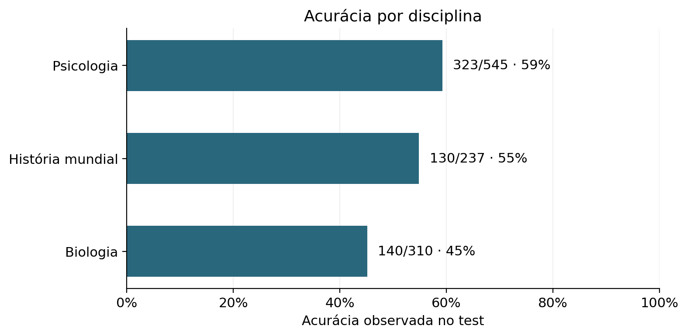
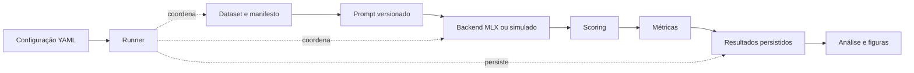

<div align="center">

# LLM Benchmark

**Desempenho e incerteza em múltipla escolha**

Python · MLX-LM · MMLU · Apple Silicon

[Resultados](RESULTS.md) · [Consolidação do TCC II](docs/reports/TCC_II_CONSOLIDACAO_EXPERIMENTAL.md) · [Arquitetura](docs/ARCHITECTURE.md) · [Roadmap](docs/ROADMAP.md)

</div>

---

Um benchmark local, modular e auditável para investigar a relação entre **acurácia** e **entropia normalizada de Shannon** nas alternativas de questões de múltipla escolha.

A **V1** reúne a infraestrutura validada, os diagnósticos de pontuação e uma avaliação do **Qwen2.5-0.5B-Instruct-bf16** em todos os registros `test` de três disciplinas do MMLU. O projeto apoia a investigação experimental do TCC II; suas evidências e limitações estão documentadas para a redação da monografia.

> **Como interpretar:** entropia baixa significa concentração entre os rótulos A–D, não garantia de acerto. A V1 não mede inteligência, não valida capacidades CHC e não define um índice de eficiência informacional.

## V1 em números

| Cobertura | Desempenho | Distribuição das alternativas | Validação de software |
| :--- | :--- | :--- | :--- |
| **1.092/1.092** registros válidos | **593/1.092** acertos · **54,304%** | **0,455315** de entropia média | **128 testes** offline aprovados |
| 3 disciplinas · 0 falhas técnicas | Macro entre disciplinas: **53,093%** | Condicionada aos quatro rótulos | 60 itens do piloto reproduzidos exatamente |

Percentuais e entropia acima estão arredondados. Fontes: [evidências integrais](docs/reports/MMLU_FULL_EVIDENCE.json), [relatório aprovado](docs/reports/MMLU_FULL_EVALUATION.md) e [registro de validação](docs/ROADMAP.md). São 1.092 registros e **1.081 conteúdos distintos**, pois 11 pares idênticos de Psicologia foram preservados.



**[Explorar os resultados →](RESULTS.md)** — tabelas por disciplina, distribuições de entropia, frequências A–D, massa original dos rótulos, exemplos e limitações.

## O que foi entregue

- **Fundação testável:** contratos tipados, configuração YAML estrita, backend simulado e funções matemáticas compartilhadas.
- **Inferência local validada:** backend MLX, template de chat fixado, tokenização contextual e extração dos logits da posição de resposta.
- **Dados rastreáveis:** adaptador MMLU, revisão fixa, índices originais e hashes; texto e ordem das alternativas preservados.
- **Execução auditável:** Runner sequencial e persistência de resultados individuais, configuração, resumo e metadados.
- **Análise sem nova inferência:** agregações, JSON de evidências e figuras científicas a partir dos registros persistidos.

A V1 foi encerrada pelo responsável. O histórico de aprovações permanece no roadmap. Outros modelos, backends Transformers/APIs, calibração e rotações sistemáticas no MMLU ficam para propostas futuras, não implementadas nesta versão.

## Protocolo experimental

| Componente | Configuração da avaliação integral |
| :--- | :--- |
| Modelo | `mlx-community/Qwen2.5-0.5B-Instruct-bf16` |
| Revisão do modelo | `56d07e766edd7159fbe12ed12d9cf114bf38bf1e` |
| Dataset | `cais/mmlu` · revisão `c30699e8356da336a370243923dbaf21066bb9fe` |
| Disciplinas | `high_school_psychology`, `high_school_world_history`, `high_school_biology` |
| Seleção integral | `mmlu-full-test-v1` · todos os índices `test`, sem amostragem |
| Prompt | `current-no-enumeration-v1` · zero-shot · chat template padrão do snapshot |
| Pontuação | `label_next_token` de A/B/C/D sem espaços; IDs contextuais 32/33/34/35 |
| Inferência | BF16 · batch 1 · forward completo **sem KV cache** · posição `T−1` |
| Normalização | Logits promovidos antes do softmax; probabilidades condicionadas a A–D e massa original registradas |
| Desempate | `lowest_index`: menor índice na ordem original |
| Ambiente de referência | Apple M2 · 8 GiB de memória unificada · Python 3.12.2 · MLX 0.32.4 · MLX-LM 0.32.2 |

A entrada passou pelo preflight: **64–788 tokens**, dentro do limite de 1.024, sem truncamento ou exclusão. Caminhos com e sem cache podem produzir logits diferentes; não são intercambiáveis neste protocolo. O backend inicial aceita somente o snapshot validado, não qualquer modelo informado por nome.

O [protocolo completo](docs/reports/TCC_II_CONSOLIDACAO_EXPERIMENTAL.md#5-protocolo-experimental-final) registra o prompt exato, as versões, o run e os hashes. A [comparação de prompts](docs/reports/PROMPT_COMPARISON.md) documenta as alternativas consideradas antes do MMLU.

## Como o benchmark se organiza



| Área | Arquivos principais | Responsabilidade |
| :--- | :--- | :--- |
| Contratos e configuração | `schemas.py`, `config.py` | Invariantes, validação e protocolo explícito |
| Datasets | `datasets.py`, `mmlu.py`, `mmlu_selection.py` | Questões e procedência, sem conhecimento do modelo |
| Prompts e backends | `prompts.py`, `backends/` | Texto versionado, template, tokenização e logits |
| Scoring e métricas | `scoring/`, `numerics.py`, `metrics.py` | Softmax estável, argmax, acurácia e entropia |
| Execução e persistência | `runner.py`, `cli.py`, `storage.py`, `results.py` | Fluxo, falhas explícitas e artefatos por execução |
| Análise | `analysis.py`, `analysis_report.py`, `diagnostics/` | Agregações, auditorias e relatórios |

Os módulos ficam em [`src/benchmark/`](src/benchmark/). [`configs/`](configs/) guarda configurações; [`tests/`](tests/) guarda os testes offline. A [arquitetura](docs/ARCHITECTURE.md) preserva também as decisões e propostas históricas; a tabela acima descreve o código implementado.

## Consultar, testar e reproduzir

### Consultar as evidências — sem executar uma LLM

Comece por [RESULTS.md](RESULTS.md). Os [gráficos](docs/reports/mmlu_full/), o [manifesto](docs/reports/MMLU_FULL_SELECTION_MANIFEST.json), o [JSON de evidências](docs/reports/MMLU_FULL_EVIDENCE.json) e o [run completo compactado](docs/reports/mmlu_full/run.tar.gz) já estão no repositório.

O arquivo do run contém `config.yaml`, `metadata.json`, `results.jsonl` e `summary.json`. O JSON compacto conserva os valores individuais e hashes; os vetores completos dos IDs de entrada estão no arquivo do run. Os logits de todo o vocabulário não foram persistidos, apenas os quatro escores, probabilidades originais e massa dos rótulos.

### Testar o núcleo e a simulação

O núcleo requer **Python ≥ 3.11 e PyYAML 6.x**; não precisa de MLX, pesos ou conexão com Hugging Face para os testes. Em um ambiente já preparado, execute da raiz:

```bash
PYTHONPATH=src .venv/bin/python -m unittest discover -s tests -v

# Controle de software: três questões autorais, sem inferência real.
PYTHONPATH=src .venv/bin/python -m benchmark.cli --config configs/synthetic.yaml
```

Para preparar um ambiente novo, a definição do pacote está em [`pyproject.toml`](pyproject.toml):

```bash
python3 -m venv .venv
.venv/bin/python -m pip install .
```

A instalação pode acessar o índice de pacotes. Os comandos com `PYTHONPATH=src` executam o checkout atual, evitando utilizar uma cópia instalada antiga. Os problemas locais de instalação encontrados na fundação estão registrados na [validação](docs/VALIDATION_DELIVERY_1_FINAL.md); não foi repetida uma instalação limpa no fechamento editorial da V1.

A simulação deve produzir **2/3 acertos** por construção dos escores controlados. Isso valida o fluxo, não representa desempenho de uma LLM ou do MMLU.

### Reproduzir a execução real — novo run

É necessário Apple Silicon com Metal, dependências opcionais e os **snapshots locais exatos**. As configurações não baixam pesos nem dados automaticamente. Requisitos: [MLX](diagnostics/mlx-requirements.txt), [MMLU](diagnostics/mmlu-requirements.txt) e, para figuras, [análise](diagnostics/analysis-requirements.txt).

A [validação integral](docs/reports/MMLU_FULL_EVALUATION.md) descreve preparação, preflight, auditoria e recursos. Com esse ambiente já preparado e a integridade verificada:

```bash
# Cria NOVA avaliação real. Não é necessário para ler os resultados publicados.
HF_HUB_OFFLINE=1 PYTHONPATH=src python -m benchmark.cli --config configs/mmlu_full_test.yaml
```

Use o Python do ambiente MLX preparado. `snapshot_path` e diretórios relativos são resolvidos a partir da raiz de execução. A configuração aponta para o manifesto aprovado; não selecionar outros índices ou alterar o prompt para obter mais acertos.

### O que cada execução preserva

`results.jsonl` registra questão, procedência, prompt, escores, probabilidades, predição, gabarito, acerto e entropia. `metadata.json` inclui modelo, revisões, versões, hashes, código, horários e eventuais falhas de encerramento. Configuração e resumo completam a trilha de reprodução.

Os metadados finais são publicados por último: uma pasta sem `metadata.json` é incompleta. Falhas técnicas têm métricas nulas e denominadores explícitos; respostas erradas do modelo continuam válidas. Não há sobrescrita de runs nem retomada automática após interrupção. Pesos, ambientes, caches e `outputs/` ficam ignorados; o arquivo auditável publicado foi incluído deliberadamente como evidência.

## Limites que acompanham os resultados

- Um modelo de classe 0,5B e três disciplinas não representam todo o MMLU ou outras famílias de LLMs.
- O piloto de 60 questões está contido nos 1.092 registros; sua reprodução é uma verificação técnica, não confirmação independente.
- A entropia usa a distribuição **condicionada aos rótulos**, não respostas livres nem probabilidade calibrada de acerto.
- Os **33 empates** e a regra `lowest_index` podem afetar frequências. BF16 tem precisão limitada; não se demonstrou que explique sozinho todos os empates.
- **B foi selecionada 415 vezes**, contra **270 gabaritos B**. Frequências isoladas não identificam causalmente viés de posição.
- **11 pares idênticos** de Psicologia e a anomalia de alternativas repetidas em Biologia `dev/2` foram preservados. Dev é exclusivamente técnico.

## Documentação para aprofundar

| Leitura | Conteúdo |
| :--- | :--- |
| [Resultados visuais](RESULTS.md) | Visão acessível dos achados e das limitações |
| [Consolidação experimental do TCC II](docs/reports/TCC_II_CONSOLIDACAO_EXPERIMENTAL.md) | Referência autocontida: metodologia, fórmulas, histórico, testes e evidências |
| [Avaliação integral](docs/reports/MMLU_FULL_EVALUATION.md) | 1.092 registros, reprodução, recursos, anomalias e aceite |
| [Piloto](docs/reports/MMLU_PILOT_VALIDATION.md) · [Análise do piloto](docs/reports/MMLU_EXPLORATORY_ANALYSIS.md) | Dev técnico e 60 test, mantidos separados |
| [Diagnóstico MLX](docs/reports/MLX_DIAGNOSTIC.md) · [Comportamento](docs/reports/MLX_BEHAVIOR_VALIDATION.md) · [Prompts](docs/reports/PROMPT_COMPARISON.md) | Evidências que fundamentaram a pontuação e o formato adotados |
| [Integração MLX](docs/reports/VALIDATION_DELIVERY_2B.md) · [Seleção MMLU](docs/reports/MMLU_DATASET_VALIDATION.md) | Contratos, validação local e integridade dos dados |
| [Arquitetura](docs/ARCHITECTURE.md) · [Roadmap](docs/ROADMAP.md) · [AGENTS.md](AGENTS.md) | Decisões, progresso e regras de desenvolvimento |

**Identificação da versão:** `v1.0.0` denomina o fechamento do ciclo experimental V1 no Git. A versão interna do pacote permanece `0.1.0`; não foi alterada apenas para coincidir com a tag. As propostas para TCC III estão documentadas, sem início da V2.
