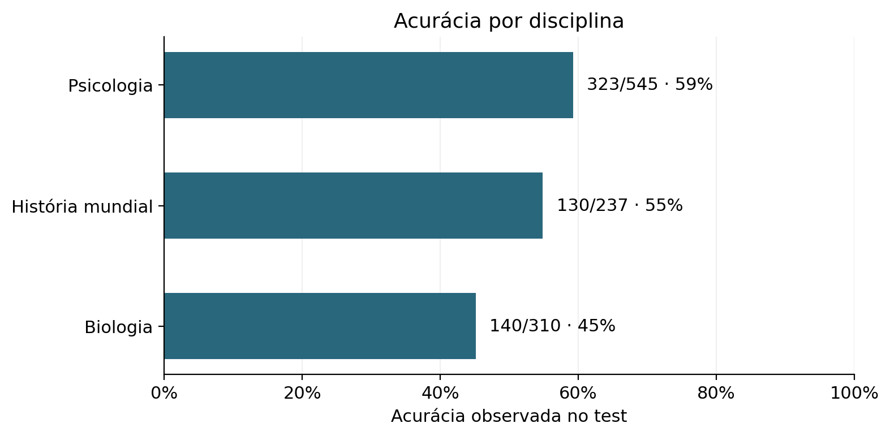
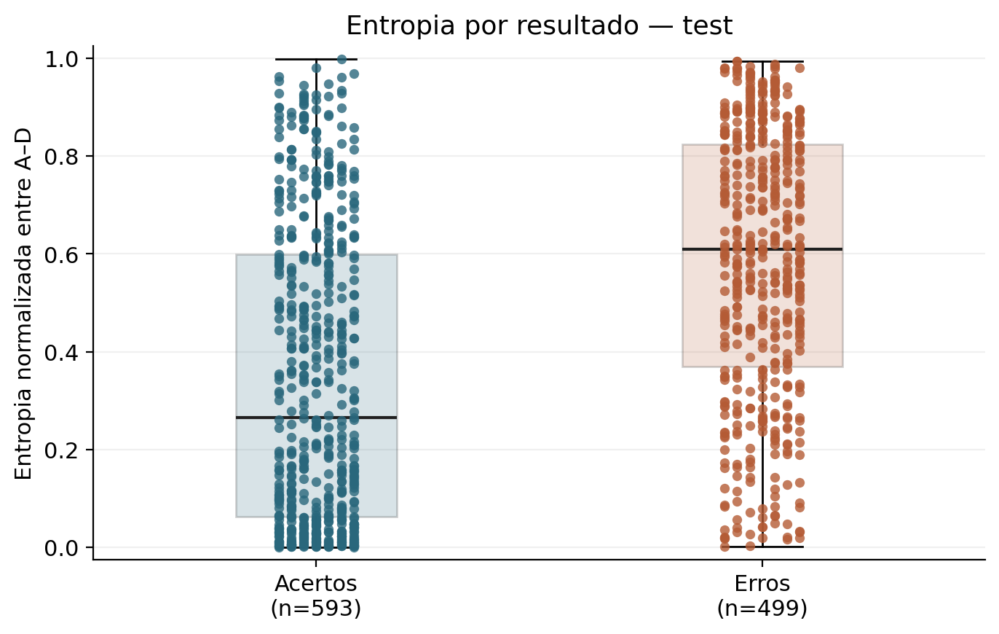
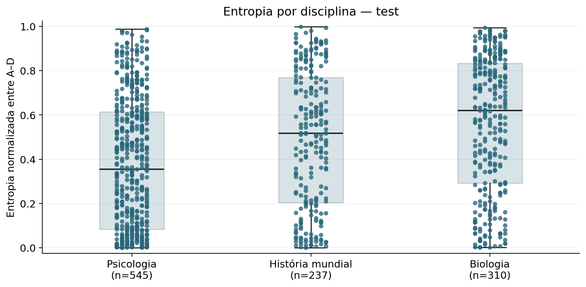
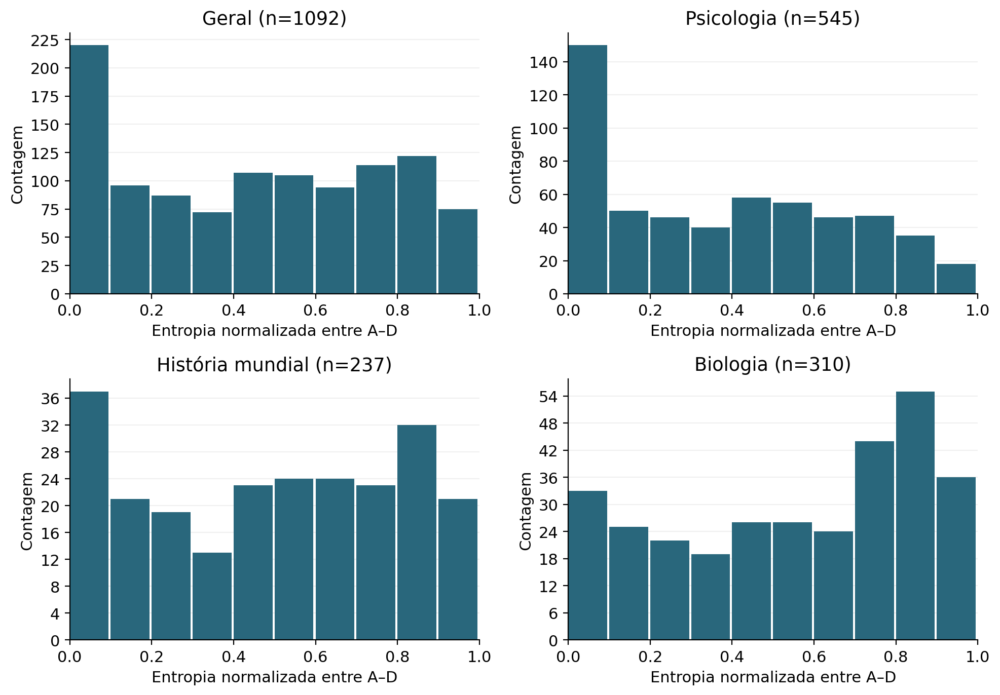
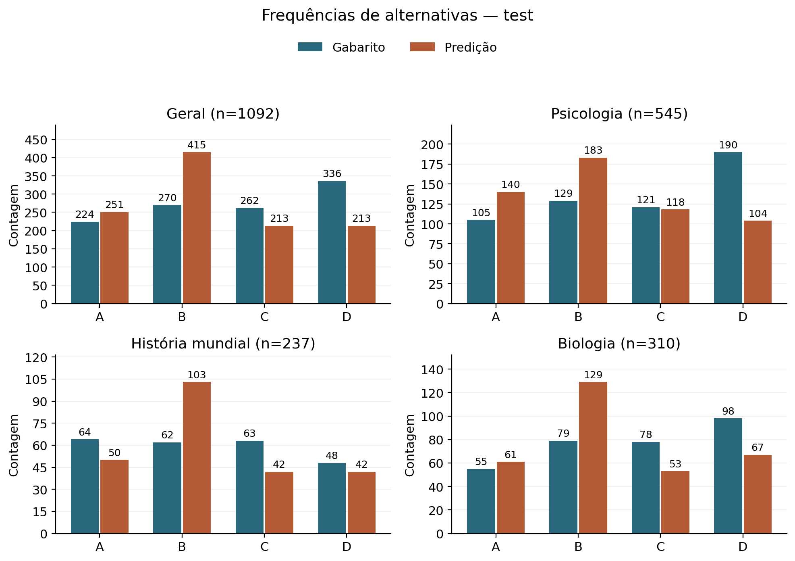

# Resultados · LLM Benchmark V1

**Qwen2.5-0.5B-Instruct-bf16 × três disciplinas do MMLU**

[Projeto](README.md) · [Protocolo e consolidação](docs/reports/TCC_II_CONSOLIDACAO_EXPERIMENTAL.md) · [Relatório integral](docs/reports/MMLU_FULL_EVALUATION.md) · [Evidências JSON](docs/reports/MMLU_FULL_EVIDENCE.json)

---

## Panorama

Esta página apresenta os **resultados já persistidos** da avaliação de 9 de novembro de 2026. Nenhuma nova inferência foi executada para produzi-la. Os gráficos são os originais da análise aprovada, sem alteração de dados ou seleção de casos.

| Registros válidos | Acertos | Acurácia global | Acurácia macro | Entropia média |
| :--- | :--- | :--- | :--- | :--- |
| **1.092/1.092** | **593/1.092** | **54,304%** | **53,093%** | **0,455315** |

**Zero falhas técnicas · 499 respostas incorretas · 1.081 conteúdos distintos.**

> A entropia mede a dispersão das probabilidades **entre A, B, C e D**, após renormalização. Não representa a chance de acertar. Alta concentração pode acompanhar respostas incorretas.

Nesta página, percentuais têm três casas e estatísticas seis, arredondadas para leitura. Contagens são exatas; valores completos permanecem no [JSON](docs/reports/MMLU_FULL_EVIDENCE.json) e na [consolidação](docs/reports/TCC_II_CONSOLIDACAO_EXPERIMENTAL.md#7-resultados-experimentais).

**Navegação:** [Desempenho](#desempenho-por-disciplina) · [Entropia](#entropia-em-acertos-e-erros) · [Alternativas](#gabaritos-predições-e-empates) · [Massa original](#massa-original-dos-rótulos) · [Exemplos](#erros-com-alta-concentração) · [Auditoria](#protocolo-e-trilha-de-auditoria)

## Desempenho por disciplina

| Disciplina | Válidos | Acertos | Erros | Acurácia | Entropia média |
| :--- | :--- | :--- | :--- | :--- | :--- |
| Geral | 1092 | 593 | 499 | 54,304% | 0,455315 |
| Psicologia | 545 | 323 | 222 | 59,266% | 0,380044 |
| História mundial | 237 | 130 | 107 | 54,852% | 0,491599 |
| Biologia | 310 | 140 | 170 | 45,161% | 0,559906 |

A acurácia **global**, `593/1092 = 0.543040293040293`, pondera cada disciplina pelo número de registros. A **macro**, `(323/545 + 130/237 + 140/310)/3 = 0.5309322201451923`, atribui o mesmo peso às três disciplinas. Não são avaliações distintas de inteligência.

**Fonte:** `MMLU_FULL_EVIDENCE.json → analysis.overall`, `analysis.by_subject` e `macro_accuracy`; contagens reconferidas nos registros individuais.

## Entropia em acertos e erros

| Grupo | Acertos (n) | Entropia nos acertos | Erros (n) | Entropia nos erros |
| :--- | :--- | :--- | :--- | :--- |
| Geral | 593 | 0,347797 | 499 | 0,583086 |
| Psicologia | 323 | 0,288531 | 222 | 0,513191 |
| História mundial | 130 | 0,383370 | 107 | 0,623091 |
| Biologia | 140 | 0,451502 | 170 | 0,649180 |

**Observado:** a entropia média foi menor nos acertos em cada disciplina e no conjunto. **Interpretação preliminar:** há associação descritiva entre maior concentração e acerto neste modelo/protocolo. As distribuições se sobrepõem; a diferença de médias não fornece uma regra confiável para prever a correção de uma resposta individual.

As caixas mostram quartis e mediana; as hastes vão do mínimo ao máximo. Todos os registros estão representados por pontos com deslocamento horizontal apenas para legibilidade. Fonte: `analysis.*.entropy_by_outcome`.

### Distribuição por disciplina

| Grupo | Média | Mediana | DP populacional | Mínimo | Máximo |
| :--- | :--- | :--- | :--- | :--- | :--- |
| Geral | 0,455315 | 0,466801 | 0,309435 | 0,000747 | 0,998594 |
| Psicologia | 0,380044 | 0,354685 | 0,293604 | 0,000786 | 0,987147 |
| História mundial | 0,491599 | 0,517366 | 0,307131 | 0,000747 | 0,998594 |
| Biologia | 0,559906 | 0,620469 | 0,302840 | 0,001124 | 0,993002 |

Cada histograma usa o denominador do próprio grupo; os valores são contagens, não densidades comparáveis por altura sem considerar o tamanho do grupo. Não houve exclusão de outliers. Não foram calculados intervalos de confiança ou testes de significância. Fonte: `analysis.*.entropy` e `analysis.*.entropy_histogram`.

## Gabaritos, predições e empates

| Grupo | Série | A | B | C | D | Total |
| :--- | :--- | :--- | :--- | :--- | :--- | :--- |
| Geral | Gabarito | 224 | 270 | 262 | 336 | 1092 |
| Geral | Predição | 251 | 415 | 213 | 213 | 1092 |
| Psicologia | Gabarito | 105 | 129 | 121 | 190 | 545 |
| Psicologia | Predição | 140 | 183 | 118 | 104 | 545 |
| História mundial | Gabarito | 64 | 62 | 63 | 48 | 237 |
| História mundial | Predição | 50 | 103 | 42 | 42 | 237 |
| Biologia | Gabarito | 55 | 79 | 78 | 98 | 310 |
| Biologia | Predição | 61 | 129 | 53 | 67 | 310 |

**B aparece em 415 predições, contra 270 gabaritos** — uma diferença descritiva de 145 registros. Essas frequências não permitem concluir causalmente que existe, ou que não existe, viés de posição. Conteúdo, prompt, distribuição de gabaritos e regras operacionais coexistem nessa execução.

### Como os empates foram resolvidos

Houve **33 questões com empate exato no maior logit**: 17 de Psicologia, 9 de História mundial e 7 de Biologia. Todas tiveram dois candidatos empatados. A regra aprovada `lowest_index` escolhe o menor índice na ordem original.

| Rótulos empatados | Questões | Escolha |
| :--- | :--- | :--- |
| A/B | 17 | A |
| A/D | 4 | A |
| B/C | 7 | B |
| B/D | 1 | B |
| C/D | 4 | C |

Nos empates, as predições foram **A=21, B=8, C=4 e D=0**. O desempate pode influenciar as frequências agregadas. BF16 pode tornar valores próximos indistinguíveis; promover logits depois do forward não recupera diferenças perdidas. Sem controle em outra precisão, não se atribuem todos os empates exclusivamente ao BF16.

**Fontes:** `analysis.*.gold_frequencies`, `prediction_frequencies`, `records[].scoring.raw_scores` e o adendo de [empates no relatório aprovado](docs/reports/MMLU_FULL_EVALUATION.md). Nenhuma predição foi corrigida artificialmente.

## Massa original dos rótulos

Antes de renormalizar A–D, soma-se a probabilidade que o modelo atribuiu a esses quatro tokens no vocabulário inteiro. Essa soma é a **massa original**; não é a soma das probabilidades condicionais, que vale 1.

| Grupo | Média | Mediana | Mínimo | Máximo |
| :--- | :--- | :--- | :--- | :--- |
| Geral | 0,996984 | 0,998499 | 0,939043 | 0,999950 |
| Psicologia | 0,996851 | 0,998505 | 0,939043 | 0,999934 |
| História mundial | 0,998051 | 0,998925 | 0,958717 | 0,999950 |
| Biologia | 0,996402 | 0,997994 | 0,942119 | 0,999902 |

A massa média global foi `0.9969840645842194`. A–D receberam grande parte da probabilidade nesse contexto, mas isso não demonstra correção semântica ou calibração. Os quatro logits e as probabilidades originais estão preservados; o vetor de logits completo do vocabulário não está, limitando o recálculo independente de seu denominador. Fonte: `scoring.original_label_probability_mass` e `analysis.*.original_label_mass`.

## Erros com alta concentração

**90 dos 499 erros** tiveram máxima probabilidade condicional **≥ 0,90**. O limiar é descritivo, herdado da análise do piloto, não um critério calibrado de confiança.

| Grupo | Erros concentrados | Total de erros | Proporção dos erros |
| :--- | :--- | :--- | :--- |
| Geral | 90 | 499 | 18,036% |
| Psicologia | 51 | 222 | 22,973% |
| História mundial | 18 | 107 | 16,822% |
| Biologia | 21 | 170 | 12,353% |

Os exemplos abaixo seguem uma regra explícita: **menor entropia entre os erros de cada disciplina**, com desempate por ID. São extremos, não amostra representativa. Os 12 exemplos simétricos de acertos/erros e menores/maiores entropias estão na consolidação; a lista dos 90 erros elegíveis está no JSON.

| ID (sufixo) | Gabarito → predição | p(A) / p(B) / p(C) / p(D) | Entropia |
| :--- | :--- | :--- | :--- |
| high_school_psychology/test/453 | C → A | 0,999703 / 0,000203 / 0,000085 / 0,000009 | 0,002110 |
| high_school_world_history/test/145 | C → D | 0,002790 / 0,001026 / 0,002790 / 0,993393 | 0,033522 |
| high_school_biology/test/83 | C → B | 0,002469 / 0,996206 / 0,001029 / 0,000295 | 0,020263 |

Prefixo comum dos IDs: `cais/mmlu@c30699e8356da336a370243923dbaf21066bb9fe/`. Fonte: `analysis.examples` e `records[]`; valores arredondados nesta tabela podem não somar exatamente 1. Os textos completos e os logits desses três erros estão na [consolidação, seção 7.6](docs/reports/TCC_II_CONSOLIDACAO_EXPERIMENTAL.md#76-erros-com-alta-concentração-e-exemplos-auditáveis).

## Registros, conteúdos e fases do estudo

### Duplicatas preservadas

Há **1.081 conteúdos distintos em 1.092 registros**: Psicologia contém 534 conteúdos em 545 registros; História, 237/237; Biologia, 310/310. A identificação considera enunciado e alternativas na ordem original, sem normalização textual. Os 11 pares têm gabaritos concordantes e não foram removidos.

Índices base zero em Psicologia/test: `14–222`, `24–423`, `43–323`, `51–68`, `71–539`, `111–425`, `135–153`, `193–298`, `198–466`, `251–505`, `380–396`. Fonte: `MMLU_FULL_SELECTION_MANIFEST.json → duplicates.same_question_and_choices`.

Nenhum item `test` tem alternativas internas repetidas. O item `high_school_biology/dev/2`, com A=C, foi mantido intacto e pertence somente à validação técnica.

### Dev, piloto e avaliação integral

| Fase | Registros | Acertos | Acurácia | Entropia média | Finalidade |
| :--- | :--- | :--- | :--- | :--- | :--- |
| Dev | 15 | 6 | 40,000% | 0,529707 | Validação técnica; fora da análise experimental |
| Piloto test | 60 | 34 | 56,667% | 0,478516 | Piloto de 20 itens por disciplina |
| Integral test | 1.092 | 593 | 54,304% | 0,455315 | Todos os índices test das três disciplinas |

Os **60 resultados anteriores foram reproduzidos exatamente** nos campos comparados. A expansão tem um novo run e inclui o piloto; não é uma amostra independente nem confirmação independente das hipóteses sugeridas por ele. Dev não forneceu exemplos few-shot e não houve ajuste do protocolo com base nos resultados. Fontes: [piloto](docs/reports/MMLU_PILOT_EVIDENCE.json) e `MMLU_FULL_EVIDENCE.json → overlap_comparison`.

## Protocolo e trilha de auditoria

| Item | Identificação |
| :--- | :--- |
| Modelo | `mlx-community/Qwen2.5-0.5B-Instruct-bf16` |
| Revisão do modelo | `56d07e766edd7159fbe12ed12d9cf114bf38bf1e` |
| Dataset | `cais/mmlu@c30699e8356da336a370243923dbaf21066bb9fe` |
| Seleção | `mmlu-full-test-v1` · split `test` · todos os índices · seed nula |
| Prompt | `current-no-enumeration-v1` · zero-shot · chat padrão fixado |
| Scoring | `label_next_token` · A–D sem espaços · posição `T−1` |
| Forward | MLX · BF16 · batch 1 · completo sem KV cache |
| Normalização | Promoção dos logits antes de normalizar; softmax compartilhado |
| Métricas | Acurácia e entropia de Shannon normalizada por log₂(4) |
| Run | `20261109T120102573628Z_d6b1d88132a14f129a8a1002dd34cf5a` |

As probabilidades são condicionadas aos rótulos. A predição é o argmax, com desempate pelo menor índice; a entropia é `−Σ p·log₂(p) / 2`. A global usa todos os válidos, e a macro é a média das três acurácias disciplinares. Fórmulas e versões completas estão na consolidação.

| Artefato | Para que serve |
| :--- | :--- |
| [Configuração](configs/mmlu_full_test.yaml) | Modelo, seleção, prompt e método de pontuação |
| [Manifesto integral](docs/reports/MMLU_FULL_SELECTION_MANIFEST.json) | Revisão, índices, IDs, hashes e preflight de 64–788 tokens |
| [JSON de evidências](docs/reports/MMLU_FULL_EVIDENCE.json) | Valores individuais, agregados, comparação com piloto e hashes |
| [Run completo](docs/reports/mmlu_full/run.tar.gz) | Quatro arquivos originais, incluindo todos os registros JSONL |
| [Relatório aprovado](docs/reports/MMLU_FULL_EVALUATION.md) | Procedimento, validação, recursos, anomalias e aceite |
| [Consolidação TCC II](docs/reports/TCC_II_CONSOLIDACAO_EXPERIMENTAL.md) | Referência técnico-científica detalhada e mapa para a monografia |

A suíte tem **128 testes offline aprovados**. A verificação editorial conferiu registros, contagens, hashes e equivalência do arquivo compactado com os originais. Os testes de software e a réplica local não provam equivalência em outro dispositivo, precisão ou modelo.

## O que estes resultados sustentam

**Observações:** execução íntegra das três disciplinas, acurácias e distribuições descritas, entropia média menor nos acertos, erros com forte concentração e reprodução local dos 60 itens.

**Limitações:** um modelo de classe 0,5B; três disciplinas; conteúdos duplicados; logits BF16 e desempate; sensibilidade ao prompt; condicionamento aos rótulos; ausência de calibração, comparação entre modelos e rotações sistemáticas no MMLU.

**Não demonstrado:** mensuração de inteligência ou fatores CHC, eficiência informacional, causalidade das diferenças disciplinares ou viés de posição a partir das frequências. A V1 é uma infraestrutura validada e uma análise exploratória, não uma validação psicométrica.

As propostas para o TCC III — modelo maior e estudo separado de posições A–D — permanecem futuras. O test atual não deve ser usado para otimizar o protocolo e depois reapresentado como validação independente.

---

[Voltar ao projeto](README.md) · [Consultar a consolidação completa](docs/reports/TCC_II_CONSOLIDACAO_EXPERIMENTAL.md)
