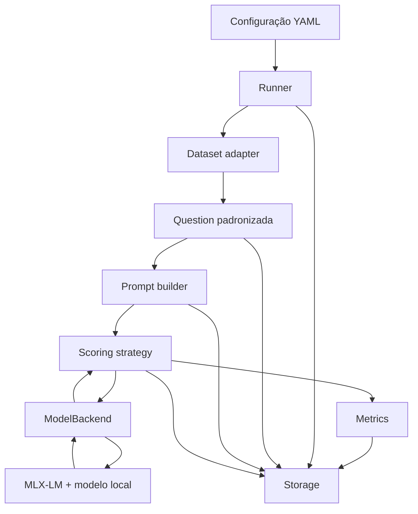

# Arquitetura do LLM Benchmark

**Status:** especificação inicial para desenvolvimento incremental do MVP.  
**Linguagem:** Python.  
**Objetivo:** sistema experimental, auditável e extensível para avaliação de LLMs em tarefas de múltipla escolha.

> Este documento descreve a **arquitetura desejada** e explicita decisões ainda abertas. Não representa uma declaração de que todos os módulos ou métodos já tenham sido implementados ou validados.

## 1. Objetivos e princípios

Construir um pequeno *evaluation harness* no repositório definitivo, capaz de:

1. carregar questões de datasets distintos para um **formato comum**;
2. formatar prompts controlados e executar LLMs por um backend substituível;
3. obter pontuações de alternativas segundo um **método identificado**;
4. calcular acurácia e entropia normalizada, mantendo-as como medidas separadas;
5. registrar resultados detalhados, parâmetros e versões para auditoria e reprodutibilidade;
6. evoluir para outros modelos, datasets e métricas sem reescrever os componentes existentes.

Princípios: **simplicidade antes de generalização**, responsabilidades isoladas, dependências explícitas, testes automatizados, falhas visíveis e configuração externa. Evitar infraestrutura de produção desnecessária, plugins genéricos, abstrações excessivas e lógica experimental escondida em módulos de inferência.

A pesquisa examina a relação entre desempenho e incerteza; **não assume** que entropia baixa implique acerto ou inteligência elevada. As possíveis conexões com dimensões CHC são **exploratórias**, não avaliações psicométricas. Não criar um índice novo de eficiência informacional sem decisão metodológica posterior.

## 2. Limites do MVP

| Dimensão | MVP | Possível expansão |
| --- | --- | --- |
| Dataset | MMLU fixado: 15 `dev` para validação técnica e 60 `test` para piloto posterior, três disciplinas | WinoGrande, outros conjuntos e divisões |
| Backend | MLX-LM no Apple Silicon | Transformers/PyTorch em Mac ou servidor; API quando suportar o protocolo |
| Modelo | Qwen2.5-0.5B-Instruct como candidato de desenvolvimento | Outros modelos e tamanhos |
| Pontuação | Inspeção e, **se válida**, pontuação de rótulos `A`–`D` no próximo token | Log-verossimilhança de sequências e outros métodos |
| Prompt | Um template zero-shot, versionado | Novos templates, few-shot, estudos de sensibilidade |
| Métricas | Acurácia e entropia normalizada | Outras métricas e análises |
| Execução | Um modelo por execução, sequencial | Lotes, múltiplos backends, comparação de execuções |
| Armazenamento | JSONL para itens e JSON/YAML para metadados | CSV e relatórios, se necessários |

O computador de referência tem **Apple M2 e 8 GB de memória unificada**. Selecionar versões de modelo de acordo com memória efetiva e suporte real da biblioteca. Não pressupor que todas as variantes caberão em memória, nem que a quantização preservará as mesmas probabilidades.

**Regra de escopo:** o primeiro ciclo de desenvolvimento deve estabelecer um fluxo completo e testado com backend simulado e, depois, validar o acesso aos logits com MLX. Não implementar agora Transformers, APIs, WinoGrande ou um sistema de plugins.

## 3. Visão lógica



O `Runner` coordena todo o fluxo. Cada módulo desconhece os detalhes internos dos demais, além dos contratos necessários. O backend deve ser carregado uma vez por execução sempre que possível.

### 3.1 Responsabilidades

| Módulo | Faz | Não deve fazer |
| --- | --- | --- |
| `datasets` | Carrega, seleciona, valida e converte questões para `Question` | Chamar LLMs ou calcular métricas |
| `schemas` | Define contratos de dados compartilhados | Acessar datasets, disco ou modelo |
| `prompts` | Formata questões; registra versão do template | Calcular pontuações ou entropia |
| `backends` | Carrega a LLM, aplica tokenização/template de chat quando pertinente, obtém evidência de inferência | Decidir o gabarito, acurácia ou entropia |
| `scoring` | Define como candidatos são avaliados e como escores viram distribuição entre alternativas | Executar análise estatística final ou salvar arquivos |
| `metrics` | Calcula medidas por questão e agregados | Fazer inferência ou escolher o prompt |
| `runner` | Valida configuração, conecta componentes, controla execução e falhas | Contém fórmulas matemáticas embutidas |
| `storage` | Persiste registros e metadados sem sobrescrever execuções antigas | Recalcular logits, reinterpretar o protocolo |
| `cli` | Expõe o ponto de entrada/configuração | Conter regras metodológicas |

## 4. Estrutura de diretórios prevista

```text
.
├── AGENTS.md
├── configs/
│   └── pilot_mmlu.yaml
├── docs/
│   ├── ARCHITECTURE.md
│   └── ROADMAP.md
├── src/
│   └── benchmark/
│       ├── __init__.py
│       ├── cli.py
│       ├── runner.py
│       ├── schemas.py
│       ├── datasets/
│       │   ├── __init__.py
│       │   ├── base.py
│       │   └── mmlu.py
│       ├── backends/
│       │   ├── __init__.py
│       │   ├── base.py
│       │   └── mlx.py
│       ├── scoring/
│       │   ├── __init__.py
│       │   ├── labels.py
│       │   └── normalization.py
│       ├── prompts.py
│       ├── metrics.py
│       └── storage.py
├── tests/
│   ├── test_metrics.py
│   ├── test_scoring.py
│   ├── test_datasets.py
│   └── test_runner.py
├── outputs/                # artefatos gerados; ignorados pelo Git por padrão
├── pyproject.toml
├── .gitignore
└── README.md
```

Esta árvore é **direcional**, não obrigatória desde o primeiro commit. É aceitável agrupar componentes pequenos antes de expandi-los em pacotes, desde que o contrato e as responsabilidades sejam mantidos. Utilizar o layout `src/` para isolar o pacote da raiz do repositório.

## 5. Contratos e dados padronizados

Preferir `dataclasses` e tipagem Python na primeira versão. As estruturas a seguir são **exemplos de intenção**, não especificações de assinatura congeladas.

### 5.1 `Question`

Representa uma questão de múltipla escolha, independente do formato original de seu dataset:

```python
@dataclass(frozen=True)
class Question:
    id: str                      # id estável e único dentro do contexto do dataset
    text: str
    choices: tuple[str, ...]     # preserva ordem das alternativas
    correct_index: int           # índice começando em zero
    subject: str | None = None
```

O dataset adapter deve acrescentar ou associar proveniência: nome/configuração do dataset, revisão, partição, ID original e filtros. Validar `2 <= len(choices)`, índice de gabarito válido e identificadores não duplicados. Não presumir que todos os datasets possuem quatro alternativas.

### 5.1.1 Preparação MMLU autorizada em 3A — 2026-11-07

O pedido de 3A **substitui a proposta inicial de até 20 questões de `validation`**:
`high_school_psychology`, `high_school_world_history` e `high_school_biology`,
5 questões de `dev` e 20 de `test` por disciplina. Em 3A somente a preparação está
autorizada; `dev` não será usado como demonstração few-shot. A preparação foi aprovada
em 2026-11-07, incluindo a anomalia de biologia; 3B foi então autorizada. O subconjunto de `test` fica congelado para o piloto,
sem escolha de prompt ou ajuste de pontuação pelos seus resultados.

`src/benchmark/mmlu.py` é um módulo de dataset separado, preservando `datasets.py`
e `Question`. `MMLUSource` fixa arquivo/revisão/hash; `MMLUItem` associa `Question`
a split, posição original (base zero) e hash da linha. IDs combinam dataset,
revisão, disciplina, split e índice. O adaptador valida quatro alternativas,
textos obrigatórios e índice inteiro 0–3; não normaliza texto nem reordena opções.

`configs/mmlu_selection.json` fixa a revisão
`c30699e8356da336a370243923dbaf21066bb9fe`, seed 42 e seis Parquets. A seleção
`sha256_index_rank_v1` ordena hashes da identidade + seed + índice, toma a
quantidade por estrato e apresenta os índices em ordem original. Conteúdo,
gabarito, comprimento e resultados de modelo não entram na escolha. Duplicações
são reportadas sem remoção ou substituição; arquivo/schema inválido interrompe a preparação.

A rede e a medição com tokenizer ficam em `diagnostics/mmlu_dataset.py`, fora do
adaptador e do Runner. O diagnóstico usa o prompt e chat template aprovados para
contar a entrada completa contra 1024 tokens, sem truncar ou substituir itens.
Os pesos não são carregados. O manifesto registra índices/IDs, hashes dos arquivos,
linhas, prompts, tokens e fontes; a saída JSONL preserva os 75 conteúdos completos.
Somente o manifesto final indica preparação persistida; isso não representa uma
execução experimental nem substitui os metadados de avaliação do Runner.

A preparação de 3A permanece separada da execução. O consumo pelo Runner foi
implementado em 3B, descrito abaixo. Evidências da preparação:
[validação 3A](reports/MMLU_DATASET_VALIDATION.md).

### 5.1.2 Consumo da seleção pelo Runner em 3B

A execução usa `mmlu_selection.py`, sem modificar o adaptador de 3A. O manifesto
aprovado é fixado por SHA-256; o carregador lê somente os arquivos locais necessários
à disciplina/split, confere hashes e conteúdo e retorna as posições congeladas.
Não reamostra, acessa rede, filtra anomalias ou conhece o modelo. Configurações
MMLU exigem revisão aprovada, seed 42, `mmlu-3a-v1`, quantidade integral por estrato
e o protocolo de 2B; os caminhos de snapshot e manifesto são configuráveis.

`EvaluationRecord.provenance` é opcional para manter fixtures anteriores e
obrigatório no conjunto MMLU persistido: ID, disciplina, split, revisão, índices
originais/seleção/execução, hashes e anomalias. O schema valida estrutura/identidade;
`RunMetadata.validate_records` confere coerência e ordem antes da gravação.
Textos, alternativas e gabaritos continuam em `Question` sem mudanças.

O Runner carrega e verifica os dados antes do backend, aplica os módulos existentes
e compara hash do prompt e dos tokens com 3A. Erros são registros explícitos,
sem retentativa por desempenho. Backend, scoring, métricas e persistência mantêm
suas responsabilidades. O resumo por disciplina usa `summarize` existente no
script de auditoria; não altera a fórmula ou o resumo geral de cada execução.

A validação autorizada foi sequencial: dev 15 → auditoria técnica → test 60.
Acurácia não é condição de avanço. `diagnostics/mmlu_pilot_validation.py` apenas
audita saídas; não executa modelo. A CLI aceita cada configuração individualmente,
portanto chamadas futuras devem respeitar essa sequência explicitamente.
Evidências: [validação 3B](reports/MMLU_PILOT_VALIDATION.md). 3B aprovada tecnicamente
em 2026-11-08; 3C autorizada para análise dos resultados persistidos, sem nova inferência.

### 5.1.3 Análise exploratória em 3C

A análise é posterior à persistência e não faz parte do caminho de inferência.
`results.py` compartilha a desserialização antes presente no diagnóstico 3B e
valida os contratos/artefatos. `analysis.py` agrega `EvaluationRecord` usando
`summarize` existente e estatísticas descritivas da biblioteca padrão. Não importa
MLX, acessa rede ou duplica fórmulas de scoring. `analysis_report.py` transforma
as agregações em Markdown, JSON e PNGs via Matplotlib, importado apenas ao renderizar.

O relatório do piloto aceita exclusivamente os 60 test de `mmlu-3a-v1`, vinculados
aos hashes aprovados de 3A/3B, com IDs/conteúdo/prompt/tokens conferidos. Os 15 dev
ficam identificados separadamente como excluídos da análise experimental, sem
carregar seus registros para agregação. Funções puras rejeitam dev/mistos e IDs
duplicados. Grupos vazios têm n=0 e métricas nulas; falhas técnicas são contadas e
não entram no denominador válido da acurácia/entropia. Gabaritos contam todos os
registros; frequências de predição contam somente registros válidos.

O limiar máx. p(A–D) ≥ 0,90 identifica descritivamente erros concentrados, sem
alegação de calibração e sem excluir outros itens dos agregados. Exemplos seguem
regra simétrica: mínimo/máximo de entropia por disciplina e acerto/erro, empate por
ID. Todos os registros e valores usados nas figuras permanecem auditáveis no JSON.
Quartis usam interpolação inclusiva; dispersão é desvio populacional descritivo.

A análise não infere viés de posição, diferenças cognitivas ou generalização a
partir desta amostra. Protocolo futuramente otimizado com estes test requer nova
amostra independente para validação. Não alterar dados ou resultados existentes.
Implementação e artefatos: [análise 3C](reports/MMLU_EXPLORATORY_ANALYSIS.md),
aguardando revisão técnica; 3B concluída no commit local `5db73f9`.

### 5.2 `ModelBackend`

É um **contrato de operações** para executar um modelo, não um modelo nem uma API remota. `backends/base.py` estabelece a interface comum; `backends/mlx.py` implementa a ponte com MLX-LM.

Capacidades mínimas que deverão ser definidas e testadas:

- carregar/descarregar um modelo e expor sua identidade, revisão e configurações;
- preparar a entrada para a inferência, inclusive template de chat se necessário;
- permitir inspecionar a tokenização de rótulos **no contexto do prompt final**;
- obter logits/escores apropriados à estratégia de pontuação, sem depender de amostragem de texto gerado;
- descrever capacidades e limitações do backend de maneira verificável.

Uma interface futura poderá oferecer operações opcionais distintas para `next_token_scores` e `continuation_loglikelihood`. **Não exigir que todo backend suporte ambas.** Configurações incompatíveis devem falhar explicitamente.

### 5.3 `ScoringResult`

Representa a saída de uma estratégia de pontuação sobre uma questão:

- IDs e textos das alternativas na ordem original;
- nome e parâmetros do método de pontuação;
- escores brutos correspondentes aos candidatos, em unidade identificada (por exemplo, logits ou log-verossimilhanças);
- probabilidades **normalizadas dentro do conjunto de alternativas**;
- índice previsto e informação diagnóstica sobre a tokenização;
- massa de probabilidade original atribuída aos rótulos válidos, **quando a evidência disponível permitir medi-la**;
- indicadores de erro/validade e metadados suficientes para auditoria.

Não chamar de “probabilidades originais” os valores obtidos por softmax apenas entre alternativas: eles são condicionais ao conjunto pontuado.

### 5.4 `EvaluationRecord` e `RunMetadata`

`EvaluationRecord` deve unir `Question`, prompt exato, `ScoringResult`, gabarito e métricas por questão. `RunMetadata` deve identificar a versão da configuração e do código, dataset, modelo, bibliotecas, ambiente, horários e contagens de itens aceitos/falhados.

Na fundação, os schemas conferem coerência entre escores e probabilidades,
predição e desempate, entropia e distribuição, acerto e gabarito. As funções
numéricas puras são compartilhadas em `numerics.py`, sem duplicação de fórmulas;
`metrics.py` e `scoring/normalization.py` mantêm suas interfaces. Antes da escrita,
o contrato de metadados também valida os registros e o resumo usando os
agregados definidos em `metrics.py`. O storage verifica sua correspondência com
a configuração e não contém fórmulas.

Horários exigem ISO 8601 com fuso, em ordem cronológica. Código e ambiente exigem
campos explícitos de proveniência, admitindo `null` para commit/estado local e
versões de pacotes indisponíveis. O campo `close_error` registra separadamente
falhas no encerramento do backend. Com itens válidos, erros por item ou de
encerramento levam a `completed_with_errors`; nenhum item válido leva a
`failed`. `completed` exige ausência de ambos os tipos de erro.

## 6. Protocolo de pontuação e decisões abertas

### 6.1 Estratégia candidata: `label_next_token`

O prompt apresenta as alternativas e instrui o modelo a selecionar um rótulo (`A`, `B`, `C`, `D`). A estratégia pretendida é:

1. construir o prompt final segundo o template registrado, incluindo formato de chat quando aplicável;
2. confirmar exatamente **em qual posição** será pontuada a próxima saída do modelo;
3. inspecionar a tokenização, inclusive alternativas como `A`, ` A` e possíveis efeitos das fronteiras do prompt;
4. verificar que cada candidato do método adotado corresponde a um único token válido e distinto no contexto utilizado;
5. obter os logits dos tokens candidatos na posição adequada;
6. aplicar softmax **somente entre os logits desses candidatos**, de forma numericamente estável;
7. selecionar a alternativa de maior probabilidade e registrar os dados diagnósticos.

Se a hipótese de token único falhar, **não converter silenciosamente** rótulos multítoken em um logit único, nem alterar o prompt sem registrar a mudança. Documentar o problema e reavaliar o método. O rótulo sozinho e o rótulo com espaço podem ter tokenizações diferentes. Comparações entre experimentos exigem protocolo de pontuação equivalente.

A estratégia não mede a incerteza sobre todo o vocabulário nem necessariamente sobre o significado completo de cada alternativa. A probabilidade entre rótulos é **condicionada** ao conjunto e ao contexto utilizado.

### 6.2 Alternativa futura: `sequence_loglikelihood`

Pontuar a continuação de cada alternativa por sua log-verossimilhança. Exige decidir qual texto compõe a continuação, delimitação entre contexto e resposta, e tratamento de possíveis diferenças de comprimento. **Não integrar esse método no MVP por suposição** e não comparar diretamente suas entropias com as do método de rótulos sem justificativa metodológica.

### 6.3 Diagnósticos antes do piloto

O teste técnico de MLX deve produzir documentação suficiente sobre:

- token IDs e quantidade de tokens por rótulo e por variação com espaço;
- prompt final, aplicação de chat template e posição dos logits utilizados;
- correspondência correta entre logits do vocabulário e rótulos;
- diferença entre distribuição do vocabulário e distribuição renormalizada entre alternativas;
- suporte real à operação pela versão instalada do MLX-LM;
- memória, tempo e eventuais falhas observadas.

A decisão de prosseguir com `label_next_token` depende dos resultados desse diagnóstico.

### 6.4 Protocolo provisório aprovado para 2B — 2026-11-06

O responsável aprovou explicitamente a [comparação de prompts](reports/PROMPT_COMPARISON.md)
e autorizou a integração ao Runner. Após revisar as evidências, aprovou
tecnicamente a Entrega 2B em 2026-11-06. Após o aceite de 3A, o piloto 3B foi autorizado
e executado em 2026-11-07, mantendo este protocolo.

- Modelo: `mlx-community/Qwen2.5-0.5B-Instruct-bf16`, revisão
  `56d07e766edd7159fbe12ed12d9cf114bf38bf1e`, snapshot local e hashes conferidos.
- Texto `current-no-enumeration` preservado no template versionado
  `current-no-enumeration-v1` de `prompts.py`; seleção em configuração, fora do backend.
- Chat template padrão do snapshot, incluindo sistema padrão e cabeçalho de geração;
  zero-shot, sem espaço adicional depois do cabeçalho.
- `label_next_token`: rótulos `A`, `B`, `C`, `D`, validação contextual por item,
  exatamente um token distinto e não especial por continuação, prefixo preservado.
- Batch 1, `model.eval()`, logits `[0, T-1, :]`, forward completo sem KV cache.
  Promover a float32 e converter a float Python antes da normalização existente.
  Caminhos com e sem cache podem produzir logits/argmax globais diferentes em BF16;
  não intercambiar seus resultados sem decisão e validação novas.
- Persistir massa/probabilidades originais no vocabulário e probabilidades
  condicionadas às alternativas, sem misturar os dois significados.

O contrato `ModelBackend` cobre ciclo de vida, identidade e metadados.
`SimulatedScoresBackend` conserva `score`; `NextTokenBackend` expõe
`prepare_prompt` e `next_token_logits`. `NextTokenOutput` transporta o vetor
transitório do vocabulário e `TokenizationEvidence`, sem métricas. O scoring
reutiliza o mesmo softmax no vocabulário e entre candidatos; os registros guardam
apenas os escores e probabilidades relevantes, com IDs, posição e dtype.
O schema distingue simulação de inferência real e valida consistência das duas
distribuições quando a massa é positiva. Massa zero por underflow é representável,
sem inventar precisão inexistente; os casos reais observados tiveram massa positiva.

A configuração de 2B usa fixture `synthetic/controlled-v1` e permanece zero-shot;
ela não implementa MMLU. O limite operacional explícito é até 1024 tokens de
entrada, recusando excessos sem truncar. MLX é importado somente ao carregar o
backend; o núcleo e os testes offline não dependem de Metal. O manifesto inicial
aceita apenas o snapshot aprovado. Resultados guardam hashes dos fontes Python
para identificar mudanças locais além do commit/estado dirty, hashes do snapshot
e versões das bibliotecas de inferência. `metadata.json` continua sendo o sinal
final de persistência completa.

Implementação e evidências: [validação 2B](reports/VALIDATION_DELIVERY_2B.md).
A aprovação explícita de 2B está registrada no roadmap; ela não autoriza
automaticamente o futuro piloto científico.

## 7. Métricas

### 7.1 Probabilidades condicionadas às alternativas

Sejam `s_i` escores comparáveis de `K` alternativas. Para logits da mesma posição, podemos obter:

\[
p_i = \frac{e^{s_i - m}}{\sum_{j=1}^{K} e^{s_j - m}}, \qquad m = \max_j s_j.
\]

A subtração do máximo implementa um softmax estável. O uso de softmax sobre log-verossimilhanças de sequências é possível matematicamente, mas muda a interpretação e exige protocolo separado.

### 7.2 Acurácia

Para cada questão, `correct = 1` se `argmax_i p_i` for o índice do gabarito, senão `0`. Para `N` questões válidas:

\[
\mathrm{accuracy} = \frac{1}{N}\sum_{q=1}^{N} \mathrm{correct}_q.
\]

Uma regra determinística para empates (por exemplo, menor índice) deve ser documentada.

### 7.3 Entropia de Shannon normalizada

Para `K >= 2`, `p_i >= 0` e `Σ_i p_i = 1`:

\[
H_{norm}(p) = \frac{-\sum_{i=1}^{K}p_i\log_2(p_i)}{\log_2(K)}.
\]

Adotar a convenção `0 log₂(0) = 0`. Valor `0`: distribuição concentrada numa alternativa; valor `1`: distribuição uniforme. A métrica não incorpora o gabarito; sua leitura junto da acurácia ocorrerá na análise.

### 7.4 Testes matemáticos obrigatórios

- Distribuição uniforme (qualquer `K >= 2`) deve produzir entropia normalizada `1`.
- Distribuição determinística deve produzir entropia `0`.
- Casos intermediários devem corresponder a resultados de referência calculados independentemente.
- Probabilidades negativas, não finitas, soma inválida e `K < 2` devem produzir erro de validação claro.
- Softmax deve permanecer estável para logits de alta magnitude.
- `argmax` deve respeitar a ordem das alternativas e a regra explícita de desempate.
- Acurácia de casos conhecidos (`0`, `1`, resultados mistos) deve estar correta.

Separar **métricas por questão** (acerto, entropia) de **agregados por execução** (acurácia, médias e contagens). Não criar uma fórmula composta de eficiência informacional nesta versão.

## 8. Configuração dos experimentos

Usar um arquivo YAML versionável e validado. O exemplo abaixo é **histórico e não executável**, anterior às decisões de 2B/3A: `validation`, limite 20 e template ilustrativo foram superados. A preparação atual está em `configs/mmlu_selection.json`; as configurações de execução de 3B são `configs/mmlu_dev.yaml` e `configs/mmlu_test.yaml`. Não usar este YAML para o piloto:

```yaml
experiment:
  name: mmlu_pilot

dataset:
  name: mmlu
  split: validation
  limit: 20
  seed: 42

model:
  backend: mlx
  name: mlx-community/Qwen2.5-0.5B-Instruct-bf16

prompt:
  template: multiple_choice_zero_shot

scoring:
  method: label_next_token

metrics:
  - accuracy
  - normalized_entropy

output:
  directory: outputs
```

> **Nota:** modelo, revisão e template aprovados estão na seção 6.4; seleção autorizada, na seção 5.1.1. Este YAML preserva apenas a intenção inicial, sem garantia de compatibilidade com a CLI atual.

Não aceitar parâmetros desconhecidos silenciosamente. Registrar a configuração resolvida em cada execução. Seleção por `seed` não substitui o registro dos IDs exatos das questões e suas ordens; o mesmo experimento deve ser reproduzível. Reservar `test` para avaliação posterior, sem ajustar o protocolo com base nesses resultados.

## 9. Armazenamento e rastreabilidade

Cada execução deve gerar um **diretório novo e imutável**, identificado de modo único (por exemplo, identificador legível mais timestamp/UUID; evitar colisões):

```text
outputs/
└── <run_id>/
    ├── config.yaml
    ├── metadata.json
    ├── results.jsonl
    └── summary.json
```

- `config.yaml`: parâmetros completos resolvidos, inclusive template e scoring.
- `metadata.json`: commit do código, situação de modificações locais, versões das dependências, modelo/revisão, dataset/revisão, ambiente, horários e ocorrências.
- `results.jsonl`: **um registro por questão**, com IDs, alternativas, prompt exato, pontuação, probabilidades, predição, gabarito, acerto, entropia e erros.
- `summary.json`: total de questões válidas/falhadas, acurácia e estatísticas agregadas explicitamente identificadas.

Armazenar valores com precisão numérica suficiente para recalcular métricas; não arredondar dados originais apenas para apresentação. Não sobrescrever resultados antigos por padrão. O histórico de execuções é **rastreabilidade experimental**, enquanto o Git versiona código e documentos.

Na implementação da fundação, a pasta é reservada por criação exclusiva.
Configuração, resultados e resumo são escritos, fechados e sincronizados antes
da publicação de `metadata.json`. Os metadados são escritos em
`metadata.json.tmp`, sincronizados e renomeados atomicamente no mesmo diretório.
**Somente a presença de `metadata.json` final indica que a persistência terminou**;
seu campo `status` informa o resultado da avaliação, que pode conter falhas.

Uma falha de gravação deixa a pasta parcial sem `metadata.json` final e propaga
o erro. Ela não é sobrescrita ou retomada automaticamente. O arquivo temporário,
se existir, não é evidência de conclusão. Essa convenção trata exceções de I/O;
não constitui garantia contra perda de energia ou edição manual dos arquivos.

Falhas em `backend.close()` não descartam registros já calculados: ficam nos
metadados e são sinalizadas pela CLI. Se a inicialização já havia falhado, a
exceção original é preservada e a falha de encerramento é acrescentada como
informação secundária. Se a própria persistência falhar, erros anteriores são
incluídos no diagnóstico da exceção; não se afirma que resultados foram salvos.

Não versionar automaticamente pesos dos modelos, caches, arquivos de saída volumosos, tokens ou credenciais. Antes da publicação de resultados/dados derivados, verificar as condições de uso dos recursos de origem. Não inserir informação pessoal em arquivos públicos.

## 10. Testes e critérios de aceitação

### Testes unitários

- `schemas`: validação de `Question`, índices, escolhas, metadados essenciais.
- `datasets`: conversão de exemplos simulados MMLU para schema comum; preservação de ordem/gabarito.
- `scoring`: softmax, tokenização simulada, erros explícitos e desempate.
- `metrics`: fórmulas e situações-limite, sem importar bibliotecas de inferência.
- `storage`: serialização/leitura de registros, preservação da precisão e isolamento de execuções.

### Teste de integração sem modelo real

Usar um **backend simulado (fake/mock)** que devolve escores controlados. Verificar fluxo completo: dados → prompt → scoring → métricas → arquivos. O teste não deve depender de internet nem de baixar pesos.

### Diagnóstico com modelo real

Executar uma pequena inferência isolada com MLX-LM; inspecionar prompt, tokenização e logits; comparar pontuação prevista com valores calculados manualmente. Não afirmar “MVP validado” enquanto o método de pontuação e seus limites não estiverem documentados.

### Critério mínimo para primeiro piloto

1. Testes unitários e de integração passam.
2. A biblioteca executa o modelo candidato na máquina de referência sem falhas de recursos que invalidem o teste.
3. Tokenização e logits suportam o método de pontuação adotado, ou outro método é especificado e validado antes de prosseguir.
4. Execução registra todas as questões, os parâmetros e os resultados com consistência.
5. Casos de falha são reportados; questões com erro não são descartadas silenciosamente.

## 11. Plano de implementação incremental para o Codex

### Entrega 1 — Fundação (sem LLM real)

- Criar `pyproject.toml`, layout `src/`, configuração de exemplo e testes automatizados.
- Implementar schemas mínimos (`Question`, registro de resultado) e adaptador de exemplo/sintético.
- Implementar métricas puras e normalização estável com testes.
- Criar `Runner` pequeno e backend simulado, com uma execução de ponta a ponta.
- Persistir uma pasta de execução e documentar os comandos **realmente testados** no README.

**Não** adicionar nesta etapa implementação completa de MLX, Transformers ou APIs. O objetivo é validar contratos e fluxo com valores controlados.

### Entrega 2 — Diagnóstico MLX

- Instalar dependências específicas e carregar um modelo pequeno compatível.
- Documentar geração do prompt final, chat template, tokenização e acesso aos logits.
- Produzir teste reproduzível da distribuição dos rótulos e das suas limitações.
- Reportar discrepâncias sem improvisar outra metodologia.

### Entrega 3 — Piloto MMLU

- **3A:** preparar adaptador MMLU independente, revisão/partição/IDs, seed, índices e hashes; 15 `dev` + 60 `test` conforme seção 5.1.1. Validar dados, duplicações e orçamento de tokens sem avaliar o modelo.
- **3B, após revisão e autorização:** conectar a seleção ao Runner, executar validação técnica e piloto com o protocolo já aprovado, revisar logs e persistência.
- **3C:** analisar somente os resultados test persistidos, com tabelas, PNGs e evidência auditável, sem nova inferência. Manter dev técnico separado e aguardar revisão.
- Documentar achados e limitações sem extrapolar para conclusões científicas; protocolo ajustado pelos resultados de test exige nova amostra independente.

### Entrega 4 — Evolução posterior

Avaliar a ampliação da amostra, variantes do Qwen, outro dataset, novos backends e métodos alternativos conforme necessidades da pesquisa e validações metodológicas.

## 12. Decisões ainda abertas

- Extensões ao protocolo provisório da seção 6.4: outros modelos, revisões, quantização, templates ou caminhos de inferência. A configuração inicial e a integração de 2B já foram aprovadas tecnicamente; extensões exigem nova revisão.
- Estratégia de comparação de experimentos com prompts, scoring ou precisão numérica distintos.
- Regras de exclusão/falha, estatísticas adicionais e amostra final da pesquisa.
- Inclusão futura de WinoGrande e justificativa das relações exploratórias com CHC.

**Não transformar esses itens em decisões definitivas sem testes ou aprovação metodológica.**

## 13. Regras para contribuições e uso do Codex

1. Implementar **incrementalmente**; não introduzir recursos fora da entrega solicitada.
2. Não alterar fórmulas, significado das métricas ou regras de pontuação silenciosamente.
3. Não inventar dados de avaliação ou afirmar resultados não executados.
4. Não acoplar dataset e métrica à biblioteca MLX-LM.
5. Usar testes offline para o núcleo matemático e para a orquestração.
6. Documentar decisões técnicas, alternativas rejeitadas e limitações encontradas.
7. Executar testes antes de concluir uma entrega e reportar falhas honestamente.
8. Não incluir nomes pessoais, emails, tokens, chaves ou caminhos privados em arquivos públicos.
9. Não expor o dataset de teste como conjunto para ajuste do protocolo.
10. Manter o README sincronizado com as funcionalidades efetivamente implementadas.

## Referências de arquitetura

- [MLX-LM](https://github.com/ml-explore/mlx-lm)
- [Hugging Face Transformers](https://huggingface.co/docs/transformers/index)
- [LM Evaluation Harness](https://github.com/EleutherAI/lm-evaluation-harness)
- [LM Evaluation Harness — New Task Guide](https://github.com/EleutherAI/lm-evaluation-harness/blob/main/docs/new_task_guide.md)

Estas referências orientam o desenho; não é objetivo copiar a complexidade do LM Evaluation Harness.
