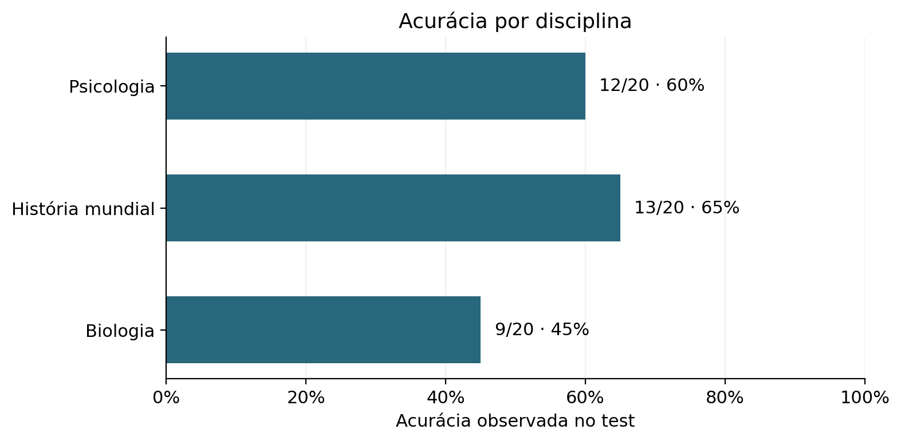
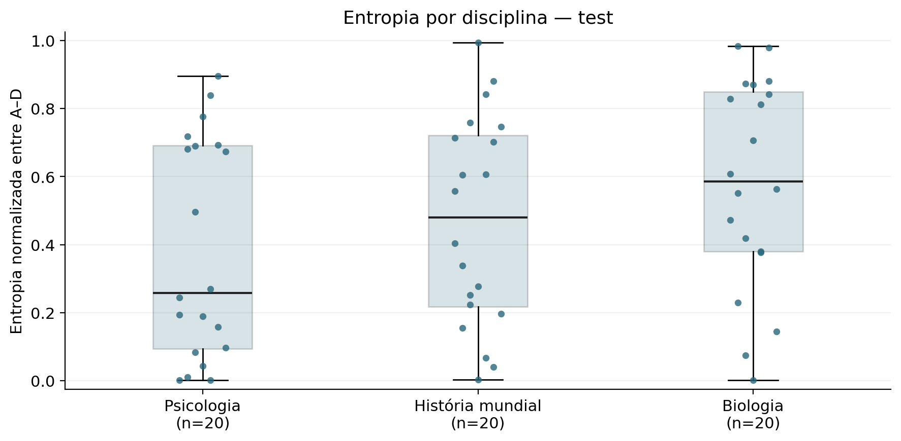
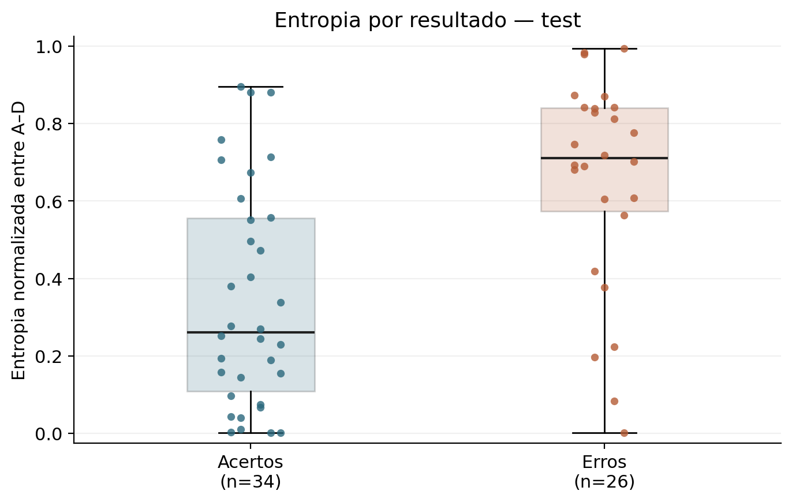
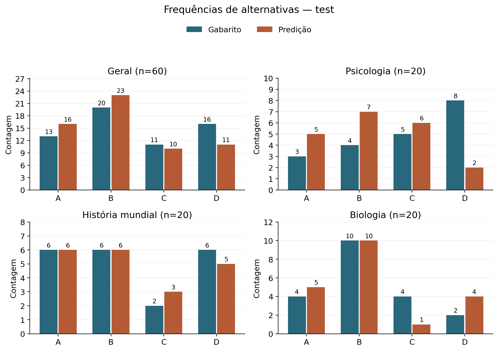

# Análise exploratória do piloto MMLU — Entrega 3C

Data: 2026-11-08. **Implementada e verificada localmente; aguardando revisão técnica. 3C não concluída.**

## Escopo e procedência

3B foi aprovada tecnicamente em 2026-11-08 e encerrada em commit local exclusivo `5db73f95bcc5f14e1c245ecf06bbf94e553cb434`, após revisão do diff e **100 testes aprovados (1,033 s)**. Esta etapa usa somente os **60 registros test**, 20 por disciplina, de `mmlu-3a-v1`. Os 15 dev permanecem separados e exclusivamente técnicos; não entram em tabelas, exemplos ou gráficos experimentais.

Execução test: `20261107T135948062030Z_5a52c49279c246fc8bc3dfdaef2bc1bb`. Dataset `cais/mmlu@c30699e8356da336a370243923dbaf21066bb9fe`; modelo `mlx-community/Qwen2.5-0.5B-Instruct-bf16@56d07e766edd7159fbe12ed12d9cf114bf38bf1e`. Prompt, scoring e resultados são os persistidos em 3B. **Nenhuma LLM foi executada novamente.**

O leitor confere os quatro hashes de artefatos contra a evidência aprovada, reconstrói os schemas, valida resumos/configuração/procedência e confronta os 60 IDs, ordem, conteúdo, prompts e tokens com 3A. Não é necessário carregar pesos, tokenizer, Parquets ou acessar rede. Entradas dev/mistas, duplicações de IDs ou artefatos adulterados são recusados. A carga do piloto exige exatamente 60 test válidos.

SHA-256 da evidência 3B: `974f22e63c06c753182ac574b8199a1579115cce2fd47f59eb35bc6f329ba6ed`. SHA-256 do manifesto 3A: `2e030192cdba40f31ec35ab33b32da1cdfe0207501e09b0edbdd1107dfd7fae1`. Hashes de cada artefato, código, versões, valores dos gráficos e todos os registros analisados estão no [JSON de evidências](MMLU_EXPLORATORY_EVIDENCE.json). Os arquivos originais não foram modificados.

## Método de análise

- Acurácia e médias gerais reutilizam `summarize`; os schemas conferem a entropia e o scoring existentes. Não há fórmula nova de eficiência informacional ou nova normalização.
- Denominador da acurácia: registros válidos; falhas técnicas são contadas separadamente. Neste piloto: 60/60 válidos, 0 falhas. Gabaritos usam todos os itens; predições, apenas válidos. As contagens são sempre explícitas.
- Descritivas: média, mínimo, máximo, mediana, quartis inclusivos por interpolação linear em `(n−1)p` e desvio padrão populacional descritivo. Grupos vazios têm `n=0` e valores nulos, não zero. O JSON contém histogramas de entropia em dez intervalos de largura 0,1, fechados à esquerda; o último inclui 1.
- Alta concentração: **máx. p(A–D) ≥ 0.90**, limiar operacional descritivo declarado antes da tabulação de 3C. Não é limiar calibrado, probabilidade de acerto ou filtro de questões. Todos os erros que satisfazem o critério são listados; os demais continuam nos agregados.
- Exemplos: menor e maior entropia por disciplina × acerto/erro; empate por ID, sem duplicar um mesmo exemplo. A regra mostra extremos de ambos os resultados, não casos representativos, e não foi ajustada para sustentar uma hipótese.
- Somente descrições desta amostra. Não foram realizados testes de significância, inferência causal, avaliação de calibração ou comparação cognitiva entre disciplinas.

## Resultados observados

### Acurácia e denominadores

| Grupo | Total | Válidas | Falhas | Acertos | Erros | Acurácia (acertos/válidas) |
| --- | ---: | ---: | ---: | ---: | ---: | ---: |
| Geral | 60 | 60 | 0 | 34 | 26 | 34/60 = 56.67% |
| Psicologia | 20 | 20 | 0 | 12 | 8 | 12/20 = 60.00% |
| História mundial | 20 | 20 | 0 | 13 | 7 | 13/20 = 65.00% |
| Biologia | 20 | 20 | 0 | 9 | 11 | 9/20 = 45.00% |



Figura 1. Proporções observadas, com denominadores explícitos, sem intervalos inferenciais. A ordem das disciplinas é a da seleção, não um ranking de capacidade.

### Entropia geral e por disciplina

| Grupo | n | Média | DP populacional | Mínimo | Q1 | Mediana | Q3 | Máximo |
| --- | ---: | ---: | ---: | ---: | ---: | ---: | ---: | ---: |
| Geral | 60 | 0.478516 | 0.315163 | 0.002084 | 0.192876 | 0.523315 | 0.749043 | 0.993727 |
| Psicologia | 20 | 0.387762 | 0.314823 | 0.002110 | 0.093805 | 0.257621 | 0.690822 | 0.895874 |
| História mundial | 20 | 0.468024 | 0.300243 | 0.002918 | 0.217243 | 0.480389 | 0.721595 | 0.993727 |
| Biologia | 20 | 0.579761 | 0.300211 | 0.002084 | 0.379304 | 0.585513 | 0.848884 | 0.983315 |



Figura 2. Cada ponto é um registro test. Caixas: Q1–Q3; linha: mediana; hastes: mínimo–máximo. O deslocamento horizontal determinístico apenas reduz sobreposição. Nenhuma observação foi removida.

### Entropia de acertos e erros

| Grupo | Resultado | n | Média | Mediana | Q1 | Q3 | Mínimo | Máximo |
| --- | --- | ---: | ---: | ---: | ---: | ---: | ---: | ---: |
| Geral | Acerto | 34 | 0.346090 | 0.261355 | 0.108989 | 0.555706 | 0.002084 | 0.895874 |
| Geral | Erro | 26 | 0.651688 | 0.709896 | 0.573181 | 0.840846 | 0.002110 | 0.993727 |
| Psicologia | Acerto | 12 | 0.272859 | 0.191873 | 0.083489 | 0.326678 | 0.002276 | 0.895874 |
| Psicologia | Erro | 8 | 0.560118 | 0.691470 | 0.531191 | 0.731997 | 0.002110 | 0.838492 |
| História mundial | Acerto | 13 | 0.388581 | 0.338067 | 0.155555 | 0.606155 | 0.002918 | 0.880334 |
| História mundial | Erro | 7 | 0.615561 | 0.702310 | 0.414156 | 0.793884 | 0.196809 | 0.993727 |
| Biologia | Acerto | 9 | 0.382357 | 0.379866 | 0.144924 | 0.550788 | 0.002084 | 0.879853 |
| Biologia | Erro | 11 | 0.741273 | 0.828615 | 0.585513 | 0.870976 | 0.377617 | 0.983315 |



Figura 3. Todos os acertos e erros, com n próprios. Convenção das caixas idêntica à Figura 2; os grupos têm tamanhos diferentes. A entropia não expressa probabilidade de acerto.

### Erros com alta concentração condicional

| Grupo | Erros com máx. p ≥ 0,90 | Total de erros válidos | Fração dos erros |
| --- | ---: | ---: | ---: |
| Geral | 4 | 26 | 0.153846 |
| Psicologia | 2 | 8 | 0.250000 |
| História mundial | 2 | 7 | 0.285714 |
| Biologia | 0 | 11 | 0.000000 |

Todos os casos que satisfazem o critério, em ordem decrescente de máx. p (desempate por ID):

| ID (sufixo) | Gabarito | Predição | máx. p condicional | Entropia | Massa original |
| --- | --- | --- | ---: | ---: | ---: |
| `high_school_psychology/test/453` | C | A | 0.999703 | 0.002110 | 0.992618 |
| `high_school_psychology/test/213` | D | A | 0.978358 | 0.084187 | 0.999598 |
| `high_school_world_history/test/60` | A | B | 0.933137 | 0.196809 | 0.999488 |
| `high_school_world_history/test/90` | D | A | 0.932792 | 0.224054 | 0.999497 |

O prefixo comum dos IDs abreviados nas tabelas é `cais/mmlu@c30699e8356da336a370243923dbaf21066bb9fe/`. IDs completos, enunciados, alternativas e distribuições estão no JSON. Não há ID nativo por linha: a identidade deriva de revisão/disciplina/split/índice base zero.

### Frequências de gabaritos e predições

| Grupo | Série | Denominador | A | B | C | D |
| --- | --- | ---: | ---: | ---: | ---: | ---: |
| Geral | Gabarito | 60 | 13 | 20 | 11 | 16 |
| Geral | Predição | 60 | 16 | 23 | 10 | 11 |
| Psicologia | Gabarito | 20 | 3 | 4 | 5 | 8 |
| Psicologia | Predição | 20 | 5 | 7 | 6 | 2 |
| História mundial | Gabarito | 20 | 6 | 6 | 2 | 6 |
| História mundial | Predição | 20 | 6 | 6 | 3 | 5 |
| Biologia | Gabarito | 20 | 4 | 10 | 4 | 2 |
| Biologia | Predição | 20 | 5 | 10 | 1 | 4 |



Figura 4. Contagens dos mesmos registros. Os painéis indicam seus tamanhos e escalas. Diferenças de frequência, isoladamente, não demonstram existência nem ausência de viés de posição.

### Massa original dos quatro rótulos

| Grupo | n | Média | DP populacional | Mínimo | Q1 | Mediana | Q3 | Máximo |
| --- | ---: | ---: | ---: | ---: | ---: | ---: | ---: | ---: |
| Geral | 60 | 0.996357 | 0.007196 | 0.953923 | 0.997515 | 0.998441 | 0.999334 | 0.999933 |
| Psicologia | 20 | 0.995633 | 0.005776 | 0.975182 | 0.995279 | 0.997745 | 0.999503 | 0.999635 |
| História mundial | 20 | 0.998778 | 0.000817 | 0.996539 | 0.998342 | 0.998957 | 0.999489 | 0.999933 |
| Biologia | 20 | 0.994662 | 0.010585 | 0.953923 | 0.997446 | 0.998376 | 0.998790 | 0.999723 |

A massa é a soma original das probabilidades A–D no vocabulário, antes da renormalização. As distribuições usadas na entropia somam 1 **entre os rótulos**. Massa elevada não implica correção ou calibração.

## Exemplos individuais auditáveis

São incluídos extremos simétricos de acertos e erros nas três disciplinas. Não são uma amostra representativa nem uma seleção de casos favoráveis; os 60 registros permanecem disponíveis no JSON.

| ID (sufixo) | Resultado / regra | Gabarito → predição | p(A), p(B), p(C), p(D) | Entropia |
| --- | --- | --- | --- | ---: |
| `high_school_psychology/test/236` | Acerto / menor H | C → C | 0.000158, 0.000096, 0.999687, 0.000058 | 0.002276 |
| `high_school_psychology/test/158` | Acerto / maior H | A → A | 0.490778, 0.124088, 0.180547, 0.204587 | 0.895874 |
| `high_school_psychology/test/453` | Erro / menor H | C → A | 0.999703, 0.000203, 0.000085, 0.000009 | 0.002110 |
| `high_school_psychology/test/119` | Erro / maior H | D → C | 0.115482, 0.089937, 0.517554, 0.277027 | 0.838492 |
| `high_school_world_history/test/29` | Acerto / menor H | D → D | 0.000203, 0.000123, 0.000085, 0.999588 | 0.002918 |
| `high_school_world_history/test/231` | Acerto / maior H | A → A | 0.371939, 0.371939, 0.199084, 0.057039 | 0.880334 |
| `high_school_world_history/test/60` | Erro / menor H | A → B | 0.059653, 0.933137, 0.004897, 0.002313 | 0.196809 |
| `high_school_world_history/test/97` | Erro / maior H | D → A | 0.289663, 0.255627, 0.199083, 0.255627 | 0.993727 |
| `high_school_biology/test/31` | Acerto / menor H | B → B | 0.000296, 0.999689, 0.000006, 0.000009 | 0.002084 |
| `high_school_biology/test/305` | Acerto / maior H | C → C | 0.130412, 0.312842, 0.455182, 0.101565 | 0.879853 |
| `high_school_biology/test/40` | Erro / menor H | A → B | 0.180757, 0.810098, 0.000145, 0.008999 | 0.377617 |
| `high_school_biology/test/24` | Erro / maior H | B → D | 0.251806, 0.251806, 0.173063, 0.323325 | 0.983315 |

## Interpretações preliminares e limitações

**Observado:** acertos (n=34) têm entropia média 0.346090; erros (n=26) têm média 0.651688. Há 4 erros com máx. p condicional ≥ 0,90. Esses valores descrevem esta amostra e não fornecem uma regra de decisão sobre a correção de uma resposta individual. As faixas se sobrepõem: acertos 0.002084–0.895874; erros 0.002110–0.993727.

**Interpretação preliminar:** concentração e correção devem ser consideradas separadamente. Os erros concentrados mostram que uma distribuição restrita aos rótulos pode favorecer uma alternativa incorreta. As estatísticas agrupadas não estabelecem calibração, mecanismo causal, relação universal ou validade fora destes itens.

- Apenas 60 itens, três disciplinas e um único modelo/snapshot/prompt. Os 20 itens por disciplina não permitem interpretar diferenças como características cognitivas ou rankings gerais de capacidade.
- Não há rotações controladas neste piloto. Frequências dependem também do conteúdo, gabaritos e amostragem; não permitem concluir presença ou ausência de viés de posição.
- Não foram estimadas incertezas populacionais, correlações, significância estatística, calibração ou contaminação de treinamento. Estatísticas de subgrupos são exploratórias.
- Dev não participa da análise experimental. A anomalia A/C em biologia dev/2 permanece documentada em 3B e não foi removida nem corrigida para esta análise.
- Os vetores completos do vocabulário não foram persistidos. Esta análise usa a massa e os escores registrados e validados em 3B, sem nova inferência.
- Qualquer protocolo futuramente otimizado com base neste test deve ser avaliado em **nova amostra independente**. Não reutilizar estes mesmos 60 itens como validação independente após ajustes.

## Reprodução e arquivos

Agregações: `src/benchmark/analysis.py`; leitura compartilhada: `src/benchmark/results.py`; relatório e gráficos: `src/benchmark/analysis_report.py`. O leitor JSON antes presente no diagnóstico 3B foi extraído sem alterar sua lógica, para reaproveitar os schemas. Scoring, métricas, prompt, seleção, Runner, backend e resultados originais não foram alterados.

Dependências opcionais dos gráficos: `diagnostics/analysis-requirements.txt`. Matplotlib, NumPy e Pillow já estavam disponíveis no ambiente usado; não houve downloads. Versões e hashes dos fontes/PNGs estão no JSON. Estatísticas usam a biblioteca padrão.

```sh
XDG_CACHE_HOME=/tmp/mmlu-analysis-cache MPLBACKEND=Agg MPLCONFIGDIR=/tmp/mmlu-analysis-mpl \
PYTHONPYCACHEPREFIX=/tmp/mmlu-3c-pycache PYTHONPATH=src \
  .venv/bin/python -m benchmark.analysis_report \
  --date 2026-11-08 --output docs/reports
```

O comando lê os resultados test indicados na evidência de 3B e grava apenas o relatório, JSON e quatro PNGs. Os caminhos das fontes e seus hashes constam do JSON. Valores não arredondados e todos os dados utilizados nas figuras são preservados; somente a apresentação nas tabelas é arredondada.

Verificação automatizada e inspeção visual desta entrega estão registradas no roadmap. Este relatório é gerado pelo módulo; sua regeneração não executa a LLM.

**Próximo passo:** revisão técnica da 3C. Sem commit de 3C, push ou merge; entrega não marcada como concluída.
