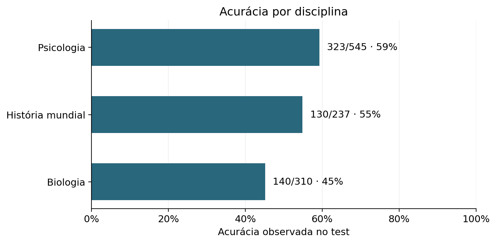
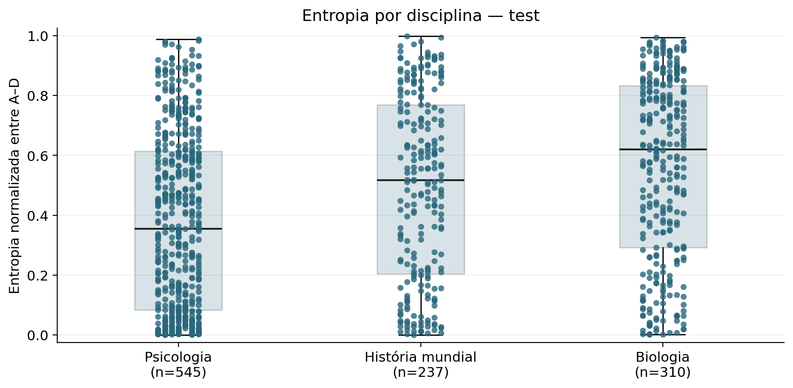
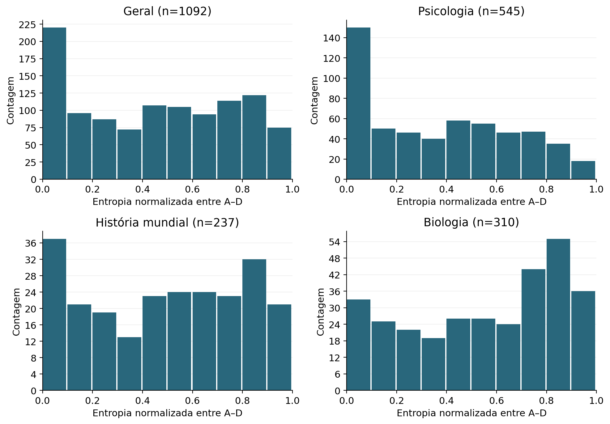
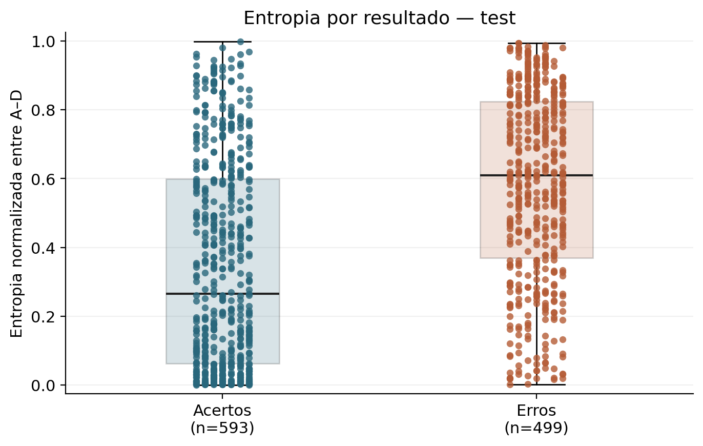
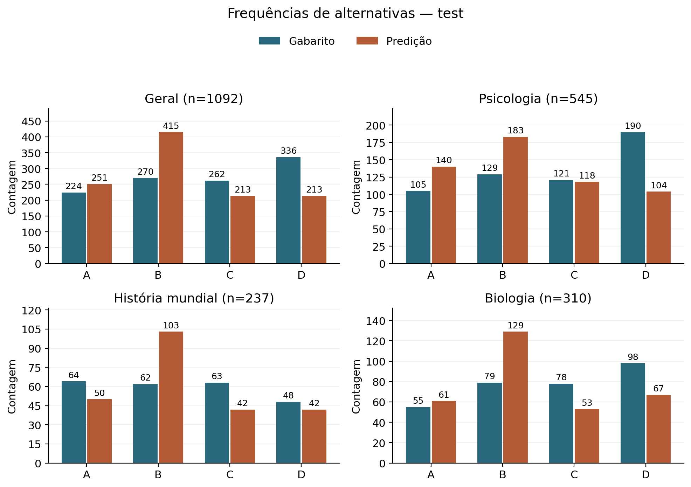

# Avaliação integral das três disciplinas MMLU

Data: 2026-11-09. **Avaliação integral concluída e aprovada tecnicamente pelo responsável. Fechamento em commit local autorizado; sem push ou merge.**

Nota editorial de fechamento: a aprovação e as seções complementares de empates,
frequências e conteúdos distintos foram acrescentadas após a validação independente.
O JSON de evidências e o gerador original preservam o estado histórico anterior
ao aceite. Regenerar o relatório-base não reproduz automaticamente este adendo
editorial; não sobrescrever o documento aprovado. Dados, predições, protocolo,
fórmulas, manifesto, run e gráficos não foram alterados.

## Delimitação e protocolo

Esta execução substitui a proposta de 1.000 questões pela totalidade dos test de Psicologia (545), História mundial (237) e Biologia (310): **1.092 índices originais**. Não é uma avaliação de todas as disciplinas do MMLU. Dev fica excluído; o piloto congelado de 60 questões e todos os relatórios anteriores foram preservados.

Dataset `cais/mmlu@c30699e8356da336a370243923dbaf21066bb9fe`; seleção `mmlu-full-test-v1`, sem amostragem, seed nula/não aplicável. Ordem: Psicologia, História mundial e Biologia, índices originais crescentes base zero. [Manifesto integral](MMLU_FULL_SELECTION_MANIFEST.json), SHA-256 `b3bb4c92c4745e69f191900a75d2a977e57b15a6da8dcba4805edc51045004da`.

Modelo `mlx-community/Qwen2.5-0.5B-Instruct-bf16@56d07e766edd7159fbe12ed12d9cf114bf38bf1e`. Backend MLX; prompt exato `current-no-enumeration-v1`, chat template padrão fixado, zero-shot, A–D sem espaços, `label_next_token`, batch 1, forward completo sem KV cache, logits em T−1 promovidos antes das funções matemáticas existentes. Limite 1.024 tokens, sem truncamento, exclusão, retentativa por desempenho ou ajuste do protocolo.

**Caminhos com e sem KV cache podem produzir logits diferentes em BF16.** Foi usado exclusivamente o caminho completo já aprovado.

## Preflight e integridade

| Disciplina | Registros test | Índices | Tokens mín.–máx. |
| --- | --- | --- | --- |
| Psicologia | 545 | 0–544 | 64–289 |
| História mundial | 237 | 0–236 | 165–788 |
| Biologia | 310 | 0–309 | 69–223 |

Hashes/tamanhos dos três Parquets, 1.092 IDs únicos, schema, quatro alternativas e gabaritos foram validados. Tokens contextuais A/B/C/D = 32/33/34/35 em todos os itens. Nenhuma entrada incompatível: máximo de 788 tokens. Os hashes de conteúdo, prompt e tokens dos 60 itens de sobreposição coincidem com 3A. Nenhum peso foi carregado no preflight.

Há **11 pares de questões com texto e alternativas duplicados em Psicologia**, sem conflito de gabarito. Foram mantidos os 22 índices originais; nenhuma deduplicação.

**Registros avaliados não equivalem a conteúdos distintos:** os 1.092 registros
correspondem a **1.081 conteúdos distintos**, definidos pela igualdade exata do
enunciado e das quatro alternativas na ordem original, sem normalização textual.
Psicologia tem 545 registros e 534 conteúdos distintos; História, 237/237;
Biologia, 310/310. Os 11 pares têm gabaritos concordantes. O denominador oficial
continua sendo 1.092 registros: não foi calculado um score deduplicado, nem
atribuída independência estatística aos itens repetidos.

 Não há alternativas repetidas dentro das questões test. A anomalia A/C de Biologia dev/2 permanece somente na evidência técnica anterior.

| Pares duplicados (Psicologia/test, índices originais) |
| --- |
| 14, 222 |
| 24, 423 |
| 43, 323 |
| 51, 68 |
| 71, 539 |
| 111, 425 |
| 135, 153 |
| 193, 298 |
| 198, 466 |
| 251, 505 |
| 380, 396 |

## Execução, cobertura e reprodução do piloto

Run `20261109T120102573628Z_d6b1d88132a14f129a8a1002dd34cf5a`, de `2026-11-09T12:01:02.573628+00:00` a `2026-11-09T12:04:05.992473+00:00`. Status `completed`; **1092/1092 registros válidos**, 0 falhas técnicas; erro de encerramento: `None`. A persistência final e os quatro arquivos foram conferidos. Uma única execução integral; nenhum novo dev ou rotação.

Tolerâncias fixadas **antes da inferência**: igualdade dos logits BF16 promovidos e das predições; diferença absoluta ≤ `1e-12`, relativa zero, para probabilidades condicionais/originais, massa e entropia. Esta é a tolerância dos contratos numéricos existentes, não um ajuste posterior aos resultados.

Comparação por ID dos **60 itens**: `True`. Conteúdo, prompt, tokenização, posição dos logits, método, predição e acerto conferidos. Diferenças máximas:

| Grandeza | Diferença absoluta máxima | Tolerância |
| --- | --- | --- |
| raw_scores | 0.000000 | 0.0 |
| probabilities | 0.000000 | 1e-12 |
| normalized_entropy | 0.000000 | 1e-12 |
| original_label_probabilities | 0.000000 | 1e-12 |
| original_label_probability_mass | 0.000000 | 1e-12 |

A auditoria interrompe a consolidação se encontrar divergência; todos os controles individuais estão no JSON. Esta repetição mede reprodutibilidade técnica dos mesmos itens, **não validação independente**.

## Método de análise

Agregações reutilizam `benchmark.analysis`, `metrics.summarize` e os schemas. Acurácia global = acertos/itens válidos; macro = média simples das três acurácias disciplinares, com pesos iguais. Falhas têm contagem e motivo explícitos, não entram no denominador válido. Macro fica indefinida se alguma disciplina não tiver itens válidos. Não há fórmula de eficiência informacional.

Entropia de Shannon normalizada é calculada sobre probabilidades **condicionadas a A–D**. Quartis usam interpolação inclusiva; desvio padrão é populacional descritivo. Histogramas mantêm todos os registros válidos, em dez intervalos de largura 0,1: [esquerda, direita), último incluindo 1. Erros concentrados usam o limiar descritivo anterior máx. p ≥ 0,90, sem alegação de calibração. Exemplos seguem a mesma regra simétrica de extremos por disciplina/acerto, com desempate por ID.

## Acurácia global, por disciplina e macro

| Grupo | Total | Válidas | Falhas | Acertos | Erros | Acurácia |
| --- | --- | --- | --- | --- | --- | --- |
| Geral | 1092 | 1092 | 0 | 593 | 499 | 593/1092 = 0.543040 |
| Psicologia | 545 | 545 | 0 | 323 | 222 | 323/545 = 0.592661 |
| História mundial | 237 | 237 | 0 | 130 | 107 | 130/237 = 0.548523 |
| Biologia | 310 | 310 | 0 | 140 | 170 | 140/310 = 0.451613 |

**Acurácia macro:** 0.530932; denominador: 3 disciplinas. A global pondera as disciplinas por seus números de questões válidas; a macro lhes dá peso igual.



## Entropia e distribuições

| Grupo | n | Média | DP | Mín. | Q1 | Mediana | Q3 | Máx. |
| --- | --- | --- | --- | --- | --- | --- | --- | --- |
| Geral | 1092 | 0.455315 | 0.309435 | 0.000747 | 0.157265 | 0.466801 | 0.733965 | 0.998594 |
| Psicologia | 545 | 0.380044 | 0.293604 | 0.000786 | 0.084092 | 0.354685 | 0.613923 | 0.987147 |
| História mundial | 237 | 0.491599 | 0.307131 | 0.000747 | 0.203794 | 0.517366 | 0.768399 | 0.998594 |
| Biologia | 310 | 0.559906 | 0.302840 | 0.001124 | 0.291760 | 0.620469 | 0.832370 | 0.993002 |



Caixas: Q1–Q3, mediana e hastes mínimo–máximo; todos os pontos são registros reais, com deslocamento horizontal determinístico. Nenhum outlier foi excluído.



Histogramas em contagens, com escalas por painel e todos os denominadores explícitos.

### Acertos e erros

| Grupo | Resultado | n | Média | Mediana | Mín. | Máx. |
| --- | --- | --- | --- | --- | --- | --- |
| Geral | Acertos | 593 | 0.347797 | 0.265561 | 0.000747 | 0.998594 |
| Geral | Erros | 499 | 0.583086 | 0.609729 | 0.002110 | 0.993727 |
| Psicologia | Acertos | 323 | 0.288531 | 0.188134 | 0.000786 | 0.924123 |
| Psicologia | Erros | 222 | 0.513191 | 0.531656 | 0.002110 | 0.987147 |
| História mundial | Acertos | 130 | 0.383370 | 0.359058 | 0.000747 | 0.998594 |
| História mundial | Erros | 107 | 0.623091 | 0.649276 | 0.033522 | 0.993727 |
| Biologia | Acertos | 140 | 0.451502 | 0.452641 | 0.001124 | 0.967990 |
| Biologia | Erros | 170 | 0.649180 | 0.729357 | 0.020263 | 0.993002 |



## Empates na pontuação e precisão BF16

Foram conferidas **33/1.092 questões (3,02%) com empate exato no maior logit**
entre A–D: 17 em Psicologia, 9 em História mundial e 7 em Biologia. São empates
nos valores persistidos, não aproximações por tolerância ou arredondamento de
exibição. Todos os 33 casos têm duas alternativas empatadas no máximo.

A regra já implementada e registrada em `ScoringResult.tie_break` é
**`lowest_index`**: escolher o menor índice entre as alternativas de probabilidade
máxima, seguindo A=0, B=1, C=2 e D=3. Logits iguais produzem probabilidades
condicionais iguais na normalização usada. O desempate é determinístico, sem
sorteio, consulta ao gabarito ou correção posterior. A regra não foi introduzida
neste fechamento e nenhuma predição foi recalculada.

| Rótulos empatados no máximo | Questões | Rótulo selecionado |
| --- | ---: | --- |
| A/B | 17 | A |
| A/D | 4 | A |
| B/C | 7 | B |
| B/D | 1 | B |
| C/D | 4 | C |
| **Total** | **33** | **A: 21; B: 8; C: 4; D: 0** |

A regra dá preferência à posição mais baixa **dentro do conjunto empatado** e,
por isso, pode influenciar as frequências agregadas de alternativas. Essa
contribuição operacional não permite atribuir causalmente a distribuição total
a viés de posição do modelo, nem explica isoladamente a frequência de B.

Os logits foram produzidos em **BF16**, cuja precisão finita pode fazer valores
próximos coincidirem. A promoção para float32 e floats Python antes da normalização
preserva os valores já calculados, mas **não recupera precisão perdida no forward**.
Não foi executado um controle em maior precisão; não se pode afirmar que todos
os 33 empates tenham sido causados exclusivamente pelo BF16. Uma investigação de
precisão ou posição deverá ser separada e não substituir este baseline aprovado.

IDs auditáveis dos 33 registros (sufixo após a revisão do dataset; logits completos
dos quatro rótulos no JSON de evidências e no arquivo original):

| Disciplina/test/índice | Rótulos empatados | Predição preservada |
| --- | --- | --- |
| `high_school_psychology/test/5` | B/C | B |
| `high_school_psychology/test/30` | B/C | B |
| `high_school_psychology/test/103` | A/B | A |
| `high_school_psychology/test/147` | B/C | B |
| `high_school_psychology/test/161` | A/B | A |
| `high_school_psychology/test/223` | A/B | A |
| `high_school_psychology/test/231` | B/D | B |
| `high_school_psychology/test/239` | C/D | C |
| `high_school_psychology/test/355` | A/B | A |
| `high_school_psychology/test/382` | A/B | A |
| `high_school_psychology/test/386` | C/D | C |
| `high_school_psychology/test/439` | A/B | A |
| `high_school_psychology/test/456` | A/B | A |
| `high_school_psychology/test/494` | A/D | A |
| `high_school_psychology/test/498` | A/B | A |
| `high_school_psychology/test/500` | A/B | A |
| `high_school_psychology/test/537` | A/D | A |
| `high_school_world_history/test/36` | B/C | B |
| `high_school_world_history/test/43` | A/B | A |
| `high_school_world_history/test/101` | A/B | A |
| `high_school_world_history/test/110` | B/C | B |
| `high_school_world_history/test/155` | B/C | B |
| `high_school_world_history/test/168` | A/B | A |
| `high_school_world_history/test/215` | C/D | C |
| `high_school_world_history/test/231` | A/B | A |
| `high_school_world_history/test/234` | C/D | C |
| `high_school_biology/test/13` | A/B | A |
| `high_school_biology/test/106` | A/D | A |
| `high_school_biology/test/193` | A/B | A |
| `high_school_biology/test/265` | A/B | A |
| `high_school_biology/test/268` | B/C | B |
| `high_school_biology/test/271` | A/B | A |
| `high_school_biology/test/274` | A/D | A |

## Frequências A–D

| Grupo | Série | Denominador | A | B | C | D |
| --- | --- | --- | --- | --- | --- | --- |
| Geral | Gabarito | 1092 | 224 | 270 | 262 | 336 |
| Geral | Predição | 1092 | 251 | 415 | 213 | 213 |
| Psicologia | Gabarito | 545 | 105 | 129 | 121 | 190 |
| Psicologia | Predição | 545 | 140 | 183 | 118 | 104 |
| História mundial | Gabarito | 237 | 64 | 62 | 63 | 48 |
| História mundial | Predição | 237 | 50 | 103 | 42 | 42 |
| Biologia | Gabarito | 310 | 55 | 79 | 78 | 98 |
| Biologia | Predição | 310 | 61 | 129 | 53 | 67 |



**B foi selecionada 415 vezes (38,00% dos 1.092 registros), contra 270 ocorrências
no gabarito (24,73%)**: diferença descritiva de 145 registros. O conteúdo das
questões, a distribuição dos gabaritos, as duplicações, os empates e a regra de
desempate coexistem nesta observação. Essas frequências não identificam causas
nem demonstram existência ou ausência de viés de posição. Não foram executadas
rotações controladas; a investigação de robustez A–D permanece uma proposta
separada, sem alterar estes resultados.

## Erros com alta concentração condicional

| Grupo | Erros com máx. p ≥ 0,90 | Total de erros | Fração |
| --- | --- | --- | --- |
| Geral | 90 | 499 | 0.180361 |
| Psicologia | 51 | 222 | 0.229730 |
| História mundial | 18 | 107 | 0.168224 |
| Biologia | 21 | 170 | 0.123529 |

Todos os IDs que atendem ao critério estão listados no JSON, sem seleção de casos favoráveis ou exclusão dos demais erros. A concentração entre rótulos não implica probabilidade de acerto ou calibração.

## Massa original dos quatro rótulos

| Grupo | n | Média | DP | Mín. | Q1 | Mediana | Q3 | Máx. |
| --- | --- | --- | --- | --- | --- | --- | --- | --- |
| Geral | 1092 | 0.996984 | 0.005366 | 0.939043 | 0.996882 | 0.998499 | 0.999289 | 0.999950 |
| Psicologia | 545 | 0.996851 | 0.005646 | 0.939043 | 0.996754 | 0.998505 | 0.999318 | 0.999934 |
| História mundial | 237 | 0.998051 | 0.003619 | 0.958717 | 0.997910 | 0.998925 | 0.999489 | 0.999950 |
| Biologia | 310 | 0.996402 | 0.005842 | 0.942119 | 0.996328 | 0.997994 | 0.998973 | 0.999902 |

Massa original = soma das probabilidades dos quatro rótulos no vocabulário antes de renormalizar. Alta massa e baixa entropia não garantem resposta correta. O vocabulário completo de logits não foi persistido.

## Comparação descritiva com o piloto de 60

| Grupo | Piloto: acertos/n | Piloto: acurácia | Integral: acertos/n | Integral: acurácia | H piloto | H integral |
| --- | --- | --- | --- | --- | --- | --- |
| Geral | 34/60 | 0.566667 | 593/1092 | 0.543040 | 0.478516 | 0.455315 |
| Psicologia | 12/20 | 0.600000 | 323/545 | 0.592661 | 0.387762 | 0.380044 |
| História mundial | 13/20 | 0.650000 | 130/237 | 0.548523 | 0.468024 | 0.491599 |
| Biologia | 9/20 | 0.450000 | 140/310 | 0.451613 | 0.579761 | 0.559906 |

Macro piloto: 0.566667; macro integral: 0.530932.

O piloto está inteiramente contido na população integral; seus 60 itens não são somados novamente aos 1.092. O piloto tinha 20 itens por disciplina; a expansão tem tamanhos diferentes. Comparações são descritivas, sem teste de independência ou alegação de confirmação das hipóteses do piloto.

## Exemplos auditáveis

| ID (disciplina/test/índice) | Regra | Gabarito → predição | p(A), p(B), p(C), p(D) | H |
| --- | --- | --- | --- | --- |
| high_school_psychology/test/197 | min_entropy | A → A | 0.999899, 0.000075, 0.000024, 0.000001 | 0.000786 |
| high_school_psychology/test/429 | max_entropy | C → C | 0.077357, 0.305952, 0.346689, 0.270002 | 0.924123 |
| high_school_psychology/test/453 | min_entropy | C → A | 0.999703, 0.000203, 0.000085, 0.000009 | 0.002110 |
| high_school_psychology/test/419 | max_entropy | B → C | 0.197398, 0.223682, 0.325455, 0.253465 | 0.987147 |
| high_school_world_history/test/30 | min_entropy | C → C | 0.000024, 0.000031, 0.999909, 0.000035 | 0.000747 |
| high_school_world_history/test/155 | max_entropy | B → B | 0.234395, 0.265605, 0.265605, 0.234395 | 0.998594 |
| high_school_world_history/test/145 | min_entropy | C → D | 0.002790, 0.001026, 0.002790, 0.993393 | 0.033522 |
| high_school_world_history/test/97 | max_entropy | D → A | 0.289663, 0.255627, 0.199083, 0.255627 | 0.993727 |
| high_school_biology/test/92 | min_entropy | C → C | 0.000051, 0.000045, 0.999858, 0.000045 | 0.001124 |
| high_school_biology/test/234 | max_entropy | B → B | 0.253009, 0.324869, 0.286696, 0.135426 | 0.967990 |
| high_school_biology/test/83 | min_entropy | C → B | 0.002469, 0.996206, 0.001029, 0.000295 | 0.020263 |
| high_school_biology/test/191 | max_entropy | B → C | 0.263543, 0.205248, 0.298633, 0.232576 | 0.993002 |

Os exemplos são extremos simétricos de acertos e erros, não uma amostra representativa. Todos os 1.092 registros, incluindo enunciados, distribuições e escores, estão preservados nas evidências/arquivo do run.

## Recursos, ambiente e testes

Python 3.12.2, macOS 15.7.4, Apple M2/8 GiB. Versões MLX/Metal 0.32.4, MLX-LM 0.32.2, Transformers 5.22.1, Tokenizers 0.23.3, PyArrow 26.0.1. O ambiente temporário anterior havia sido removido; reutilizado o ambiente local, restaurando apenas PyArrow 26.0.1 (wheel de 37,3 MB). Dataset/tokenizer/pesos locais reutilizados e conferidos por hash; nenhum novo download desses artefatos.

Pico alocador MLX: **1644228480 bytes**; ativos após close: 8 bytes. Cache do alocador de 256 MiB, distinto de KV cache. Medições antes/depois, swap global e `/usr/bin/time -l` estão no JSON; não somar RSS, footprint e pico MLX nem atribuir todo o swap ao benchmark.

| Medida | Valor |
| --- | --- |
| Processo completo (s) | 183.72 |
| RSS máximo (bytes) | 493617152 |
| Peak memory footprint (bytes) | 1900417152 |
| Disco livre antes (bytes) | 24122220544 |
| Disco livre depois (bytes) | 24095784960 |

O tempo inclui inicialização, hashing, carga, processamento e persistência; não é latência pura do modelo.

Testes antes da inferência: **126, OK, 1,166 s**. Verificação final: **128 testes, OK, 1.12 s**. Novas regressões cobrem contagens integrais, seed nula, índices completos, preflight bloqueado, separação de seleções, macro/denominadores, integração offline e comparação com o piloto; regressões anteriores preservadas.

Auditoria independente Decimal (70 dígitos) nos 1.092 registros: erro absoluto máximo 1.1102230246251565e-16 no softmax e 1.1709383462843448e-16 na entropia. Descritivas, quartis, histogramas, frequências e macro conferidos independentemente com NumPy/Counter nos quatro grupos. Hashes dos artefatos anteriores do piloto e dos fontes executados conferidos.

## Observações, interpretações preliminares e limitações

**Observado:** 593/1092 acertos, entropia média 0.455315. Acertos: 0.347797; erros: 0.583086. 90 erros têm máx. p ≥ 0,90.

**Interpretação preliminar:** acerto e concentração devem ser tratados separadamente. As descritivas não estabelecem relação causal, calibração ou uma regra universal de correção de respostas.

- Três disciplinas, um modelo/snapshot e um único protocolo: não representam todo o MMLU nem permitem inferir capacidades cognitivas do CHC.
- As 1.092 linhas cobrem integralmente os test dessas disciplinas na revisão fixada; duplicatas originais permanecem e limitam interpretações de independência entre itens.
- Não foram examinados contaminação de treinamento, significância estatística, calibração ou robustez a reformulações/rotações.
- A repetição dos 60 itens é controle técnico; a expansão sobreposta não é confirmação independente de hipóteses exploratórias.
- Resultados test não foram usados para otimizar o protocolo. Qualquer ajuste futuro inspirado nestes resultados exige nova validação independente.
- O forward completo pode divergir do caminho com cache em BF16; a repetição observada não garante invariância em outras plataformas/versões.
- Persistência com publicação final de metadados não garante recuperação após queda de energia. O arquivo auditável preserva os bytes produzidos, não elimina essa limitação operacional.

## Artefatos e reprodução

Run original: `outputs/mmlu-full-test/20261109T120102573628Z_d6b1d88132a14f129a8a1002dd34cf5a` (ignorado pelo Git, preservado localmente). [Arquivo completo auditável](mmlu_full/run.tar.gz), SHA-256 `a8267b3d6544e2015279d3eeae2b3ffd703da380de5f3fd08acac8c23f1094b4`. Contém exatamente os quatro arquivos originais, com hashes individuais no [JSON de evidências](MMLU_FULL_EVIDENCE.json). A extração permite restaurar a pasta esperada de resultados sem executar a LLM.

Código-base `e581438504233a584370f82c9f7f32e0abfd002b`, dirty=True; hashes dos fontes da execução e da análise constam nos metadados/JSON. Nenhum commit desta expansão foi criado antes da revisão.

```sh
HF_HUB_OFFLINE=1 PYTHONPATH=src:. .cache/mlx-diagnostic/venv/bin/python -m diagnostics.mmlu_full_preflight \
  --snapshot <snapshot-local-do-dataset-fixado> --tokenizer-snapshot <snapshot-local-do-modelo-fixado> \
  --output outputs/<nova-pasta-de-preflight>
# Apenas após conferir o preflight; isto cria NOVO run, não regenera a análise:
HF_HUB_OFFLINE=1 PYTHONPATH=src .cache/mlx-diagnostic/venv/bin/python -m benchmark.cli --config configs/mmlu_full_test.yaml
# Auditoria/análise sem inferência:
HF_HUB_OFFLINE=1 PYTHONPATH=src:. .cache/mlx-diagnostic/venv/bin/python -m diagnostics.mmlu_full_validation \
  --run outputs/mmlu-full-test/20261109T120102573628Z_d6b1d88132a14f129a8a1002dd34cf5a --output outputs/<nova-auditoria>.json
PYTHONPATH=src:. .venv/bin/python -m diagnostics.mmlu_full_report \
  --audit outputs/<nova-auditoria>.json --resources outputs/mmlu-full-resource \
  --output outputs/<novo-relatorio> --date 2026-11-09
```

O preflight inclui versões/espaço livre; a seleção semântica é identificada por seu hash e seus índices, e o Runner exige o manifesto original fixado. A auditoria depende dos Parquets e artefatos do piloto locais; o relatório utiliza somente o JSON auditado e os recursos persistidos.

## Aceite técnico e fechamento

O responsável aprovou explicitamente a avaliação integral com base neste relatório,
no JSON de evidências e no manifesto. A conferência independente confirmou 1.092
válidas, 593 acertos, acurácia 54,304%, entropia média 0,455315 e reprodução exata
dos 60 itens anteriores. O diff da expansão foi revisado e a suíte foi reexecutada:
**128 testes, OK, 1,131 s**, incluindo a regra de desempate e as regressões anteriores.

Manifesto, JSON de evidências, quatro artefatos originais, arquivo `run.tar.gz` e
cinco PNGs conferidos por SHA-256 e preservados byte a byte; o conteúdo do arquivo
compactado também coincide com os quatro arquivos do Runner. Código experimental,
configuração e fórmulas permanecem iguais aos hashes da execução aprovada. O JSON
mantém seu status histórico de revisão pendente; o aceite posterior fica registrado
neste adendo e no roadmap, sem reescrever as evidências.

**Próximo passo:** encerrar em commit local e submeter uma proposta de comparação
com modelo maior, mantendo o protocolo nas mesmas 1.092 questões. A robustez às
posições A–D deverá ter delineamento e execução separados. Nenhum outro modelo
foi iniciado; push e merge não autorizados.
