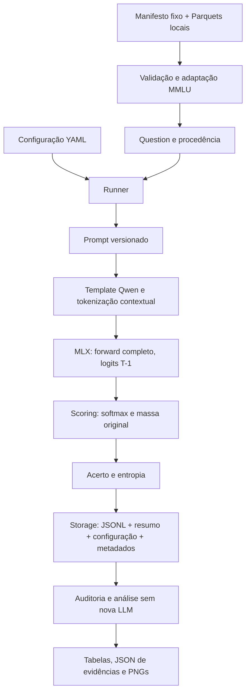
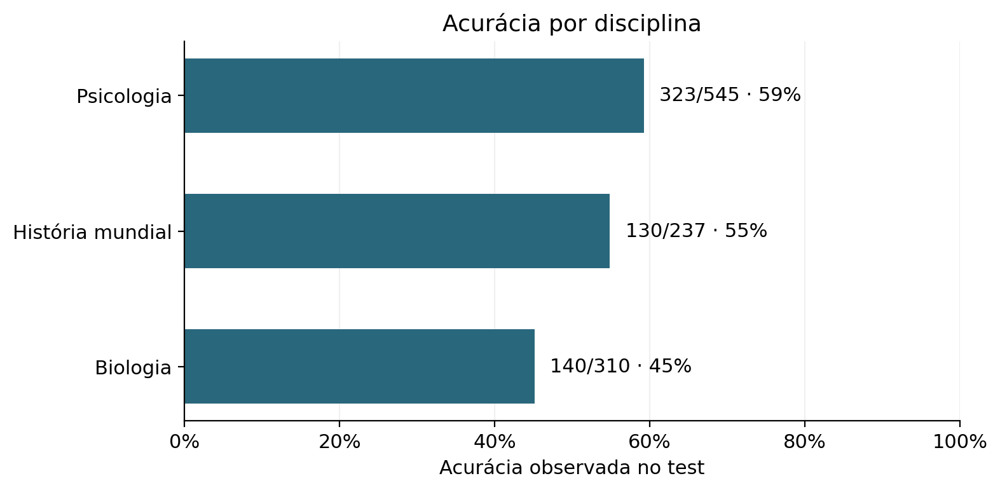
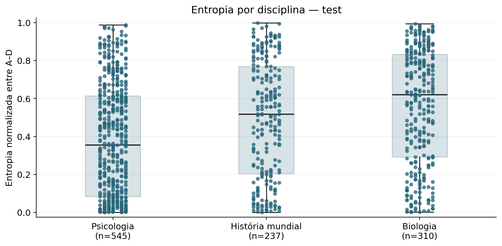
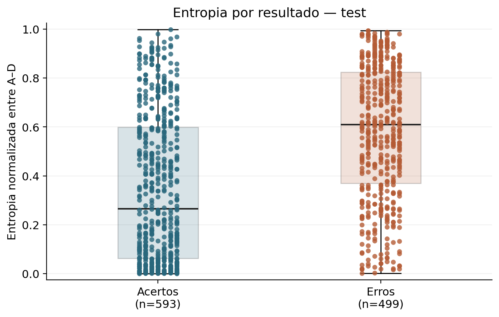
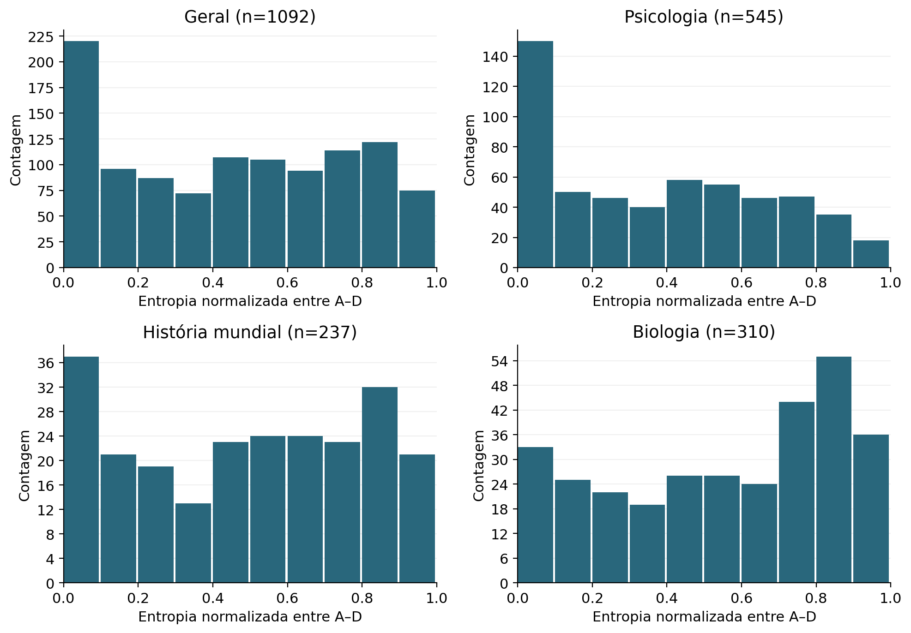
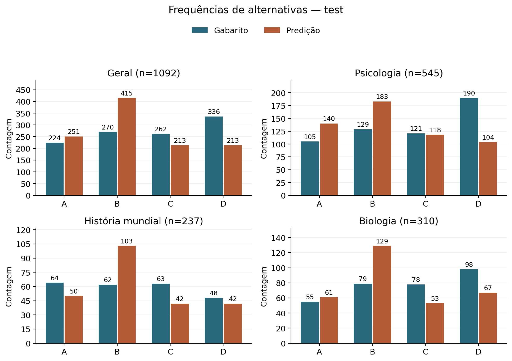

# TCC II — Consolidação técnico-científica experimental do LLM Benchmark V1

**Data da consolidação:** 2026-11-09. **Escopo:** V1 encerrada; documento de referência para redação, não capítulo de monografia, manual de instalação ou plano de implementação da V2.

**Base de código consultada:** commit `d1d983e8acc50fd9823e05b120cb2287d7dccbb1`, fechamento local da avaliação integral. A consolidação não modifica esse código, o protocolo, os dados ou os resultados. Não houve nova inferência, geração de respostas, download de modelo ou experimento. Houve leitura de fontes, conferência dos artefatos existentes, recálculo para auditoria e reexecução da suíte offline.

**Convenção de evidência:** “observado” identifica valores nos registros ou verificações realizadas; “decisão” identifica opções metodológicas aprovadas; “interpretação” designa uma leitura descritiva limitada; “hipótese/proposta” não designa um resultado demonstrado. As tabelas numéricas usam ponto decimal para corresponder ao JSON, preservando a representação dos floats armazenados; percentuais apresentados com menos casas são explicitamente aproximações. Contagens e denominadores são inteiros exatos. Um float persistido não deve ser confundido com um número real conhecido com precisão infinita.

## 1. Visão geral

### 1.1 Objetivo da V1 e contribuição ao TCC II

A V1 implementou e validou um benchmark local, modular e auditável para relacionar **desempenho em questões de múltipla escolha** e **dispersão das probabilidades condicionadas às alternativas**. O desenvolvimento avançou de escores simulados até um run real com o Qwen2.5-0.5B-Instruct-bf16 em 1.092 registros test de três disciplinas do MMLU. O produto do TCC II é, portanto, uma infraestrutura experimental verificada e um conjunto de resultados exploratórios rastreáveis; não uma teoria de inteligência nem um índice de eficiência informacional.

A avaliação integral obteve **593 acertos em 1.092 registros válidos**, 499 respostas incorretas e nenhuma falha técnica. A acurácia global foi `0.543040293040293` (aproximadamente 54,304%); a macro entre disciplinas, `0.5309322201451923`; a entropia normalizada média, `0.4553146632905629`. Esses valores serão discriminados por disciplina e por resultado na seção 7, com origem direta nos artefatos.

### 1.2 Escopo efetivamente implementado

O sistema inclui schemas tipados e validados, configuração YAML estrita, fixtures autorais, adaptador MMLU, prompts versionados, backend simulado, backend MLX local, pontuação de próximo token, funções de acurácia/entropia, Runner sequencial, persistência por execução, auditorias e relatórios gráficos. Não implementa backend Transformers, APIs remotas, pontuação de sequências, comparação entre modelos, avaliação psicométrica CHC ou métrica composta de eficiência. Transformers participa apenas como biblioteca de tokenização/configuração no ambiente MLX.

Perguntas de pesquisa operacionalmente exploradas: (a) é possível obter e persistir de modo coerente a distribuição dos rótulos A–D? (b) como a entropia dessa distribuição se apresenta em acertos e erros do modelo fixado? (c) quais frequências de respostas e erros concentrados aparecem nas três disciplinas? (d) o resultado de itens idênticos se repete sob o mesmo protocolo? A V1 oferece evidências técnicas e descritivas para essas perguntas, sem estimar causas internas do modelo.

### 1.3 Desempenho, incerteza e inteligência

**Desempenho** é a proporção de escolhas que coincidem com o gabarito sob um prompt e método de pontuação definidos. **Incerteza operacional**, neste trabalho, é a dispersão entre quatro probabilidades de tokens renormalizadas; não é um estado mental nem uma probabilidade calibrada de erro. **Inteligência** é um construto mais amplo que não foi operacionalizado ou validado psicometricamente na V1. A referência exploratória ao modelo Cattell–Horn–Carroll (CHC), registrada em README e arquitetura, não autoriza mapear automaticamente disciplinas escolares a capacidades cognitivas ou comparar “inteligências” por suas acurácias.

### 1.4 Hierarquia de fontes e estado documental

Para resultados, a referência primária é o conteúdo dos quatro arquivos do run, confrontado com seus hashes, manifesto e JSON de evidências. Código e configuração definem as operações efetivamente executadas; relatórios documentam decisões e contexto. Textos históricos que dizem “aguardando aprovação” conservam o estado de sua data e não invalidam um aceite posterior registrado no roadmap. A aprovação integral e seu adendo estão em `MMLU_FULL_EVALUATION.md`; o JSON aprovado foi preservado, inclusive seu status histórico anterior ao aceite.

`V1` é a denominação do ciclo encerrado pelo responsável. O pacote em `pyproject.toml` continua `0.1.0`; nenhuma tag Git local foi encontrada nesta consulta. Isso não deve ser apresentado como uma release de pacote `1.0.0`. O README e a arquitetura contêm árvores “previstas” e exemplos históricos: os módulos reais são os identificados na seção 3.

**Tabela 1 — Fontes internas e finalidade.**

| Grupo | Arquivos | Uso |
| --- | --- | --- |
| Normas e escopo | `AGENTS.md`, `README.md`, `docs/ARCHITECTURE.md`, `docs/ROADMAP.md` | Autorização, restrições e decisões; confrontados com o código |
| Fundação | `docs/reports/VALIDATION_DELIVERY_1.md`; `docs/VALIDATION_DELIVERY_1_FINAL.md` | Revisão, F1/F2/F3, 31 → 54 testes e simulações |
| Diagnósticos MLX | `MLX_DIAGNOSTIC.md`; `MLX_BEHAVIOR_VALIDATION.md`; `MLX_BEHAVIOR_EVIDENCE.json` | Tokenização, posição, geração, comportamento e controles |
| Prompts | `PROMPT_COMPARISON.md`; `PROMPT_COMPARISON_EVIDENCE.json` | 48 condições e adaptações explícitas de frameworks |
| Integração | `VALIDATION_DELIVERY_2B.md`; `VALIDATION_DELIVERY_2B_EVIDENCE.json` | Runner real, contratos e 16 apresentações controladas |
| Seleção MMLU | `MMLU_DATASET_VALIDATION.md`; `MMLU_SELECTION_MANIFEST.json`; `configs/mmlu_selection.json` | Revisão fixa, dev/test e seleção de 75 itens |
| Piloto/análise | `MMLU_PILOT_VALIDATION.md`; `MMLU_PILOT_EVIDENCE.json`; `MMLU_EXPLORATORY_ANALYSIS.md`; `MMLU_EXPLORATORY_EVIDENCE.json` | 15 dev técnicos; 60 test; análise posterior sem inferência |
| Integral | `MMLU_FULL_EVALUATION.md`; `MMLU_FULL_EVIDENCE.json`; `MMLU_FULL_SELECTION_MANIFEST.json`; `mmlu_full/run.tar.gz` | 1.092 registros, auditorias, figuras, aceite e empates |
| Documentos opcionais ausentes | `V1_FINAL_VALIDATION.md`; `V1_TEST_EVIDENCE.md` | Não encontrados no checkout; não utilizados como evidência presumida |

Fonte interna: inventário do checkout; arquivos sem prefixo neste quadro estão em `docs/reports/`.

## 2. Fundamentos operacionais

### 2.1 Unidade de avaliação e evento pontuado

Cada registro contém um enunciado, quatro alternativas na ordem original, disciplina e gabarito inteiro `0..3`. O prompt identifica as posições por A, B, C e D. O modelo não recebe o gabarito. Não se pontua o texto completo das alternativas como continuação: pontua-se a probabilidade de o **próximo token do assistente** ser um dos quatro rótulos. Isso depende de o contexto induzir o mapeamento adequado entre conteúdo e letra.

Seja $x_q$ a sequência tokenizada do prompt da questão $q$, com $T_q$ tokens. O forward retorna um tensor de logits de forma $[1,T_q,V]$; no modelo fixado, $V=151936$. O vetor relevante é $z_{q,v}=L[0,T_q-1,v]$. Os índices contextuais dos quatro rótulos são $t_A=32,t_B=33,t_C=34,t_D=35$. Os rótulos são anexados apenas para verificar fronteiras de tokenização; não são inseridos no forward principal.

### 2.2 Probabilidades originais, massa dos rótulos e probabilidades condicionais

A implementação promove os logits BF16 para float32, materializa o vetor e converte os elementos para floats Python antes da normalização. O softmax usa subtração do máximo e `math.fsum`, para estabilidade numérica, sem temperatura ajustável, penalidade, máscara ou correção baseada no gabarito.

A probabilidade original no vocabulário é:

$$
P_q(v)=\frac{\exp(z_{q,v}-M_q)}{\sum_{u=0}^{V-1}\exp(z_{q,u}-M_q)},\qquad M_q=\max_u z_{q,u}.
$$

A massa original dos rótulos válidos é:

$$
m_q=\sum_{k\in\{A,B,C,D\}}P_q(t_k).
$$

As probabilidades usadas para a escolha e a entropia são:

$$
p_{q,k}=\frac{\exp(z_{q,t_k}-b_q)}{\sum_{j\in\{A,B,C,D\}}\exp(z_{q,t_j}-b_q)}
=\frac{P_q(t_k)}{m_q},\qquad b_q=\max_j z_{q,t_j},\quad m_q>0.
$$

A identidade é matemática; os contratos verificam compatibilidade em ponto flutuante. O scoring calcula diretamente o softmax dos quatro escores e, separadamente, o softmax do vocabulário para obter $m_q$ e as probabilidades originais. Logo, a massa não é a soma trivial das probabilidades condicionais (que vale 1). A normalização restrita pode aparentar forte concentração mesmo quando o modelo atribui pouca massa aos rótulos; o diagnóstico sem cabeçalho de geração demonstrou esse risco.

**Fontes de implementação:** `src/benchmark/backends/mlx.py::next_token_logits`, `src/benchmark/scoring/__init__.py::score_choices`, `src/benchmark/numerics.py::softmax` e `src/benchmark/schemas.py::ScoringResult`. O run persiste `raw_scores`, `probabilities`, `original_label_probabilities` e `original_label_probability_mass`.

### 2.3 Predição, desempate, acerto e cobertura

Associando A, B, C e D aos índices $k\in\{0,1,2,3\}$ nessa ordem, a escolha é:

$$
\hat y_q=\min\{k:p_{q,k}=\max_j p_{q,j}\},\qquad c_q=\mathbf{1}[\hat y_q=y_q].
$$

A regra `lowest_index` seleciona a primeira alternativa entre máximos empatados. O código usa `max(range(len(probabilities)), key=probabilities.__getitem__)`, que preserva o primeiro índice em empates. Não há tolerância de “quase empate” no argmax. Os 33 empates exatos nos maiores logits observados na avaliação integral são discriminados na seção 7.

Se $\mathcal V$ é o conjunto de registros tecnicamente válidos, a acurácia global é:

$$
\operatorname{Acc}=\frac{\sum_{q\in\mathcal V}c_q}{|\mathcal V|}.
$$

Acurácia por disciplina usa o mesmo quociente no respectivo subconjunto. A macro entre três disciplinas é:

$$
\operatorname{Acc}_{macro}=\frac{1}{3}\sum_{s=1}^{3}\operatorname{Acc}_s.
$$

A global pondera as disciplinas pelo número de registros válidos; a macro lhes atribui pesos iguais. `analysis.macro_accuracy` retorna valor indefinido se uma disciplina não tiver válidos, sem omiti-la silenciosamente. `summarize` retorna acurácia/entropia média nulas para zero válidos. Falha técnica não vira acerto falso nem zero de entropia; os campos de métricas ficam nulos e há motivo explícito. Neste run, cobertura = 1.092/1.092, falhas = 0 e erros legítimos de resposta = 499.

### 2.4 Entropia de Shannon normalizada

A entropia é calculada exclusivamente sobre $p_q=(p_{q,A},p_{q,B},p_{q,C},p_{q,D})$:

$$
H_q=-\sum_{k\in\{A,B,C,D\}}p_{q,k}\log_2 p_{q,k},\qquad
h_q=\frac{H_q}{\log_2(4)}=-\frac{1}{2}\sum_{k\in\{A,B,C,D\}}p_{q,k}\log_2 p_{q,k}.
$$

Usa-se $0\log_2 0=0$, implementado omitindo os termos nulos. $H_q\in[0,2]$ bits; $h_q\in[0,1]$ é uma medida normalizada adimensional. Distribuição uniforme produz 1; determinística, 0. A implementação geral admite $K\ge2$, divide por $\log_2 K$, valida probabilidades finitas/não negativas e soma 1 com tolerância absoluta `1e-12`; limita o resultado a [0,1] apenas contra arredondamento após a validação.

A média reportada é:

$$
\bar h=\frac{1}{|\mathcal V|}\sum_{q\in\mathcal V}h_q.
$$

As médias de acertos/erros usam denominadores próprios, 593 e 499 na avaliação integral. **Não se calcula a entropia das frequências agregadas de A–D para substituir essa média.** A fórmula não consulta o gabarito; a relação com correção surge somente na análise posterior.

Fontes: `numerics.normalized_entropy`, reexportada por `metrics.py`; `metrics.accuracy`, `metrics.summarize`; validação cruzada em `EvaluationRecord`; agregação por resultado em `analysis.py`.

### 2.5 Limites de interpretação das medidas

Probabilidade de um token condicionado ao prompt não é probabilidade calibrada de a resposta estar correta. Entropia baixa significa concentração entre os rótulos considerados, podendo concentrar a alternativa errada. Entropia alta tampouco garante erro. A massa original informa quanto do vocabulário foi atribuído ao conjunto de rótulos, não a verdade do conteúdo. Não foram calculadas calibração, decomposição epistemológica/aleatória da incerteza, eficiência informacional, informação mútua ou capacidades CHC. A acurácia é uma medida de correspondência com os gabaritos deste dataset e protocolo, não uma avaliação independente de raciocínio interno.

## 3. Arquitetura do benchmark

### 3.1 Tecnologias e delimitação de dependências

O núcleo é Python, com dataclasses, `unittest`, JSON/JSONL, `pathlib`, `math`, `statistics` e PyYAML. `pyproject.toml` declara Python ≥3.11 e PyYAML como dependência básica. As bibliotecas de inferência, leitura de Parquet e gráficos ficam em requisitos opcionais de `diagnostics/`. Imports MLX são tardios, permitindo testes e simulação sem Metal. Isso foi verificado por testes de ausência de import do runtime.

**Tabela 2 — Ambiente observado na avaliação integral.**

| Componente | Versão/condição |
| --- | --- |
| Máquina/SO | Apple M2, Mac14,2, 8.589.934.592 bytes (8 GiB); macOS 15.7.4 arm64 |
| Python | 3.12.2 |
| mlx | 0.32.4 |
| mlx-metal | 0.32.4 |
| mlx-lm | 0.32.2 |
| transformers | 5.22.1 |
| tokenizers | 0.23.3 |
| huggingface-hub | 2.4.0 |
| numpy | 2.5.4 |
| safetensors | 0.8.0 |
| PyArrow | 26.0.1 |
| Matplotlib / NumPy / Pillow da análise | 3.9.1.post1 / 1.26.4 / 10.4.0 |

Fonte interna: `MMLU_FULL_EVIDENCE.json`: `metadata.environment`, `metadata.model.dependencies`, `resources.before`, `plotting_versions`; requisitos em `diagnostics/*requirements.txt`.

NumPy 2.5.4 pertence ao runtime MLX; NumPy 1.26.4 pertence ao ambiente de gráficos. Não são duas versões simultâneas no mesmo ambiente. A presença de Transformers não implica uso de PyTorch para inferência. O arquivo de requisitos registra dependências instaladas na ocasião; não foi realizado um novo teste de instalação limpa nesta consolidação.

**Tabela 3 — Módulos reais e responsabilidades.**

| Componente | Implementação | Responsabilidade e limite |
| --- | --- | --- |
| Contratos | `src/benchmark/schemas.py` | Question, TokenizationEvidence, NextTokenOutput, ScoringResult, EvaluationRecord e RunMetadata; invariantes e validação cruzada |
| Configuração | `config.py` | YAML estrito, campos únicos, versões e seleções autorizadas, paths locais; rejeita deriva de protocolo |
| Dados sintéticos | `datasets.py` | Fixtures autorais para fluxo simulado e testes controlados |
| MMLU | `mmlu.py`; `mmlu_selection.py` | Schema original → Question, IDs/índices/hashes, fontes locais e manifestos fixos; não conhece logits |
| Prompt | `prompts.py` | Enunciado/opções e instrução exata; não contém gabarito |
| Backend | `backends/base.py`; `simulated.py`; `mlx.py` | Ciclo de vida, template/tokenização e logits; sem métricas/gabaritos |
| Scoring | `scoring/__init__.py`; `scoring/normalization.py`; `numerics.py` | Extrai candidatos, normaliza probabilidades e identifica método/unidade |
| Métricas | `metrics.py`; `numerics.py` | Acurácia, argmax e entropia; funções compartilhadas com schemas |
| Orquestração | `runner.py`; `cli.py` | Sequência, carga única, falhas por item, close e chamada à persistência |
| Persistência/leitura | `storage.py`; `results.py` | Quatro arquivos por run, conclusão por metadados finais, leitura e verificação de hashes |
| Análise | `analysis.py`; `analysis_report.py` | Agregações descritivas, separação dev/test e projeção dos valores em gráficos |
| Diagnósticos e auditoria | `diagnostics/mlx_labels.py`, `mlx_behavior.py`, `prompt_comparison.py`, `mmlu_dataset.py`, `mmlu_pilot_validation.py`, `mmlu_full_*.py` | Pré-validação, auditoria de resultados e relatórios sem inserir lógica no backend |

Fonte interna: inspeção dos fontes em `src/benchmark/` e `diagnostics/`; paths abreviados após a primeira linha pertencem a `src/benchmark/`.

### 3.2 Fluxo efetivo dos dados



O carregador verifica seleção e fontes antes de carregar o modelo. O Runner compara o prompt com o hash congelado antes do scoring e compara os tokens retornados com o preflight depois dele. O backend valida a fronteira de cada candidato em cada questão. Um erro de resposta mantém o registro válido; uma exceção de processamento gera registro de falha, sem repetir até acertar.

### 3.3 Persistência e rastreabilidade

`save_run` valida e serializa o conjunto antes de criar uma pasta exclusiva. Grava `config.yaml`, `results.jsonl`, `summary.json` e `metadata.json.tmp`, com flush/fsync; publica `metadata.json` por renomeação somente após fechar os arquivos. A presença dos metadados finais é a convenção de persistência concluída, mas o campo `status` ainda pode indicar erros. Exceções ordinárias em `backend.close()` são registradas e não descartam os resultados já produzidos; erros secundários são anexados sem ocultar causas primárias. Não existe promessa de recuperação após queda de energia ou retomada automática de uma execução interrompida.

A rastreabilidade inclui identidade do dataset/modelo, revisão, hashes das fontes, índice original e de execução, seleção, prompt final, evidência de tokens, logits A–D, duas famílias de probabilidades, massa original, predição, gabarito, acerto, entropia, erros e horários. O vocabulário completo de logits é transitório no Runner. A identidade do código usa commit-base, `dirty` e hashes dos arquivos Python; não se presume que um commit-base anterior sozinho contenha o checkout executado.

### 3.4 Extensibilidade efetiva

As responsabilidades estão separadas, mas a V1 não é um sistema genérico de plugins: o backend MLX fixa um modelo/revisão e manifesta seus arquivos; a configuração restringe templates, datasets e seleções aceitos. Adicionar outro modelo exige revisão explícita desses limites, testes e preflight, não apenas trocar uma string em YAML. Essa restrição protege o protocolo validado. `analysis.py` distingue `mmlu-3a-v1` de `mmlu-full-test-v1` e recusa entradas dev/mistas; não mistura automaticamente bases experimentais.

## 4. Histórico de desenvolvimento e decisões

### 4.1 Fundação, simulação e correções de integridade

Em 2026-10-20 a revisão inicial encontrou 31 testes passando e um fluxo simulado completo. A fixture tem três questões autorais, com 2, 3 e 4 alternativas. O backend atribui `score[i] = float(i)`, sem consultar texto ou gabarito. Os resultados 2/3 e entropia média `0.7603746960459724` são controles de software, não desempenho de uma LLM.

Foram identificados F1 (finalização antes de persistência íntegra), F2 (erro no close poderia impedir a preservação de resultados) e F3 (contratos aceitavam inconsistências semânticas). As correções introduziram publicação final dos metadados, preservação/registro de erros secundários e validação cruzada de escores, probabilidades, entropia e status. A suíte passou a 54 testes. A revalidação da fundação e o aceite posterior estão documentados em `docs/VALIDATION_DELIVERY_1_FINAL.md` e no roadmap; o aceite ocorreu em 2026-11-06.

### 4.2 Diagnóstico inicial do MLX-LM

Em 2026-11-06 o diagnóstico isolado carregou o snapshot fixado, obteve `OK` na inferência simples e verificou 8 contextos × 20 candidatos, 160 combinações por rodada. Seis contextos permitiram pontuar A–D; dois foram recusados por fronteira incompatível. A/B/C/D isolados e contextuais receberam IDs 32–35 no chat aprovado; variantes com espaço receberam 362/425/356/422 e não são aliases. Quebras adicionais e espaço no final do prompt podem retokenizar a fronteira. O controle sem cabeçalho de geração não coloca o modelo na mesma posição de resposta.

A saída `[1,T,151936]` foi inspecionada em `T−1` e contrastada com `T−2`. Cache manual e logits capturados da API coincidiram, mas a passagem completa e a passagem com cache diferiram numericamente. Exponenciar diretamente logprobs BF16 da geração produziu somas que não eram 1. **Decisão posterior:** usar logits brutos promovidos e fixar o forward completo sem cache, em vez de misturar caminhos. A conversão de precisão não reverte arredondamentos já ocorridos.

No primeiro diagnóstico, `What is 2 + 2?` produziu A nas quatro rotações, mesmo quando o gabarito mudou. Isso motivou investigação antes de incorporar o método ao benchmark. Fonte: `MLX_DIAGNOSTIC.md`; JSON local `outputs/mlx-diagnostic-2a/run-02/diagnostic.json`, conferido como disponível nesta consolidação.

### 4.3 Investigação de preferência por alternativas

Foram usadas quatro perguntas autorais (soma, capital da França, dias da semana e antônimo de hot), quatro rotações cíclicas e quatro instruções: 64 condições, além de oito controles. Cada grupo de 16 contém quatro perguntas reapresentadas, não 16 questões independentes. Rotações cíclicas não correspondem às 24 permutações possíveis.

**Tabela 4 — Investigação comportamental: contagens reconferidas.**

| Instrução | Condições | Acertos por scoring | Seleções A |
| --- | --- | --- | --- |
| original | 16 | 6/16 | 13/16 |
| reverse-enumeration | 16 | 4/16 | 16/16 |
| no-enumeration | 16 | 13/16 | 7/16 |
| semantic | 16 | 14/16 | 5/16 |

Fonte interna: `MLX_BEHAVIOR_EVIDENCE.json`, `cases[].variant`, `scored_label`, `correct_label`; descrição em `MLX_BEHAVIOR_VALIDATION.md`.

Nos 64 casos, o vencedor A–D coincidiu com o primeiro token da geração; não foi encontrada troca de índices nos controles. Remover a enumeração final melhorou três perguntas, mas não a soma. A instrução semântica teve 14/16 vencedores corretos, porém nove gerações fora do formato estrito e somente 6/16 respostas completas estritamente corretas, conforme o relatório e os textos em `cases[].generated`. Conhecer uma resposta em geração aberta não garantiu mapeá-la corretamente à letra. Esses achados sustentam sensibilidade ao prompt e seguimento imperfeito de instruções no conjunto controlado; não identificam uma causa única nos pesos nem estabelecem viés geral de posição.

### 4.4 Comparação de formatos de prompt e alternativas consideradas

A comparação seguinte usou quatro novas perguntas (lados do triângulo, planeta vermelho, órgão que bombeia sangue e centímetros em um metro), sem reutilizar as quatro anteriores. Foram 4 perguntas × 4 rotações × 3 formatos = 48 condições. O modelo, revisão, precisão, template de chat, ordem das rotações e scoring A–D sem espaço foram mantidos. Não houve MMLU nesta fase.

Os formatos de referência foram consultados nas revisões registradas no relatório: Harness `d6de81643928d653435c431bae19945d41d32520` e LightEval `b97a6533bec22c4184b88526366fdf5d73d502c9`. O texto Harness adaptado introduz o assunto e termina em `Answer:`; o LightEval adaptado acrescenta `Question: ` antes do enunciado. Ambos foram colocados integralmente no turno user do Qwen. O formato atual usa instrução explícita de uma letra sem enumeração final. Portanto a comparação não executa nem reproduz integralmente os frameworks.

Conforme a documentação histórica consultada em `PROMPT_COMPARISON.md`, o Harness usa múltipla escolha por log-verossimilhança, com convenção de delimitador dependente do caminho; o LightEval daquela revisão configura exact-match por geração, até cinco tokens e parada em newline. A comparação local importou os formatos textuais e usou **um scoring comum**, não o método nativo de cada framework. Essas referências são parte da proveniência interna; não foram reconsultadas na internet nesta consolidação e não se afirma que descrevam versões futuras.

**Tabela 5 — Comparação primária dos formatos adaptados.**

| Formato | Acertos/n | Acurácia | Entropia média | A/B/C/D |
| --- | --- | --- | --- | --- |
| current-no-enumeration | 11/16 | 0.6875 | 0.2938674223513097 | 7/2/3/4 |
| harness-adapted | 10/16 | 0.625 | 0.2395495893476604 | 10/2/2/2 |
| lighteval-adapted | 10/16 | 0.625 | 0.2471610551121061 | 10/2/2/2 |

Fonte interna: `PROMPT_COMPARISON_EVIDENCE.json`, `cases[]` reconferidos e `summary[formato].primary_bare`.

**Tabela 6 — Massa original nos formatos comparados.**

| Formato | Mínimo | Média | Máximo |
| --- | --- | --- | --- |
| current-no-enumeration | 0.9935778729402164 | 0.998754582060833 | 0.9998760829055098 |
| harness-adapted | 0.2845705509118884 | 0.547754215110351 | 0.7354942661808331 |
| lighteval-adapted | 0.464292119432437 | 0.6199737881875435 | 0.7670150923297384 |

Fonte interna: mesmos 16 casos por formato, `cases[].valid_label_mass`.

Pontuar variantes com espaço usando os mesmos vetores foi uma análise de sensibilidade distinta: o formato atual passou a 12/16, mas a massa desses eventos era muito pequena, entre aproximadamente `2.88e-7` e `2.17e-5`. Não se adotou a variante que maximizou acertos. O texto atual foi recomendado por continuidade, instrução explícita e massa válida observada; a diferença de um acerto para as referências não demonstra superioridade estatística. A aprovação do responsável fixou `current-no-enumeration-v1`, zero-shot, chat padrão, rótulos nus e forward sem KV cache antes do MMLU.

A comparação também registrou diferença máxima de logits de `0.423828125` no vocabulário entre caminhos completo/com cache, e de probabilidades condicionais de aproximadamente `0.030672103`. Vencedores A–D coincidiram em 48/48; argmax global, em 46/48. Esses fatos impedem afirmar equivalência numérica irrestrita entre scoring direto e geração.

### 4.5 Integração real ao Runner

A Entrega 2B adicionou contratos de evidência contextual, backend MLX local, extração do vocabulário e massa original, mantendo as fórmulas compartilhadas. Os 17 novos testes com doubles elevaram a suíte a 71. Duas execuções reais de 16 apresentações autorais reproduziram o resultado de 2A: 11/16, acurácia 0.6875, entropia média `0.2938674223513097`, sem falhas técnicas. A execução final foi `20261106T171107979803Z_1c1baaac1d0c4cd6857cdd930d858b50`.

A evidência registra igualdade dos JSONL entre duas execuções e concordância dos prompts, IDs e escores dos 16 casos com 2A. Reutilizar esses casos verificou integração; não constituiu validação independente da escolha do prompt. Fonte: `VALIDATION_DELIVERY_2B_EVIDENCE.json`, `summary`, `audit` e `records`; descrição em `VALIDATION_DELIVERY_2B.md`. Aceite posterior: roadmap de 2026-11-06.

### 4.6 MMLU: preparação, piloto e análise sem nova inferência

A Entrega 3A fixou `cais/mmlu@c30699e8356da336a370243923dbaf21066bb9fe` e três disciplinas, baixando apenas seis Parquets: dev/test por disciplina, 377.382 bytes, 1.107 linhas validadas. O escopo inicial foi alterado explicitamente de uma proposta de validation para **5 dev + 20 test por disciplina**. Dev permaneceu técnico, sem fornecer exemplos few-shot.

A seleção `mmlu-3a-v1` usa seed 42 e `sha256_index_rank_v1`. Para cada índice original, calcula SHA-256 de um JSON compacto com método, dataset, revisão, disciplina, split, seed e índice; ordena por hash/índice, escolhe a quantidade e reapresenta em ordem original crescente. Texto, gabarito e resultados do modelo não são argumentos do ranking. Os 75 prompts selecionados tinham 72–574 tokens. Foram preservadas alternativas A/C idênticas em `high_school_biology/dev/2`, gabarito D, sem correção editorial.

Na 3B, os 15 dev foram executados e auditados antes dos 60 test; a acurácia de dev não era critério de avanço. O gate técnico concluiu antes do início de test, conforme `MMLU_PILOT_EVIDENCE.json::phase_gate`. Dev teve 6/15 acertos; test, 34/60, sem falhas. A 3C apenas leu os 60 test persistidos, agregou estatísticas e produziu quatro PNGs; não executou a LLM novamente. Seus exemplos foram definidos por extremos de entropia em cada disciplina × acerto/erro, com desempate por ID, e seu limiar descritivo de concentração foi máx. p ≥ 0.90.

**Tabela 7 — Fases MMLU, sem somar dev ao resultado experimental.**

| Fase | Run | Válidas | Acertos | Acurácia | Entropia média |
| --- | --- | --- | --- | --- | --- |
| dev | 20261107T135918604041Z_0ca97243beec40a98ed44a36e3c402cb | 15 | 6 | 0.4 | 0.5297072929081859 |
| test | 20261107T135948062030Z_5a52c49279c246fc8bc3dfdaef2bc1bb | 60 | 34 | 0.5666666666666667 | 0.4785157438890066 |

Fonte interna: `MMLU_PILOT_EVIDENCE.json::runs[]`, conferido com os JSONL originais.

### 4.7 Expansão integral e fechamento da V1

A decisão posterior substituiu a proposta de 1.000 questões por todos os índices test das três disciplinas: 545 + 237 + 310 = 1.092. O novo conjunto `mmlu-full-test-v1` não usa amostragem; seed é nula/não aplicável. Os 60 itens do piloto permanecem congelados e estão contidos na expansão. O preflight integral passou: 64–788 tokens, todos dentro de 1.024, com 4.368 continuações contextuais A–D válidas. Não houve truncamento, exclusão por comprimento, seleção por gabarito ou remoção das duplicatas.

O run integral é independente como **execução e armazenamento**, mas não como **amostra estatística** em relação ao piloto. Foram 1.092 válidos/0 falhas em uma execução, com as mesmas decisões técnicas; os 60 itens de sobreposição reproduziram exatamente os valores comparados. Não se ajustou o protocolo com base em dev/test. O fechamento técnico acrescentou documentação dos 33 empates, de B=415 versus 270 gabaritos B e dos 1.081 conteúdos distintos, sem alterar resultados. O commit de fechamento é `d1d983e8acc50fd9823e05b120cb2287d7dccbb1`.

## 5. Protocolo experimental final

**Tabela 8 — Identificação e configurações fixas.**

| Elemento | Valor |
| --- | --- |
| Modelo | mlx-community/Qwen2.5-0.5B-Instruct-bf16 |
| Revisão do modelo | 56d07e766edd7159fbe12ed12d9cf114bf38bf1e |
| Precisão | Pesos e logits de inferência BF16; sem quantização adicional; promoção antes de normalizar |
| Dataset/revisão | cais/mmlu@c30699e8356da336a370243923dbaf21066bb9fe |
| Seleção/split | mmlu-full-test-v1 / test; 1092; seed=null |
| Disciplinas/ordem | high_school_psychology; high_school_world_history; high_school_biology |
| Prompt | current-no-enumeration-v1; zero-shot; sistema padrão do snapshot |
| Rótulos | A, B, C, D sem espaços; IDs 32, 33, 34, 35 validados contextualmente |
| Pontuação | label_next_token; score_unit=logits; softmax_over_choices; lowest_index |
| Inferência | MLX; model.eval(); batch 1; full_no_kv_cache; logits[0,T−1,:] |
| Limite e caches | 1024 tokens sem truncamento; cache do alocador 268435456 bytes, distinto de KV cache |
| Configuração | configs/mmlu_full_test.yaml; experiment.name=mmlu_full_test_v1; version=1 |
| Run | 20261109T120102573628Z_d6b1d88132a14f129a8a1002dd34cf5a |
| Início/fim UTC | 2026-11-09T12:01:02.573628+00:00 / 2026-11-09T12:04:05.992473+00:00 |
| Status operacional | completed; simulation=false; close_error=null |

Fonte interna: `config.yaml` e `metadata.json` originais; campos espelhados em `MMLU_FULL_EVIDENCE.json.config` e `.metadata`.

### 5.1 Prompt exato e aplicação do template

O texto de usuário é construído pela concatenação abaixo; as chaves representam substituição literal dos textos do dataset, sem tradução, normalização de espaços ou reformulação:

```text
{question}
A. {choice_A}
B. {choice_B}
C. {choice_C}
D. {choice_D}
Reply with exactly one letter. Do not add spaces or explanations.
```

`prompts.build_prompt` não acrescenta newline ao final dessa instrução. Quebras eventualmente presentes no enunciado/alternativas são preservadas. O nome `current-no-enumeration` refere-se à ausência de enumeração **na instrução final**, não à remoção das letras das alternativas.

`prepare_prompt` passa uma única mensagem user a `apply_chat_template(..., tokenize=False, add_generation_prompt=True)`. O sistema padrão vem do snapshot, não de uma mensagem personalizada do Runner. A renderização efetiva dos 1.092 registros foi conferida nesta consolidação:

```text
<|im_start|>system
You are Qwen, created by Alibaba Cloud. You are a helpful assistant.<|im_end|>
<|im_start|>user
{user_prompt}<|im_end|>
<|im_start|>assistant
```

A quebra final após `assistant` integra a entrada. `encode(add_special_tokens=False)` evita duplicar marcadores já renderizados. Não há `Answer:` no prompt final adotado, demonstração dev, histórico de diálogo, texto de resposta fornecido ou análise de raciocínio gerada. A avaliação principal não usa `generate()`; não há resposta livre a interpretar ou temperatura de amostragem a ajustar. `temp=0` pertence às sondas diagnósticas, não a um parâmetro de sampling deste run.

Para cada letra $c$, exige-se que `encode(prompt+c)` preserve todo o prefixo `encode(prompt)` e acrescente exatamente um token, não especial, distinto e decodificável para $c$. A validação da letra isolada não satisfaz esse contrato. O backend também confere shape e finitude do vetor completo.

### 5.2 Seleção, identidade e integridade

Não existem IDs nativos por linha no schema consumido. O ID derivado é `cais/mmlu@{revision}/{subject}/{split}/{original_index}`, com índice base zero. Cada registro conserva `original_index`, `selection_index`, `execution_index`, fonte, SHA-256 da fonte e `row_sha256`. O hash da linha usa JSON canônico de `question`, `subject`, `choices` e `answer`, preservando exatamente o conteúdo. O manifesto registra também `prompt_sha256`, `input_ids_sha256`, contagem, posição e candidatos do preflight. O hash integral do manifesto é fixado no carregador: mudar o caminho não autoriza mudar o conteúdo.

**Tabela 9 — Populações test, índices e orçamento de tokens.**

| Disciplina | Índices inclusivos | Registros | Tokens mín.–máx. | Parquet: bytes | SHA-256 |
| --- | --- | --- | --- | --- | --- |
| Psicologia | 0–544 | 545 | 64–289 | 92752 | 9df4a744eb6faa12bb359df1f808c0461c055f240b998a9ec9d97b1c4e49a958 |
| História mundial | 0–236 | 237 | 165–788 | 201554 | abc9b0182e7cdd19ef7b70ec9734f62436f99e76c740c67f41155611eccbcd7d |
| Biologia | 0–309 | 310 | 69–223 | 62704 | 73600cc5c8032ffd20115887ec4f2c868d75c403c70ac1d115295e72cb8d80e3 |

Fonte interna: `MMLU_FULL_SELECTION_MANIFEST.json::groups`, `selected_records[].input_tokens` e fontes de 3A.

A ordem entre disciplinas é fixa; dentro de cada uma, percorrem-se todos os índices originais crescentes. Os três Parquets test totalizam 357.010 bytes. O adaptador rejeita schema inesperado, disciplina incoerente, alternativas não textuais/vazias, número de opções diferente de quatro e gabarito não inteiro ou fora de 0..3. Relata duplicatas sem removê-las. Essa validação formal não verifica a correção factual de todos os enunciados ou gabaritos.

### 5.3 Âncoras de reprodução e recursos

Os seguintes identificadores permitem localizar os arquivos exatos, independentemente da narrativa. O run original continua em `outputs/mmlu-full-test/20261109T120102573628Z_d6b1d88132a14f129a8a1002dd34cf5a`. O arquivo versionado `docs/reports/mmlu_full/run.tar.gz` contém os quatro arquivos originais sob o diretório do run; a cópia extraída local não é uma segunda execução.

**Tabela 10 — Hashes SHA-256 de referência.**

| Objeto | SHA-256 |
| --- | --- |
| Manifesto integral | b3bb4c92c4745e69f191900a75d2a977e57b15a6da8dcba4805edc51045004da |
| Seleção semântica integral | 57909b5b7060a47922bd2441a63890a5fb740380621c466b697076852d1bd067 |
| Evidência integral | d46c17d0c29dfd137f498d2f3aec8505ccfa072e6f317d8b85f96254e1fa1387 |
| Arquivo completo run.tar.gz | a8267b3d6544e2015279d3eeae2b3ffd703da380de5f3fd08acac8c23f1094b4 |
| Pesos model.safetensors | 39da1e4174f12953ad7ace17239da672aa2b4b9ba723a09835963484c5a05b41 |
| Chat template (UTF-8) | d5495a1e5db0611132a97e46a65dbb64a642a499421228b9c8b93229097fa9a4 |
| config.yaml | f3d16fdbaebe28b35bd5737e69cf14e17d266ba52754c212f76d7caa69c44464 |
| metadata.json | 55b2dd619323b0f23ee99fd35c96f96bd7747c19dc0ff64eb5b89d5fa64e058e |
| results.jsonl | 52a7d569544183aea98805b1c5c90ccbee2151947af59a045ce25cb81eb26730 |
| summary.json | 886d362770b7227d6c5bd83d1d9e764faf7d130c86b7f8fc3596e796c2805bc3 |

Fonte interna: `MMLU_FULL_EVIDENCE.json`; seleção em `MMLU_FULL_SELECTION_MANIFEST.json`. Nesta consolidação foram reconferidos manifesto, evidência, arquivo compactado e quatro arquivos do run. Os hashes dos pesos e do chat template são os registrados na validação original; não houve novo hashing dos pesos.

**Tabela 11 — Recursos observados no run integral.**

| Medida | Valor | Interpretação |
| --- | --- | --- |
| Tempo total do processo | 183.72 s | Inclui inicialização, hashing, carga, execução e persistência |
| Pico do alocador MLX | 1644228480 | Bytes; não somar ao RSS/footprint |
| MLX ativo após close | 8 | Bytes; medição do alocador |
| RSS máximo | 493617152 | Bytes; contador do processo |
| Peak memory footprint | 1900417152 | Bytes; medida distinta |
| Disco livre antes/depois | 24122220544 / 24095784960 bytes | Medições globais pontuais |
| Swap global usado antes/depois | 203.56 / 419.94 MiB | Não atribuível integralmente ao benchmark |

Fonte interna: `MMLU_FULL_EVIDENCE.json::resources`, `metadata.model`; log `/usr/bin/time -l` preservado no JSON.

O ambiente temporário anterior havia sido removido; reutilizou-se o ambiente local e restaurou-se apenas PyArrow 26.0.1. Os pesos, tokenizer e Parquets locais foram reutilizados. O teste demonstra viabilidade desta configuração no M2/8 GiB, não uma garantia para modelos maiores, lotes ou prompts mais longos. O cache do alocador é limitado e restaurado no close; o limite não representa teto da memória total.

## 6. Testes e validação

### 6.1 Matriz dos testes automatizados

A contagem abaixo foi obtida do código dos métodos `test_*`, confrontada com a execução da suíte; subcasos parametrizados por `subTest` não são testes adicionais. Os doubles de MLX/tokenizer simulam as interfaces sem carregar pesos ou executar Metal. Os testes MMLU usam fixtures autorais e mocks de leitura, sem rede ou Hugging Face. Verificações reais com GPU foram realizadas nos diagnósticos/runs históricos, não presumidas a partir dos testes offline.

**Tabela 12 — Matriz da suíte V1.**

| Arquivo em tests/ | Casos | Objetivo |
| --- | --- | --- |
| test_analysis.py | 17 | Descritivas, vazios, denominadores, falhas, exemplos simétricos, dev/test, hashes e carga do piloto |
| test_config.py | 3 | Round-trip YAML, campos inválidos/desconhecidos e chaves duplicadas |
| test_contract_invariants.py | 10 | Compatibilidade entre escores, probabilidades, predição, entropia, proveniência e status |
| test_metrics.py | 7 | Uniforme/determinística, referência H=0.875, inválidos, argmax, acurácia e resumo vazio |
| test_mlx_backend.py | 17 | Ciclo local, template, posição/shape, precisão, ausência de cache, massa e fronteiras inválidas com doubles |
| test_mmlu.py | 15 | Texto/ordem/gabarito preservados, ranking independente do conteúdo, fontes, anomalias e preflight sem truncamento |
| test_mmlu_full.py | 11 | Contagens integrais, seed nula, índices completos, macro, sobreposição e arquivo compactado |
| test_mmlu_runner.py | 14 | Integração e procedência, falhas antes de carregar modelo, drift de prompt/tokens, gate técnico sem limiar de acurácia |
| test_runner_storage.py | 14 | Fluxo/CLI, não sobrescrita, falhas por item/close/carga/escrita e causas primárias |
| test_schemas_datasets.py | 8 | Questões, adaptação sintética, IDs, seleção determinística, ordem, prompt e metadados |
| test_scoring.py | 6 | Softmax estável, invariância a deslocamento, inválidos, ciclo simulado e lowest_index |
| test_storage_failures.py | 6 | Abertura, escrita parcial, flush, close, fsync, renomeação e rejeição prévia de inconsistências |
| Total | 128 | Todos aprovados |

Fonte interna: `tests/test_*.py`; reexecução offline nesta consolidação.

Resultado reconferido em 2026-11-09: **128 testes, OK, 1.141 s**, saída 0, com `PYTHONPYCACHEPREFIX=/tmp/tcc-test-pycache PYTHONPATH=src .venv/bin/python -m unittest discover -s tests -q`. Essa execução usa fakes/fixtures e diretórios temporários de teste; não constitui nova avaliação experimental da LLM. O fechamento anterior registrou 128 testes em 1.131 s, e o JSON integral registra a rodada de 1.120 s. São repetições dos mesmos 128 testes; diferenças de duração não significam novos casos.

A evolução documentada foi 31 testes iniciais → 54 após F1/F2/F3 → 71 com MLX offline → 86 com preparação MMLU → 100 com Runner MMLU → 117 com análise → 128 com expansão. Não se somam esses totais cumulativos. Antes do run integral passaram 126 testes; os dois testes de arquivamento/consolidação adicionados depois completaram 128. Não há percentual de cobertura de linhas demonstrado, certificação formal ou testes em múltiplos dispositivos.

### 6.2 Evidências reais e limites dos controles

**Tabela 13 — Camadas de validação e alcance.**

| Camada | Evidência | O que não demonstra |
| --- | --- | --- |
| Simulada | 3 registros, 2/3 e H média 0.7603746960459724; repetições e matemática independente | Conhecimento, tokenização ou desempenho de uma LLM |
| Diagnóstico MLX | 160 combinações/contextos por rodada; posição T−1; controles cache/API e geração simples | Correção universal de todos os prompts/modelos |
| Comportamento | 64 condições + 8 controles; 64/64 primeiro token alinhado ao scoring | Viés causal geral ou invariância a todas as permutações |
| Comparação de formatos | 48 condições, 96 vetores auditados; famílias com/sem espaço separadas | Execução oficial de Harness/LightEval ou prova de superioridade do prompt |
| Integração 2B | 16 válidas; duas rodadas JSONL idênticas; 11/16 | Generalização independente dos exemplos diagnósticos |
| MMLU 3A/3B | Hashes, IDs, 15 dev antes de 60 test; nenhuma falha técnica | Validade factual irrestrita do dataset ou independência entre duplicatas |
| Integral | 1092 válidas; 60 sobrepostas iguais; persistência/arquivo verificados | Replicação integral em outro dispositivo ou outro modelo |

Fonte interna: relatórios e JSONs do inventário da Tabela 1; conferências de registros detalhadas abaixo.

### 6.3 Conferências específicas desta consolidação

Foram lidos diretamente os 1.092 objetos do `results.jsonl` original. Os schemas aceitaram todos; suas questões e probabilidades foram confrontadas com o JSON compacto. Os hashes de linha, prompt e tokens coincidiram com o manifesto. A renderização textual do sistema/user/assistant foi reconstruída a partir de `prompts.py` e conferida em todos os registros, sem executar o tokenizer ou o modelo novamente. Os IDs candidatos e a posição T−1 foram conferidos contra a evidência persistida; sua validade contextual em inferência continua apoiada no preflight e backend executados anteriormente.

Cada softmax A–D e cada entropia foi recalculado independentemente com Decimal de 70 dígitos: maior diferença absoluta `1.1102230246251565e-16` no softmax e `1.1709383462843448e-16` na entropia. Contagens, acurácias, quartis, dispersões, histogramas, frequências, massa e exemplos foram confrontados com o JSON. Essa conferência não muda os floats originais nem substitui as funções do benchmark.

Os quatro arquivos originais coincidiram com seus SHA-256 e com os bytes contidos no arquivo compactado. Os cinco PNGs coincidiram com os hashes publicados. Os hashes dos fontes executados coincidiram com o checkout de fechamento. O piloto foi relido: 60/60 registros de test apresentaram igualdade exata em `question`, `prompt`, `scoring`, `correct` e `normalized_entropy` com o run integral; índices de seleção/execução legitimamente pertencem a conjuntos distintos. O gate original fixou tolerância zero nos logits e `1e-12` nas probabilidades, massa e entropia; diferenças observadas foram zero, não apenas menores que a tolerância.

A massa original foi conferida por soma, limites e consistência com as probabilidades condicionais; **não pode ser recalculada independentemente a partir do vocabulário completo do run integral**, pois esse vetor não foi persistido. Os testes e diagnósticos de 2A/2B oferecem a validação do procedimento, sem suprir a ausência desses vetores na execução final.

### 6.4 Disponibilidade documental e lacunas

Não foram encontrados `V1_FINAL_VALIDATION.md` nem `V1_TEST_EVIDENCE.md` no checkout. Não se atribui a esses nomes uma validação inexistente. Há relatórios por entrega, `docs/VALIDATION_DELIVERY_1_FINAL.md`, evidências compactas, testes e logs locais históricos. O arquivo original de diagnóstico `outputs/mlx-diagnostic-2a/run-02/diagnostic.json`, os JSONs históricos e os runs MMLU estão disponíveis localmente; `outputs/` não integra o versionamento padrão. O run integral possui uma cópia auditável versionada; essa proteção não deve ser presumida para todos os `.npy` e logs antigos.

O código-base da execução integral é `e581438504233a584370f82c9f7f32e0abfd002b`, com `dirty=true`, não o commit posterior de fechamento. Os hashes identificam os fontes efetivos; o commit de conclusão consolidou-os sem reexecutar a LLM. A informação deve ser preservada na monografia, evitando atribuir retroativamente ao run um commit que ainda não existia.

A arquitetura/README ainda apresentam trechos históricos e planejados e a 3C tem marcações temporais anteriores ao aceite integral. O usuário declarou a V1 encerrada e a avaliação integral tem aprovação explícita documentada; esta consolidação não inventa uma data de aprovação adicional para cada texto histórico. Não há evidência, na V1, de comparação entre modelos, auditoria de contaminação de treinamento, calibração, inferência causal ou robustez sistemática de posições no MMLU.

## 7. Resultados experimentais

### 7.1 Cobertura, acurácia global, macro e disciplinas

As tabelas desta seção descrevem somente os 1.092 test da execução integral, salvo quando identificadas como piloto/dev. `error=null` define registros válidos; respostas incorretas são mantidas. Não se acrescentam os 60 itens anteriores ao denominador integral nem os 15 dev ao conjunto experimental.

**Tabela 14 — Cobertura e acurácia da avaliação integral.**

| Grupo | Registros | Válidos | Falhas | Acertos | Erros | Acurácia (float) |
| --- | --- | --- | --- | --- | --- | --- |
| Geral | 1092 | 1092 | 0 | 593 | 499 | 0.543040293040293 |
| Psicologia | 545 | 545 | 0 | 323 | 222 | 0.5926605504587156 |
| História mundial | 237 | 237 | 0 | 130 | 107 | 0.5485232067510548 |
| Biologia | 310 | 310 | 0 | 140 | 170 | 0.45161290322580644 |

Fonte interna: `results.jsonl`: `question.subject`, `correct`, `error`; `summary.json`; `MMLU_FULL_EVIDENCE.json.analysis`.

**Global:** 593/1092 = `0.543040293040293` (aproximadamente 54,3040293040293%). **Macro:** (323/545 + 130/237 + 140/310)/3 = `0.5309322201451923` (aproximadamente 53,0932%). Denominadores disciplinares: 545, 237 e 310; denominador macro: três disciplinas. A diferença global/macro decorre da ponderação e não constitui outra avaliação de inteligência. Fonte: `analysis.overall`, `analysis.by_subject`, `macro_accuracy` do JSON integral, reconferidos por contagem.



**Figura 1.** Contagens e proporções observadas. A ordem das disciplinas é a da seleção; não é um ranking de capacidades cognitivas. Fonte: PNG e `plot_data.accuracy_by_subject` do JSON integral.

**Tabela 15 — Entropia normalizada: descritivas completas.**

| Grupo | n | Média | DP populacional | Mínimo | Q1 | Mediana | Q3 | Máximo |
| --- | --- | --- | --- | --- | --- | --- | --- | --- |
| Geral | 1092 | 0.4553146632905629 | 0.3094345532399513 | 0.0007466754319291195 | 0.15726522672816737 | 0.4668012758470358 | 0.7339649341303601 | 0.998593865077168 |
| Psicologia | 545 | 0.38004392494291633 | 0.2936043389674746 | 0.0007858407539594777 | 0.08409231639692785 | 0.3546846109377261 | 0.6139231882575257 | 0.9871474382698244 |
| História mundial | 237 | 0.4915987621840458 | 0.30713124542739534 | 0.0007466754319291195 | 0.2037943065982765 | 0.5173662938802325 | 0.7683988730169954 | 0.998593865077168 |
| Biologia | 310 | 0.5599056986509242 | 0.3028397669686008 | 0.0011238953608045 | 0.2917602877721675 | 0.6204694115017139 | 0.8323704548368405 | 0.9930020614025941 |

Fonte interna: `results.jsonl::normalized_entropy`; `analysis.{overall,by_subject}.entropy`.

O DP é populacional descritivo (`statistics.pstdev`), não erro padrão. Quartis são inclusivos com interpolação linear em `(n−1)p`, iguais aos empregados nos relatórios anteriores. Não foram calculados intervalos de confiança ou testes de significância.



**Figura 2.** Caixas Q1–Q3, linha mediana e hastes mínimo–máximo; todos os registros válidos são pontos, com deslocamento horizontal determinístico. Nenhum outlier foi excluído.

### 7.2 Entropia em acertos e erros

**Tabela 16 — Entropia por resultado, geral e por disciplina.**

| Grupo | Resultado | n | Média | DP populacional | Mínimo | Q1 | Mediana | Q3 | Máximo |
| --- | --- | --- | --- | --- | --- | --- | --- | --- | --- |
| Geral | correct | 593 | 0.34779734448341304 | 0.2986367708136136 | 0.0007466754319291195 | 0.062419057629111256 | 0.2655606014814204 | 0.5989194153146955 | 0.998593865077168 |
| Geral | incorrect | 499 | 0.5830857455603823 | 0.2710892088409056 | 0.0021099257414986822 | 0.3693148199572746 | 0.6097292412054652 | 0.8243829486690246 | 0.9937272529119412 |
| Psicologia | correct | 323 | 0.28853083971873594 | 0.27434742452994254 | 0.0007858407539594777 | 0.041656668228143845 | 0.1881341170005409 | 0.494066200596115 | 0.9241228256639948 |
| Psicologia | incorrect | 222 | 0.5131913417330526 | 0.26870687103846863 | 0.0021099257414986822 | 0.3000022276872536 | 0.5316557112222136 | 0.7359096632027087 | 0.9871474382698244 |
| História mundial | correct | 130 | 0.3833701636557912 | 0.30736161907345366 | 0.0007466754319291195 | 0.09604452521952497 | 0.3590575902133307 | 0.6319986221277919 | 0.998593865077168 |
| História mundial | incorrect | 107 | 0.6230914519847289 | 0.25027187722472166 | 0.033521836663503835 | 0.4652811803217323 | 0.6492763382461273 | 0.8435906553433004 | 0.9937272529119412 |
| Biologia | correct | 140 | 0.45150173410185257 | 0.3104034040715664 | 0.0011238953608045 | 0.14677833992457512 | 0.4526409782965612 | 0.7485652117379132 | 0.9679896607147468 |
| Biologia | incorrect | 170 | 0.6491795518089831 | 0.2650370678355145 | 0.02026277008423414 | 0.4508483322052932 | 0.7293566962146995 | 0.8718275470731934 | 0.9930020614025941 |

Fonte interna: `correct` e `normalized_entropy` dos registros; `analysis.*.entropy_by_outcome`.



**Figura 3.** 593 acertos e 499 erros. As distribuições se sobrepõem; as médias distintas não fornecem uma probabilidade de correção para uma questão individual.

### 7.3 Distribuição de entropia com todos os registros

**Tabela 17 — Histogramas de entropia, contagens completas.**

| Intervalo | Geral | Psicologia | História mundial | Biologia |
| --- | --- | --- | --- | --- |
| [0.0, 0.1) | 220 | 150 | 37 | 33 |
| [0.1, 0.2) | 96 | 50 | 21 | 25 |
| [0.2, 0.3) | 87 | 46 | 19 | 22 |
| [0.3, 0.4) | 72 | 40 | 13 | 19 |
| [0.4, 0.5) | 107 | 58 | 23 | 26 |
| [0.5, 0.6) | 105 | 55 | 24 | 26 |
| [0.6, 0.7) | 94 | 46 | 24 | 24 |
| [0.7, 0.8) | 114 | 47 | 23 | 44 |
| [0.8, 0.9) | 122 | 35 | 32 | 55 |
| [0.9, 1.0] | 75 | 18 | 21 | 36 |
| Total | 1092 | 545 | 237 | 310 |

Fonte interna: `analysis.*.entropy_histogram`, conferido nos 1.092 valores individuais; última classe inclui 1.



**Figura 4.** Cada painel exibe contagens e denominador próprios; os eixos verticais não devem ser confundidos com densidades normalizadas comuns. Não há valores ilustrativos ou inferidos.

### 7.4 Frequências de gabaritos, predições e empates

**Tabela 18 — Frequências completas A–D.**

| Grupo | Série | Denominador | A | B | C | D |
| --- | --- | --- | --- | --- | --- | --- |
| Geral | Gabarito | 1092 | 224 | 270 | 262 | 336 |
| Geral | Predição | 1092 | 251 | 415 | 213 | 213 |
| Psicologia | Gabarito | 545 | 105 | 129 | 121 | 190 |
| Psicologia | Predição | 545 | 140 | 183 | 118 | 104 |
| História mundial | Gabarito | 237 | 64 | 62 | 63 | 48 |
| História mundial | Predição | 237 | 50 | 103 | 42 | 42 |
| Biologia | Gabarito | 310 | 55 | 79 | 78 | 98 |
| Biologia | Predição | 310 | 61 | 129 | 53 | 67 |

Fonte interna: `question.correct_index` e `scoring.predicted_index`; `analysis.*.{gold_frequencies,prediction_frequencies}`.

**Observado:** B foi selecionada **415/1.092** vezes (aproximadamente 38,00%), contra **270/1.092** gabaritos B (24,73%): diferença descritiva de 145 registros. Essa diferença não identifica uma causa. O conteúdo, a distribuição de gabaritos, as duplicações, o prompt, os logits em BF16 e o desempate coexistem na mesma execução. Não se demonstrou presença ou ausência de viés de posição.



**Figura 5.** Frequências observadas, sem intervenção de posição no run integral. Para testar robustez à posição seria necessário variar a associação entre conteúdo e letra sob um desenho separado.

Foram conferidos **33 empates exatos no maior logit**, 17 em Psicologia, 9 em História e 7 em Biologia. Todos são empates entre dois candidatos. A contagem usa igualdade dos valores armazenados, não tolerância ou arredondamento da tabela. Os IDs completos estão no adendo de `MMLU_FULL_EVALUATION.md` e os escores em `records[].scoring.raw_scores`.

**Tabela 19 — Empates e seleção por lowest_index.**

| Máximos empatados | Registros | Rótulo escolhido |
| --- | --- | --- |
| AB | 17 | A |
| AD | 4 | A |
| BC | 7 | B |
| BD | 1 | B |
| CD | 4 | C |
| Total | 33 | A=21; B=8; C=4; D=0 |

Fonte interna: recontagem de `raw_scores`, confrontada com `predicted_index` e `tie_break=lowest_index`.

A preferência pelo menor índice dentro dos empates pode influenciar frequências agregadas. Ela é uma regra operacional explícita, não uma evidência de preferência causal interna do modelo. BF16 pode tornar valores próximos indistinguíveis; promover os logits depois do forward não recupera diferenças perdidas. Não foi executado controle FP32 e, portanto, não se atribuem todos os empates exclusivamente ao BF16. Tampouco se corrige retrospectivamente A ou B para compensar frequências.

### 7.5 Massa original dos rótulos

**Tabela 20 — Massa original: descritivas completas.**

| Grupo | n | Média | DP populacional | Mínimo | Q1 | Mediana | Q3 | Máximo |
| --- | --- | --- | --- | --- | --- | --- | --- | --- |
| Geral | 1092 | 0.9969840645842194 | 0.005365948785718038 | 0.9390433841268566 | 0.9968824046212963 | 0.9984988099344007 | 0.9992889258161396 | 0.9999504961015963 |
| Psicologia | 545 | 0.9968510369173675 | 0.005646193171142483 | 0.9390433841268566 | 0.9967543697122542 | 0.9985045579115767 | 0.9993183713649114 | 0.9999344585688376 |
| História mundial | 237 | 0.9980507606067818 | 0.0036185749729475054 | 0.9587172010287439 | 0.9979096757614347 | 0.9989252190873672 | 0.9994894940628036 | 0.9999504961015963 |
| Biologia | 310 | 0.9964024294909516 | 0.005842168761058877 | 0.9421187177334684 | 0.9963278481425415 | 0.9979940098806324 | 0.9989732495936381 | 0.9999017534416215 |

Fonte interna: `scoring.original_label_probability_mass`; `analysis.*.original_label_mass`.

A massa se refere ao vocabulário completo, antes da renormalização; os valores altos observados indicam que A–D receberam grande parte da probabilidade nesse contexto. Isso não demonstra correção semântica ou calibração. Os logits do restante do vocabulário não estão no arquivo final, limitando o recálculo independente de massa descrito na seção 6.

### 7.6 Erros com alta concentração e exemplos auditáveis

**Tabela 21 — Erros com máx. probabilidade condicional ≥ 0.90.**

| Grupo | Erros concentrados | Total de erros | Fração dos erros |
| --- | --- | --- | --- |
| Geral | 90 | 499 | 0.18036072144288579 |
| Psicologia | 51 | 222 | 0.22972972972972974 |
| História mundial | 18 | 107 | 0.16822429906542055 |
| Biologia | 21 | 170 | 0.12352941176470589 |

Fonte interna: `analysis.*.high_concentration_errors`; regra inclusiva herdada da 3C, aplicada sem filtrar os agregados.

São 90 erros entre 499 que satisfazem esse critério. O limiar 0.90 é operacional/descritivo, não calibrado. Todos os IDs elegíveis estão em `analysis.overall.high_concentration_errors.ids`; nenhum deles foi excluído das demais estatísticas. Para não escolher apenas exemplos favoráveis a uma interpretação, a tabela seguinte reproduz a regra anterior: menor/maior entropia em cada disciplina × acerto/erro, empate por ID, sem duplicar o mesmo item. São extremos auditáveis, não uma amostra representativa.

**Tabela 22 — Exemplos simétricos já definidos na análise integral.**

| ID (sufixo) | Acerto? | Regra | Gabarito → predição | p(A), p(B), p(C), p(D) | h | Massa |
| --- | --- | --- | --- | --- | --- | --- |
| high_school_psychology/test/197 | True | min_entropy | A → A | 0.9998993980822661, 7.484429965006801e-05, 2.4298386549102247e-05, 1.459231534598153e-06 | 0.0007858407539594777 | 0.9985221353285483 |
| high_school_psychology/test/429 | True | max_entropy | C → C | 0.07735681808542576, 0.305952150568869, 0.3466892061295826, 0.27000182521612265 | 0.9241228256639948 | 0.9960526455361218 |
| high_school_psychology/test/453 | False | min_entropy | C → A | 0.9997028619367903, 0.0002034079108135519, 8.479303252032314e-05, 8.937119875891007e-06 | 0.0021099257414986822 | 0.9926184260292428 |
| high_school_psychology/test/419 | False | max_entropy | B → C | 0.19739847988844153, 0.22368178212333056, 0.325455072595945, 0.2534646653922829 | 0.9871474382698244 | 0.9963651626363986 |
| high_school_world_history/test/30 | True | min_entropy | C → C | 2.429862345682848e-05, 3.120005010909272e-05, 0.9999091470379173, 3.5354288516725885e-05 | 0.0007466754319291195 | 0.9993419908165132 |
| high_school_world_history/test/155 | True | max_entropy | B → B | 0.23439531331312188, 0.26560468668687814, 0.26560468668687814, 0.23439531331312188 | 0.998593865077168 | 0.9973109927041566 |
| high_school_world_history/test/145 | False | min_entropy | C → D | 0.0027902366485854633, 0.0010264706990176981, 0.0027902366485854633, 0.9933930560038114 | 0.033521836663503835 | 0.9997637240020518 |
| high_school_world_history/test/97 | False | max_entropy | D → A | 0.28966338381871215, 0.2556270390121863, 0.19908253815691523, 0.2556270390121863 | 0.9937272529119412 | 0.9992823347783762 |
| high_school_biology/test/92 | True | min_entropy | C → C | 5.143754346075041e-05, 4.539347278067275e-05, 0.999857775510978, 4.539347278067275e-05 | 0.0011238953608045 | 0.9990875019806538 |
| high_school_biology/test/234 | True | max_entropy | B → B | 0.25300856928304544, 0.32486943359923176, 0.2866962688957339, 0.1354257282219888 | 0.9679896607147468 | 0.9907599325057028 |
| high_school_biology/test/83 | False | min_entropy | C → B | 0.0024693486634903023, 0.9962063520247906, 0.0010293776711529927, 0.00029492164056610376 | 0.02026277008423414 | 0.999568622186638 |
| high_school_biology/test/191 | False | max_entropy | B → C | 0.2635430741248024, 0.2052475525014414, 0.29863342676099575, 0.23257594661276051 | 0.9930020614025941 | 0.9978237353054273 |

Fonte interna: `analysis.examples` e `analysis.records` do JSON integral; prefixo comum `cais/mmlu@c30699e8356da336a370243923dbaf21066bb9fe/`.

A seguir, três erros de alta concentração são apresentados com conteúdo completo: o mínimo de entropia entre os erros de cada disciplina, conforme a mesma regra acima. Essa identificação não é um novo procedimento de escolha de questões para avaliação. Os valores e textos são cópias dos registros, sem nova inferência.

**Exemplo — `cais/mmlu@c30699e8356da336a370243923dbaf21066bb9fe/high_school_psychology/test/453`.**

```text
What type of test is the Advanced Placement Examination in Psychology?
A. aptitude
B. projective
C. achievement
D. intelligence
```

Gabarito: C; predição: A. Logits A–D: `[29.0, 20.5, 19.625, 17.375]`. Probabilidades condicionais: `[0.9997028619367903, 0.0002034079108135519, 8.479303252032314e-05, 8.937119875891007e-06]`. Entropia: `0.0021099257414986822`; massa original: `0.9926184260292428`. Fonte: `results.jsonl`, registro selecionado por `question.id`; espelhado em `MMLU_FULL_EVIDENCE.json.records`.

**Exemplo — `cais/mmlu@c30699e8356da336a370243923dbaf21066bb9fe/high_school_world_history/test/145`.**

```text
This question refers to the following information.
Although in Protestant Europe, [Peter the Great] was surrounded by evidence of the new civil and political rights of individual men embodied in constitutions, bills of rights and parliaments, he did not return to Russia determined to share power with his people. On the contrary, he returned not only determined to change his country but also convinced that if Russia was to be transformed, it was he who must provide both the direction and the motive force. He would try to lead; but where education and persuasion were not enough, he could drive—and if necessary flog—the backward nation forward.
—Robert K. Massie, Peter the Great: His Life and World
When Peter the Great ruled Russia, he continued the practice of which of the following?
A. Decentralization of power
B. Isolationism
C. Serfdom
D. Reform
```

Gabarito: C; predição: D. Logits A–D: `[22.75, 21.75, 22.75, 28.625]`. Probabilidades condicionais: `[0.0027902366485854633, 0.0010264706990176981, 0.0027902366485854633, 0.9933930560038114]`. Entropia: `0.033521836663503835`; massa original: `0.9997637240020518`. Fonte: `results.jsonl`, registro selecionado por `question.id`; espelhado em `MMLU_FULL_EVIDENCE.json.records`.

**Exemplo — `cais/mmlu@c30699e8356da336a370243923dbaf21066bb9fe/high_school_biology/test/83`.**

```text
Within a cell, the amount of protein synthesized using a given mRNA molecule depends in part on which of the following?
A. DNA methylation suppresses the expression of genes.
B. Transcription factors mediate the binding of RNA polymerase and the initiation of transcription, which will determine how much protein is manufactured.
C. The speed with which mRNA is degraded will determine how much protein is synthesized.
D. The location and number of ribosomes in a cell will solely determine how much protein is synthesized.
```

Gabarito: C; predição: B. Logits A–D: `[22.25, 28.25, 21.375, 20.125]`. Probabilidades condicionais: `[0.0024693486634903023, 0.9962063520247906, 0.0010293776711529927, 0.00029492164056610376]`. Entropia: `0.02026277008423414`; massa original: `0.999568622186638`. Fonte: `results.jsonl`, registro selecionado por `question.id`; espelhado em `MMLU_FULL_EVIDENCE.json.records`.

### 7.7 Duplicatas e conteúdos distintos

A unidade oficial é o registro/índice do dataset, não o conteúdo deduplicado. Por igualdade exata do enunciado e das quatro alternativas ordenadas, sem normalização textual, há **1.081 conteúdos distintos em 1.092 registros**. Psicologia tem 534 conteúdos em 545 registros; História, 237/237; Biologia, 310/310. Os 11 pares de Psicologia têm gabaritos concordantes; nenhum registro foi removido e nenhum score deduplicado substitui o publicado.

**Tabela 23 — Pares idênticos preservados em Psicologia/test.**

| Índices originais base zero | Conflito de gabarito |
| --- | --- |
| 14, 222 | False |
| 24, 423 | False |
| 43, 323 | False |
| 51, 68 | False |
| 71, 539 | False |
| 111, 425 | False |
| 135, 153 | False |
| 193, 298 | False |
| 198, 466 | False |
| 251, 505 | False |
| 380, 396 | False |

Fonte interna: `MMLU_FULL_SELECTION_MANIFEST.json::duplicates.same_question_and_choices`; correspondência de conteúdo reconferida no JSONL.

Não há alternativas repetidas dentro dos registros test. A anomalia `high_school_biology/dev/2` (A=C, gabarito D, predição A) pertence apenas aos 15 dev técnicos e não é um dos 1.092 test. Sua preservação foi deliberadamente aprovada; não serve como justificativa para filtrar outras questões.

### 7.8 Piloto versus integral: comparação descritiva sobreposta

**Tabela 24 — Comparação entre piloto e integral.**

| Grupo | Piloto acertos/n | Piloto acurácia | Integral acertos/n | Integral acurácia | h média piloto | h média integral |
| --- | --- | --- | --- | --- | --- | --- |
| Geral | 34/60 | 0.5666666666666667 | 593/1092 | 0.543040293040293 | 0.4785157438890066 | 0.4553146632905629 |
| Psicologia | 12/20 | 0.6 | 323/545 | 0.5926605504587156 | 0.387762292366504 | 0.38004392494291633 |
| História mundial | 13/20 | 0.65 | 130/237 | 0.5485232067510548 | 0.46802382175153856 | 0.4915987621840458 |
| Biologia | 9/20 | 0.45 | 140/310 | 0.45161290322580644 | 0.5797611175489772 | 0.5599056986509242 |

Fonte interna: `MMLU_PILOT_EVIDENCE.json`, `MMLU_FULL_EVIDENCE.json.pilot_analysis` e `.analysis`, verificados com ambos os JSONL.

O piloto tinha 20 test por disciplina, e a expansão tamanhos desiguais. A macro do piloto equivale à sua global, `0.5666666666666667`; a integral é `0.5309322201451923`. Os 60 resultados repetiram exatamente, mas os agregados mudam pela inclusão dos demais índices e pela ponderação. A expansão não é uma confirmação independente das hipóteses exploratórias do piloto. Não foi calculada significância para a diferença nem ajustado o protocolo a partir dela.

## 8. Discussão preliminar

### 8.1 Associação descritiva entre correção e entropia

**Observado:** a entropia média dos acertos é menor que a dos erros, tanto no total quanto em cada uma das três disciplinas, conforme a tabela por resultado. Há distribuições sobrepostas, erros quase determinísticos e acertos próximos da distribuição uniforme. A diferença de médias não é uma fronteira de decisão individual nem uma medida de “grau de inteligência”.

**Interpretação preliminar:** no modelo e protocolo fixados, a distribuição A–D tende, em média, a ser mais concentrada nas respostas que coincidem com o gabarito. Isso é compatível com associação entre discriminação de alternativas e desempenho nesta base. Não identifica o mecanismo causal, não separa conhecimento factual de seguimento de instruções e não garante generalização para outros modelos, prompts, disciplinas ou gerações livres.

**O que não segue dessa observação:** $h=0.2$ não significa 80% de chance de acerto; escolher itens abaixo de um limiar e anunciá-los como respostas confiáveis exigiria calibração e validação própria. Os 90 erros com máx. p ≥ 0.90 contradizem a equivalência simplista entre concentração e correção. Não se estimou uma função calibrada $P(\text{acerto}\mid h)$.

### 8.2 Prompt, rótulos e posição

Os diagnósticos autorais demonstraram diferenças observadas ao mudar instruções e posições em condições controladas. A retirada da enumeração final afetou três perguntas; a comparação dos formatos distinguiu seus pacotes textuais; pontuar rótulos com espaço alterou o evento condicionado. Esses resultados justificam congelar e versionar convenções, não escolher um prompt por questão ou corrigir uma letra após observar desempenho.

No MMLU, a ordem original foi mantida e não houve rotações extras. Portanto os diagnósticos pequenos não substituem um estudo sistemático de robustez A–D nas 1.092 questões. A frequência de B, a distribuição dos gabaritos e a preferência operacional `lowest_index` em empates não isolam efeitos causais de posição. Um futuro desenho deverá remapear alternativas/gabaritos, preservar o conteúdo e comparar respostas por identidade de alternativa, mantendo separados os runs rotacionados e o baseline.

### 8.3 Disciplinas, CHC e eficiência informacional

Psicologia, História mundial e Biologia são categorias do dataset com conteúdos, extensões e gabaritos diferentes. As diferenças de acurácia/entropia são estatísticas desses conjuntos. Não é sustentado equiparar cada disciplina a um fator CHC, inferir perfis cognitivos ou concluir que menor entropia mede inteligência superior. Também não se mede eficiência computacional, custo energético ou eficiência informacional pela razão entre acurácia e entropia: nenhuma fórmula desse tipo integra a V1.

Tempo e memória descrevem viabilidade operacional local. Não houve controle de carga do sistema que permita comparar eficiência de hardware ou atribuir toda a variação de recursos ao modelo. O objetivo técnico atingido — executar, pontuar e auditar — deve ser separado das hipóteses científicas que ainda exigem experimentos adicionais.

## 9. Limitações e ameaças à interpretação

**Tabela 25 — Limitações, evidências e consequências.**

| Limitação | Base observada | Consequência |
| --- | --- | --- |
| Um único modelo de classe 0,5B | Uma identidade e revisão Qwen em todos os experimentos reais | Não estima efeito de escala nem diferenças entre famílias |
| Três disciplinas | 1092 test das três configurações selecionadas | Não é score de todo o MMLU ou amostra representativa de todas as áreas |
| Duplicatas | 11 pares idênticos em Psicologia, 1081 conteúdos | Registros não são todos independentes; denominadores permanecem originais |
| Anomalia em dev | Biologia dev/2 com A=C | Validação técnica não saneia gabaritos ou conteúdo |
| Empates e BF16 | 33 máximos empatados; lowest_index | Frequências podem ser afetadas pela regra; ausência de controle de maior precisão |
| Condicionamento A–D | Entropia sobre quatro rótulos renormalizados | Não descreve toda a distribuição do vocabulário ou respostas livres |
| Prompt fixado após diagnóstico | Escolha aprovada antes do MMLU, baseada em investigação pequena | Não prova superioridade universal; não otimizar por test e chamá-lo independente |
| Ausência de rotações MMLU | Ordem original em piloto/integral | Não permite concluir causalmente viés de posição |
| Sobreposição piloto/integral | 60 IDs com resultados exatamente repetidos | Replicação técnica, não nova amostra independente |
| Validação de software finita | 128 testes offline e diagnósticos locais | Não prova ausência de todo defeito ou equivalência entre plataformas |
| Logits completos não persistidos no Runner | Só quatro logits e massa/probabilidades originais | Não há recálculo do denominador de vocabulário final a partir do arquivo |
| Sem calibração/contaminação/psicometria | Nenhum experimento correspondente na V1 | Não afirmar confiança calibrada, ausência de vazamento ou validade CHC |
| Recursos e persistência | Swap global, execução local, sem recuperação após queda de energia | Não extrapolar throughput ou resiliência operacional |
| Documentação distribuída | Relatórios históricos e dois documentos V1 opcionais ausentes | Usar hashes/campos primários e explicitar a temporalidade dos aceites |

Fonte interna: confronto dos relatórios, código, testes e artefatos identificados nas seções 1, 5 e 6.

## 10. Síntese do TCC II e continuidade

### 10.1 O que foi demonstrado tecnicamente

Foi construído um fluxo modular que preserva conteúdo e identidade de questões, verifica a tokenização contextual dos rótulos, obtém logits da posição correta, aplica funções numéricas comuns, distingue falhas técnicas de respostas incorretas e persiste informações auditáveis. O modelo fixado executou a população test autorizada no hardware de referência sem falhas técnicas. A comparação exata dos 60 itens e os hashes do arquivo completo constituem evidências concretas de reprodutibilidade local desse protocolo.

A simulação permitiu validar a infraestrutura antes da inferência; as regressões F1/F2/F3 trataram persistência, close e contratos; os diagnósticos expuseram diferenças relevantes entre geração/cache e forward completo e a necessidade de validar fronteiras contextuais. A versão final preservou essas decisões, em vez de ocultar falhas comportamentais ou modificar previsões.

### 10.2 Afirmações sustentadas e hipóteses abertas

**Tabela 26 — Síntese das afirmações e seu estatuto.**

| Afirmação | Estatuto | Evidência/limite |
| --- | --- | --- |
| A V1 processou 1092 test com 593 acertos e zero falhas técnicas | Fato observado | JSONL e metadados completos, hashes e archive |
| A média de entropia é menor nos acertos que nos erros | Fato descritivo | Agregação estratificada; distribuições sobrepostas |
| Baixa entropia ou alta massa garante correção | Não sustentada | 90 erros concentrados; probabilidade condicionada não calibrada |
| Os 60 itens antigos reproduziram exatamente | Fato técnico local | Comparação por ID de escores, probabilidades, massa, entropia e predição |
| A expansão valida independentemente as hipóteses do piloto | Não sustentada | Piloto é subconjunto da população integral |
| O modelo tem viés causal de posição porque escolheu B 415 vezes | Não demonstrada | Não houve intervenção sistemática de posições no MMLU |
| A precisão BF16 explica todos os empates | Hipótese não testada | Sem controle FP32; promoção posterior não recupera precisão |
| Modelo maior terá melhores métricas ou outra relação com entropia | Hipótese futura | Não existe comparação entre modelos na V1 |
| As disciplinas medem capacidades CHC/eficiência informacional | Não demonstrada | Ausência de operacionalização e validação psicométrica/índice específico |

Fonte interna: resultados e limites desta consolidação; nenhuma hipótese futura é contada como resultado.

### 10.3 Próximos experimentos possíveis para o TCC III

1. **Comparação pareada entre modelos:** selecionar e aprovar um modelo maior, fixar revisão, precisão e template, realizar preflight de memória/tokenização e avaliar os mesmos 1.092 IDs com novo run. Preservar prompt, ordem original, zero-shot, A–D, forward sem cache, desempate e métricas. Se o novo modelo exigir alteração de template ou precisão, declarar o fator adicional e submetê-lo à decisão antes da execução; não atribuir diferenças apenas à capacidade paramétrica.
2. **Robustez a posições em estudo separado:** pré-especificar rotações ou permutações balanceadas, remapear os gabaritos e comparar a identidade do conteúdo escolhido, não apenas a letra. Registrar empates, probabilidades e estabilidade por questão; tratar reapresentações da mesma questão como dependentes. Não misturar seus denominadores com a avaliação original nem reescrever o baseline.
3. **Diagnóstico de precisão, se autorizado:** contrastar caminhos/precisões sob condições controladas para investigar empates e variação de logits, sem “corrigir” retroativamente resultados BF16.
4. **Generalização e calibração, se fizerem parte do desenho futuro:** usar novas questões/conjuntos independentes para validar qualquer procedimento escolhido após examinar o test atual. Definir previamente hipóteses, medidas e critérios, preservando a separação entre exploração e confirmação.

Essas propostas não foram implementadas nesta consolidação e não iniciam a V2. Não há promessa de viabilidade de um modelo maior no M2/8 GiB sem preflight. Também não se propõe converter os dados existentes em evidência de confirmação para hipóteses escolhidas a posteriori.

## 11. Mapa de aproveitamento na monografia

O mapa indica usos possíveis como fonte, sem fornecer capítulos prontos. A redação deverá distinguir fundamentação bibliográfica externa das evidências internas de software e experimento; não há referências autorais inventadas ou revisão de literatura substituída por este documento.

**Tabela 27 — Mapa de aproveitamento na monografia.**

| Seção desta consolidação | Destino possível | Conteúdo aproveitável e cuidado |
| --- | --- | --- |
| 1. Visão geral | Introdução / delimitação | Objetivo operacional, escopo e distinção entre desempenho, incerteza e inteligência |
| 2. Fundamentos operacionais | Metodologia / definições | Fórmulas verificadas, condicionamento A–D, denominadores e desempate; bibliografia teórica a documentar separadamente |
| 3. Arquitetura | Metodologia / instrumento experimental | Módulos, contratos, fluxo e rastreabilidade efetivamente implementados |
| 4. Histórico | Metodologia / decisões de projeto | Diagnósticos e alternativas consideradas; separar desenvolvimento de avaliação final |
| 5. Protocolo final | Metodologia / configuração experimental | Modelo/revisões, prompt exato, splits, índices, ambiente, run e hashes |
| 6. Testes e validação | Metodologia / validação do instrumento; apêndices | Matriz da suíte, controles reais, verificações e limites |
| 7. Resultados | Resultados / tabelas e figuras | Contagens exatas, métricas, distribuições, massa, exemplos e comparação sobreposta |
| 8. Discussão preliminar | Discussão dos resultados | Associações e interpretações condicionais, sem causalidade ou equivalências psicométricas |
| 9. Limitações | Discussão / ameaças à validade | Escopo, duplicatas, precisão, posição, sobreposição e lacunas |
| 10. Síntese e continuidade | Conclusão / trabalhos futuros | Contribuição técnica, achados sustentados e experimentos ainda não realizados |

Fonte interna: organização deste documento; não constitui uma redação pronta da monografia.

## 12. Inventário de figuras e tabelas reutilizáveis

Os arquivos abaixo já existiam antes desta consolidação. Nenhum gráfico foi regenerado. Os números devem conservar fase, denominadores, legenda e significado condicional ao serem reutilizados; uma figura de dev não deve ser apresentada como resultado experimental test.

**Tabela 28 — Arquivos PNG existentes para reutilização.**

| Caminho no repositório | População | Conteúdo |
| --- | --- | --- |
| `docs/reports/mmlu_full/accuracy_by_subject.png` | 1092 test | Acurácia e denominadores por disciplina |
| `docs/reports/mmlu_full/entropy_by_outcome.png` | 1092 test | Entropia em acertos e erros |
| `docs/reports/mmlu_full/entropy_by_subject.png` | 1092 test | Entropia por disciplina |
| `docs/reports/mmlu_full/label_frequencies.png` | 1092 test | Gabaritos e predições A–D |
| `docs/reports/mmlu_full/entropy_histograms.png` | 1092 test | Histogramas completos de entropia |
| `docs/reports/mmlu_exploratory/accuracy_by_subject.png` | 60 test do piloto | Acurácia e denominadores por disciplina |
| `docs/reports/mmlu_exploratory/entropy_by_outcome.png` | 60 test do piloto | Entropia em acertos e erros |
| `docs/reports/mmlu_exploratory/entropy_by_subject.png` | 60 test do piloto | Entropia por disciplina |
| `docs/reports/mmlu_exploratory/label_frequencies.png` | 60 test do piloto | Gabaritos e predições A–D |

Fonte interna: arquivos de `docs/reports/mmlu_full/` e `docs/reports/mmlu_exploratory/`, vinculados aos respectivos JSONs de evidências.

**Tabela 29 — Tabelas preexistentes que podem ser reaproveitadas.**

| Arquivo | Seções/tabelas | Cuidados |
| --- | --- | --- |
| `docs/reports/MLX_DIAGNOSTIC.md` | Ambiente; candidatos/tokenização; posição/cache; logits/probabilidades; recursos | Diagnóstico de poucos contextos, não MMLU |
| `docs/reports/MLX_BEHAVIOR_VALIDATION.md` | Matriz de 64 condições; instruções; controles; hipóteses | Rotações correlacionadas e geração versus scoring distintos |
| `docs/reports/PROMPT_COMPARISON.md` | Formatos; comparação primária; variantes com espaço; controles numéricos | Adaptações, não scores oficiais de frameworks |
| `docs/reports/VALIDATION_DELIVERY_2B.md` | Testes/contratos; 16 apresentações; recursos | Fixture reutilizada para integração, não validação independente |
| `docs/reports/MMLU_DATASET_VALIDATION.md` | Fontes/contagens/tokens; índices e anomalias | Preparação de 75, sem resultados do modelo na 3A |
| `docs/reports/MMLU_PILOT_VALIDATION.md` | Métricas por fase/disciplina e recursos | Dev técnico separado de test |
| `docs/reports/MMLU_EXPLORATORY_ANALYSIS.md` | Acurácia, descritivas, concentração, massa, frequências e exemplos | Somente piloto test de 60 |
| `docs/reports/MMLU_FULL_EVALUATION.md` | Acurácia/macro, descritivas, empates, duplicatas, comparação e recursos | 1092 registros; anexo editorial de fechamento; não deduplicar |
| `docs/VALIDATION_DELIVERY_1_FINAL.md` | Matriz de 54 testes, simulações e correções | Estado histórico da fundação, não quantidade final da V1 |

Fonte interna: documentos internos efetivamente consultados.

As tabelas numeradas desta consolidação foram organizadas a partir das fontes acima e dos artefatos, com floats preservados. Para localização rápida:

- Tabela 1: Fontes internas e finalidade.
- Tabela 2: Ambiente observado na avaliação integral.
- Tabela 3: Módulos reais e responsabilidades.
- Tabela 4: Investigação comportamental: contagens reconferidas.
- Tabela 5: Comparação primária dos formatos adaptados.
- Tabela 6: Massa original nos formatos comparados.
- Tabela 7: Fases MMLU, sem somar dev ao resultado experimental.
- Tabela 8: Identificação e configurações fixas.
- Tabela 9: Populações test, índices e orçamento de tokens.
- Tabela 10: Hashes SHA-256 de referência.
- Tabela 11: Recursos observados no run integral.
- Tabela 12: Matriz da suíte V1.
- Tabela 13: Camadas de validação e alcance.
- Tabela 14: Cobertura e acurácia da avaliação integral.
- Tabela 15: Entropia normalizada: descritivas completas.
- Tabela 16: Entropia por resultado, geral e por disciplina.
- Tabela 17: Histogramas de entropia, contagens completas.
- Tabela 18: Frequências completas A–D.
- Tabela 19: Empates e seleção por lowest_index.
- Tabela 20: Massa original: descritivas completas.
- Tabela 21: Erros com máx. probabilidade condicional ≥ 0.90.
- Tabela 22: Exemplos simétricos já definidos na análise integral.
- Tabela 23: Pares idênticos preservados em Psicologia/test.
- Tabela 24: Comparação entre piloto e integral.
- Tabela 25: Limitações, evidências e consequências.
- Tabela 26: Síntese das afirmações e seu estatuto.
- Tabela 27: Mapa de aproveitamento na monografia.
- Tabela 28: Arquivos PNG existentes para reutilização.
- Tabela 29: Tabelas preexistentes que podem ser reaproveitadas.

## 13. Trilhas de auditoria e encerramento documental

### 13.1 Como localizar a origem de uma afirmação

Para um resultado individual, buscar o ID em `results.jsonl` ou em `MMLU_FULL_EVIDENCE.json.records`, conferir `question`, `provenance`, `prompt`, `scoring` e `normalized_entropy`. Os vetores completos de IDs de entrada estão no arquivo do run; a evidência compacta usa contagem/hash. Para um agregado, usar `analysis.overall` ou `analysis.by_subject[disciplina]`; para figuras, `plot_data` e `figure_sha256` (os histogramas usam `analysis.*.entropy_histogram`). Para a seleção, usar `groups` e `selected_records` do manifesto; para a réplica de 60 itens, `overlap_comparison.per_record`. Os 90 erros concentrados estão listados em `analysis.overall.high_concentration_errors.ids`.

`summary.json` contém o resumo do Runner; `metadata.json` contém protocolo, fontes, ambiente, contagens e horários. A acurácia macro é uma agregação posterior em `macro_accuracy`, não um campo que deva ser presumido no resumo original. As fórmulas permanecem as implementadas em `numerics.py`/`metrics.py`. Os links seguintes permitem abrir as fontes principais:

- [Regras do projeto](../../AGENTS.md), [README](../../README.md), [arquitetura](../ARCHITECTURE.md) e [roadmap](../ROADMAP.md).
- [Configuração integral](../../configs/mmlu_full_test.yaml), [manifesto integral](MMLU_FULL_SELECTION_MANIFEST.json), [evidência integral](MMLU_FULL_EVIDENCE.json), [arquivo completo](mmlu_full/run.tar.gz) e [relatório integral aprovado](MMLU_FULL_EVALUATION.md).
- [Relatório do piloto](MMLU_PILOT_VALIDATION.md), [evidência do piloto](MMLU_PILOT_EVIDENCE.json), [seleção 3A](MMLU_SELECTION_MANIFEST.json) e [análise exploratória do piloto](MMLU_EXPLORATORY_ANALYSIS.md).
- [Diagnóstico MLX](MLX_DIAGNOSTIC.md), [investigação comportamental](MLX_BEHAVIOR_VALIDATION.md), [comparação de prompts](PROMPT_COMPARISON.md) e [integração 2B](VALIDATION_DELIVERY_2B.md).
- [Revisão da fundação](VALIDATION_DELIVERY_1.md) e [revalidação da fundação](../VALIDATION_DELIVERY_1_FINAL.md).

### 13.2 Estado final desta consolidação

O documento registra evidências de implementação, validação técnica e resultados exploratórios da V1. Os artefatos originais e seus hashes foram preservados; não se executou nova LLM, não se modificou o protocolo e não se iniciou comparação entre modelos. A suíte offline foi reexecutada apenas como verificação de consistência do checkout. As lacunas documentais e de validade externa estão explicitadas, sem preenchimento por suposições.

O próximo uso é a revisão deste material e sua incorporação seletiva à redação do TCC II, com fontes internas claramente identificadas e fundamentação bibliográfica própria. Este encerramento documental não autoriza V2, novos experimentos, push ou merge.
